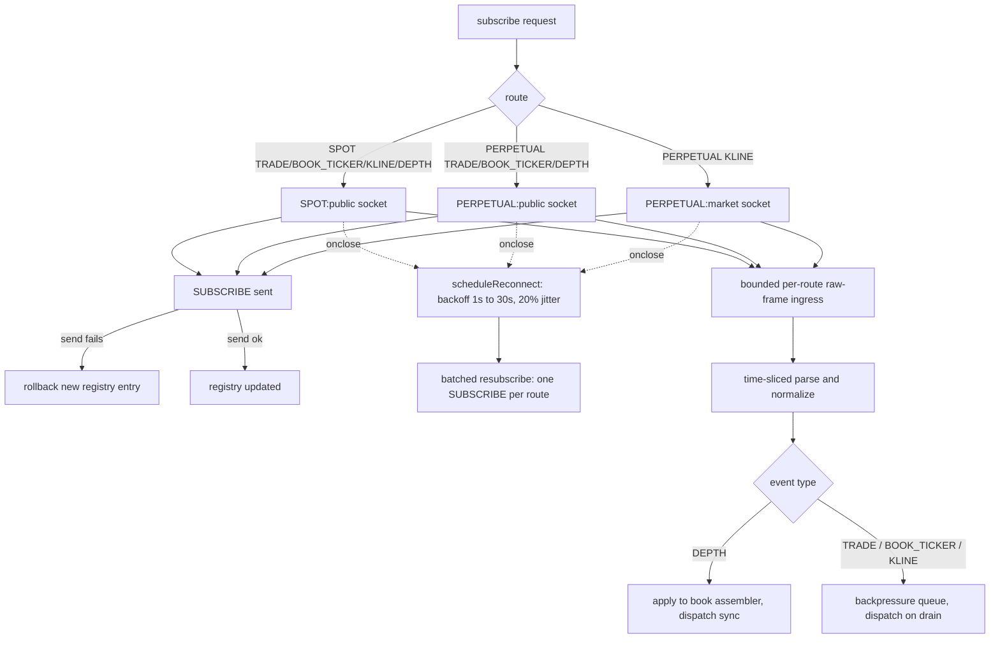

# Binance Connection, Routing, and Subscription Lifecycle

> **Historical implementation evidence.** This dated page records the result
> of a completed build or audit. It is not a current deployment/health
> statement; use the handbook and final-state overview for supported operation.

Connection, route-management, and subscription-lifecycle layer for
Binance spot and USD-M perpetual, `BTCUSDT` and `ETHUSDT`.

## Flow

## Files

- `apps/runtime/src/providers/binance/binance-connection.js` — routing, subscribe/unsubscribe, reconnect, message dispatch, raw-frame ingress, depth-snapshot orchestration
- `apps/runtime/src/providers/binance/binance-config.js` — symbol/market-kind/event-type allowlists, base URLs
- `apps/runtime/src/providers/shared/subscription-registry.js` — refcounted per-tuple subscription tracking
- `apps/runtime/src/providers/binance/binance-subscription-guard.js` — request validation, telemetry redaction
- `apps/runtime/src/providers/binance/binance-backpressure-queue.js` — the bounded per-tuple queue used by non-DEPTH message handling
- `apps/runtime/src/providers/binance/binance-kline-backfill.js` — REST kline backfill (`fetchRecentKlines`), see "REST kline backfill" below
- `apps/runtime/scripts/collect/run-collector.js` — the durable collector; supplies the raw-ingress config (50,000-frame/64 MiB caps), the local-scheduler health gate, and the fatal-shutdown-on-overflow behavior described below

Uses, but does not own: `binance-event-normalizer.js` (payload normalization, see `P1.02-binance-event-normalizer-evidence.md`), `binance-book-assembler.js` and `binance-http-client.js` (DEPTH snapshot/assembly, see `P1.03-binance-book-assembler-evidence.md`), `binance-feed-health.js` (see `P1.04-binance-feed-health-evidence.md`).

## Routing

Every subscription is gated through an explicit allowlist: symbols
(`BTCUSDT`, `ETHUSDT`), market kinds (`SPOT`, `PERPETUAL`), and event
types (`TRADE`, `BOOK_TICKER`, `KLINE`, `DEPTH`). SPOT and PERPETUAL
each get their own isolated context (base URLs, subscription registry).

Exactly 3 WebSocket routes are opened regardless of symbol count:
`SPOT:public`, `PERPETUAL:public`, `PERPETUAL:market`, each a single
connection to Binance's combined-stream endpoint. Both symbols are
multiplexed onto these same 3 sockets via SUBSCRIBE/UNSUBSCRIBE control
messages, never a separate socket per symbol.

The runtime explicitly uses the audited `ws` implementation rather than a
process-global WebSocket. Each route caps inbound frames at 256 KiB and
disables transport compression, bounding allocation and decompression work
before application parsing.

`subscribe()` requires an already-connected route. A failed
`subscribe()` rolls back only the newly added registry entry. In contrast,
`unsubscribe()` and `removeConsumer(consumerId)` always remove desired
state: when a route is down, no wire message is needed because reconnect
uses the registry as its source of truth; when an UNSUBSCRIBE write fails,
the route is closed and rebuilt. Exclusive tuples get a real UNSUBSCRIBE
when possible and full teardown (DEPTH assemblers, backpressure queues);
shared tuples stay on the wire.

## Reconnect

`scheduleReconnect` uses exponential backoff (1s base, 30s cap, 20%
jitter), guarded by a session-generation counter so a reconnect
scheduled against an already-torn-down connection can never fire. A
reconnect resubscribes every previously active registry entry on that
route in one batched SUBSCRIBE message. PERPETUAL's two routes
(`public`/`market`) reconnect and resubscribe fully independently.

Every connected route also has a 60-second application-data watchdog,
checked every 5 seconds while that route has active subscriptions. Any
received frame proves transport liveness. A subscribed route that
delivers nothing within the bound is rebuilt through the same
generation-guarded reconnect path; unused routes do not churn. The
collector supplies a local-scheduler health gate to this watchdog. If the
Node event loop has stopped sampling or exceeded its delay bound, route
recovery is deferred until local scheduling is healthy again. This prevents
a process pause from being misclassified as provider silence while retaining
the normal reconnect behavior for a genuinely quiet route.

## Message handling

The durable collector places each received WebSocket frame into a bounded
per-route FIFO before JSON parsing or normalization. The socket callback only
captures receipt time and enqueues the frame; parsing runs in 1,000-frame or
8 ms turns. This prevents a continuously readable socket from monopolizing
Node's poll phase during a volume burst. The browser relay retains synchronous
parsing because it does not enable this collector profile.

`handleRawMessage()` validates the raw frame, unwraps the
combined-stream envelope, resolves the stream name into
`{symbol, eventType, interval}`, confirms the tuple is actively
subscribed, then normalizes the payload. `DEPTH` is applied to its book
assembler and dispatched synchronously. Every other event type is
enqueued into a bounded, per-`(symbol, eventType, interval)`
backpressure queue and delivered on a later, batched drain tick.

The collector raw queue is capped independently at 50,000 frames and 64 MiB
per route and uses the strict capture policy. Overflow is counted, persisted as an invalidating incident,
and triggers controlled non-zero shutdown. Receipt timestamps are captured
before queueing, so downstream latency and feed-health evidence reflect the
actual socket-arrival boundary. Stale recovery defers while accepted raw
frames remain, avoiding a false reconnect caused solely by local parse lag.

## REST kline backfill

`fetchRecentKlines(marketKind, symbol, options)` pages Binance's REST
klines endpoint (`binance-http-client.js`'s `fetchKlines`, 1,000 rows per
request, default 7 days back, 250ms inter-page delay, capped pages) into
validated, contiguous bars via the normalizer's `parseKlineRows`. It is
exposed on the connection handle for callers that need to warm-up or
backfill bar history outside the live WebSocket stream; it does not
subscribe to anything and has no effect on route state.

## Known limitations

- **No outbound rate limiting.** Resubscribe batches every active entry
  per route into one message to keep control-message volume low instead.
- Tuple-level staleness is recovered by the collector's bounded
  feed-maintenance loop, which rebuilds the affected physical route when a
  subscribed feed becomes stale while the socket still appears connected.
