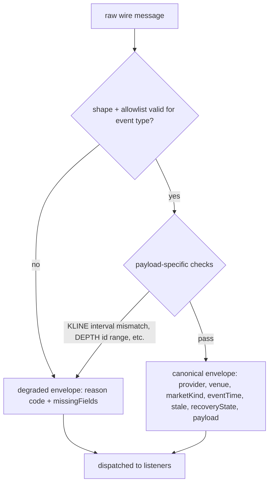

# Binance Canonical Event Normalization

> **Historical implementation evidence.** This dated page records the result
> of a completed build or audit. It is not a current deployment/health
> statement; use the handbook and final-state overview for supported operation.

Normalizes raw Binance `TRADE`/`BOOK_TICKER`/`KLINE`/`DEPTH` wire
messages into one canonical envelope shape. Full field-level shape is
documented in `docs/contracts/binance-canonical-event/v1/binance-canonical-event-v1.md`.

## Flow

## Files

- `apps/runtime/src/providers/binance/binance-event-normalizer.js` — validation and canonical-envelope conversion
- `apps/runtime/src/providers/shared/live-event-time-policy.js` — live event-time bounds check (`assessLiveEventTime`), shared verbatim with dxFeed's bar aggregator

## Behavior

Validates and converts the raw payload into the canonical envelope.
Malformed, mismatched, or otherwise unusable input produces a full
degraded envelope — never a partial object and never a silent drop.
Every wire-field allowlist is scoped per event type, since Binance
legitimately includes different extra fields on different streams.

Kline `interval` is read from the wire payload itself and must equal
the subscribed interval, not merely copied from the subscription.
Book-ticker `eventTime` falls back to `receivedAt` only when the
timestamp fields are genuinely absent (spot book ticker never sends
them); a present-but-unusable timestamp degrades instead of silently
falling back. A kline with `high < low` is an invalid range; equal
high/low is a valid flat bar.

Decimal tokens are bounded at 1,024 characters. Trade price/quantity, book
prices, and kline OHLC must be strictly positive; volumes and book quantities
may be zero. Kline duration must exactly match its interval and the open time
must lie on the interval's UTC epoch grid. REST pages additionally have to be
strictly ordered and contiguous on that grid.

Every event's resolved `eventTime` (and, for kline, `openTime`
separately) is also checked against a shared live-event-time policy: it
must not sit more than 120 seconds ahead of `receivedAt`. A violation
degrades the envelope (`EVENT_TIME_TOO_FAR_IN_FUTURE`) rather than
passing through a payload with an untrustworthy timestamp. This same
policy module is reused by dxFeed's bar aggregator, so both providers
apply an identical future-skew bound.

## Wiring

Called from the connection layer's message-handling seam, after frame
validation, stream-name resolution, and the active-subscription check.
Both healthy and degraded envelopes are dispatched to listeners
uniformly — nothing downstream is specially gated on normalization
outcome at this layer.

## Deliberately out of scope

No book assembly, feed health, or backpressure. `DEPTH` payloads
normalize like any other event type; nothing here assembles them into
a book.
