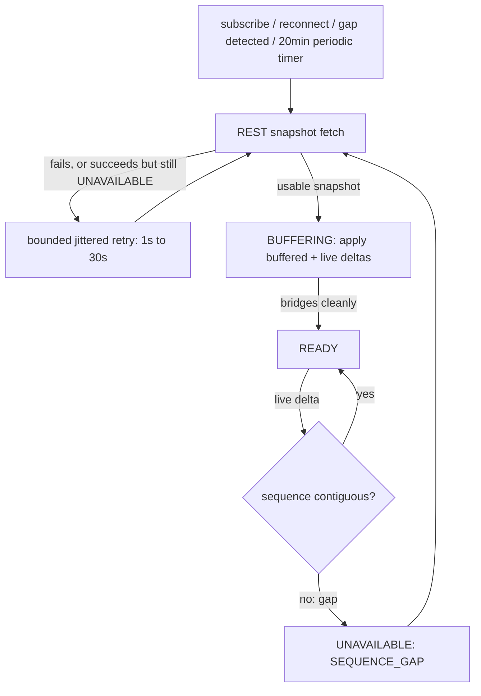

# Binance L2 Order-Book Assembler

> **Historical implementation evidence.** This dated page records the result
> of a completed build or audit. It is not a current deployment/health
> statement; use the handbook and final-state overview for supported operation.

Assembles a live L2 order book per `marketKind:symbol` from a REST
depth snapshot plus the `DEPTH` delta stream. Full state machine, book
shape, and reason codes are documented in
`docs/contracts/binance-order-book/v1/binance-order-book-v1.md`; the
connection layer's own wrapping around it is in
`docs/contracts/binance-order-book/v2/binance-order-book-v2.md`.

## Flow

## Files

- `apps/runtime/src/providers/binance/binance-book-assembler.js` — book state machine
- `apps/runtime/src/providers/binance/binance-http-client.js` — REST depth-snapshot fetch
- `apps/runtime/src/providers/binance/binance-connection.js` — owns everything in "Connection-layer wiring" below: per-key assembler cache, snapshot-fetch triggers and generation/epoch guards, retry backoff, periodic refresh

## Behavior

Three states: `BUFFERING`, `READY`, and `UNAVAILABLE` with a reason.
Price levels are keyed by canonical decimal-string identity, so
different wire spellings of the same numeric price (`"50.00"` vs
`"50.0"`) merge correctly instead of duplicating or failing to delete
a level. A zero-quantity entry is a valid price-level deletion.

Sequence reconciliation and display-book materialization are separate paths.
The connection applies snapshots and deltas through the status-only path,
which validates continuity, mutates levels, tracks best bid/ask incrementally,
and detects crossed books without sorting the complete ladder. A consumer that
actually requests `getState()` receives the immutable, correctly sorted book;
that representation is memoized until the next genuine depth mutation. This
keeps the raw collector independent of frontend rendering cost.

## Connection-layer wiring

One assembler is lazily created and cached per `marketKind:symbol`. A
REST snapshot is requested on subscribe, on reconnect/resubscribe, and
automatically on a detected sequence gap. Live deltas are applied to
the cached assembler; on a genuine transition into `UNAVAILABLE`, a
fresh snapshot is requested. The normalized envelope is dispatched to
listeners unconditionally, independent of book-assembly outcome.

A session generation, the assembler object identity, and a per-key
monotonic request epoch are captured before each REST fetch; if any of
the three changed while the fetch was in flight, the response is
discarded. This guards against a disconnect mid-fetch, a stale
assembler from an unsubscribe/resubscribe cycle, and two overlapping
requests against the same still-live assembler.

A snapshot fetch that fails, or that succeeds but still leaves the
assembler `UNAVAILABLE` (a malformed body, a snapshot too old to
bridge the buffered backlog), is retried with bounded, jittered backoff
(1s base, 30s cap, 20% jitter) rather than waiting indefinitely for a
live delta to re-arm recovery — since the gap-triggered re-snapshot
only fires on a transition into `UNAVAILABLE`, not on every subsequent
delta while already there. The retry is cancelled if the key is
unsubscribed or a resubscribe/successful attempt resets its counter in
the meantime.

Independent of all of the above, every active DEPTH subscription also
gets a REST re-snapshot on a flat 20-minute timer
(`depthSnapshotRefreshIntervalMs`, default), regardless of book status —
a periodic correction pass rather than a reaction to any detected
problem.

## Deliberately out of scope

**Feed-health wrapping** (`CONNECTION_DOWN` / `RECOVERY_IN_PROGRESS`
distinguishing a confirmed-live book from a stale one) lives in the
connection layer's feed-health integration, not here — see
`P1.04-binance-feed-health-evidence.md`.

Tuple staleness that cannot be inferred from sequence IDs is handled by
the server maintenance loop: a stale active DEPTH subscription rebuilds
its route, resubscribes, and obtains a fresh snapshot.

**No REST rate limiting.** Snapshot fetches happen on subscribe, a
detected gap, a bounded retry off a prior failure, or the flat
20-minute periodic refresh — low enough combined volume across four
symbol/market-kind pairs that a local limiter isn't needed.
