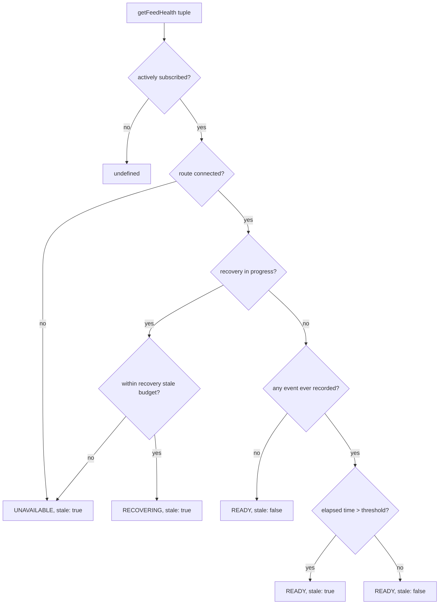

# Binance Feed Health Monitor

> **Historical implementation evidence.** This dated page records the result
> of a completed build or audit. It is not a current deployment/health
> statement; use the handbook and final-state overview for supported operation.

Tracks connection and data-freshness health per route and per
`(marketKind, symbol, eventType, interval)` tuple. Full query shape and
priority order are documented in
`docs/contracts/binance-feed-health/v1/binance-feed-health-v1.md` and
`docs/contracts/binance-order-book/v2/binance-order-book-v2.md`.

## Flow

## Files

- `apps/runtime/src/providers/binance/binance-feed-health.js` — health state, priority order, thresholds

## Behavior

Three states: `READY`, `RECOVERING`, `UNAVAILABLE`, checked in that
priority order — a disconnected route always wins over an in-progress
recovery. Recovery is bounded by a stale budget; a recovery that
cannot establish valid data before that deadline is `UNAVAILABLE`, not
an indefinite `RECOVERING` state. That budget is the tuple's normal
stale threshold for every event type except `DEPTH`'s snapshot-retry
recovery, which uses a separate, wider `recoveryStaleMs` derived from
the real retry timing (`binance-connection.js`'s `DEPTH_RECOVERY_STALE_MS`
— first-retry wait plus the snapshot fetch's own timeout plus margin).
The plain 5,000ms `DEFAULT_STALE_MS.DEPTH` steady-state threshold is
tight enough that a genuinely on-schedule first retry could otherwise
be marked `UNAVAILABLE` before it ever had a fair chance to land.

`stale`/`recoveryState` are computed fresh at the moment of actual
delivery, not baked in when a message first arrived — so a message
that itself resolves a recovery (a delta bridging a gap, the first
event after a fresh subscription) reports its own resolved state
rather than the recovering state it inherited on arrival. `DEPTH`
envelopes get a second, post-apply recompute after the book mutation,
so a recovery the delta itself just resolved is reflected on that same
envelope.

`getFeedHealth(marketKind, symbol, eventType, interval)` checks the
live subscription registry first and returns `undefined` for any tuple
that isn't actively subscribed, rather than stale leftover data.
`getOrderBook()` wraps the book assembler's raw state with this
module's own health context — see the v2 order-book contract for the
exact priority order.

## Reset boundaries

An unsubscribed tuple reads as `undefined`, never leftover state from
before the unsubscribe. Every fresh subscription unconditionally
begins in a recovering state (`RECOVERING`/`stale: true`) until a real
event proves otherwise — a stale last-event timestamp from a previous
subscription can never read as fresh again on its own.

## Deliberately out of scope

Route-level half-open detection and tuple-level stale recovery are
implemented by the connection watchdog and market-data server
maintenance loop respectively; this monitor remains a pure state
calculator and does not own timers.

**No backpressure.** Delivery-time health computation is shared with
the backpressure queue's own deferred-delivery recompute — see
`P1.05-binance-backpressure-evidence.md`.

## dxFeed has no equivalent of this module

dxFeed's collector and both WS servers carry no code shared with, or
structurally parallel to, `binance-backpressure-queue.js` or this
file. dxFeed's own protection is real but differently shaped: a
per-client outbound `bufferedAmount` cap (24MB, closes slow clients)
in both `dxfeed-market-data-server.js` and
`dxfeed-eager-market-data-server.js`, plus an independently-built
stale/recovery/quiet-timer state machine in the same two files
(`dxfeedHealthFrame`, `bookStale`, the `printsQuiet` 90s silence
timer — see `DX3.16`). Each side looks sound on its own; they are two
independently-maintained "recovering/stale" state machines with no
shared code, which is a real drift risk to keep in mind if either one
changes — not something to silently assume stays in sync.
