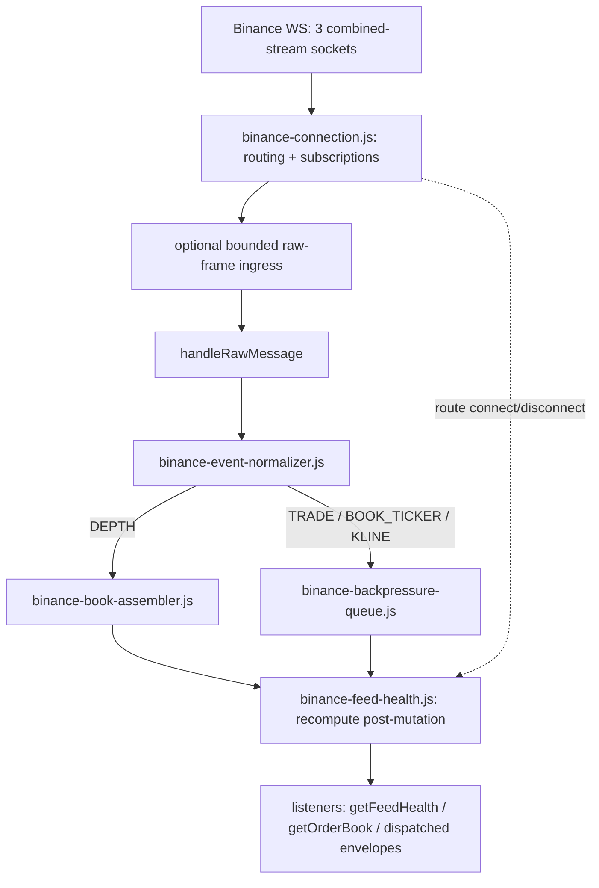

# Binance Connection Layer — Combined Behavior

> **Historical implementation evidence.** This dated page records the result
> of a completed build or audit. It is not a current deployment/health
> statement; use the handbook and final-state overview for supported operation.

How routing, book assembly, feed health, and backpressure behave
together on a single connection. Each module's own behavior is
documented separately: `P1.01-binance-connection-layer-evidence.md`,
`P1.03-binance-book-assembler-evidence.md`, `P1.04-binance-feed-health-evidence.md`,
`P1.05-binance-backpressure-evidence.md`.

## Flow

## Files

- `apps/runtime/src/providers/binance/binance-connection.js` — combines all four modules below
- `apps/runtime/src/providers/binance/binance-event-normalizer.js` — wire message to canonical envelope
- `apps/runtime/src/providers/binance/binance-book-assembler.js` — L2 book state machine
- `apps/runtime/src/providers/binance/binance-feed-health.js` — staleness/recovery tracking
- `apps/runtime/src/providers/binance/binance-backpressure-queue.js` — bounded delivery queue
- `apps/runtime/src/providers/binance/binance-http-client.js` — bounded REST JSON client and depth snapshot fetch
- `apps/runtime/src/providers/binance/binance-kline-backfill.js` — bounded, exact-coverage REST candle pagination
- `apps/runtime/src/providers/binance/binance-config.js` — allowlists and endpoints
- `apps/runtime/src/providers/binance/binance-subscription-guard.js` — request validation
- `apps/runtime/src/providers/shared/subscription-registry.js` — refcounted subscriptions
- `apps/runtime/src/providers/shared/live-event-time-policy.js` — live event-time future-skew bound, shared with dxFeed
- `apps/runtime/scripts/collect/run-collector.js` — the durable collector: the production capture-path caller referenced in "Audit state" below
- `apps/runtime/src/server/app.js` — the browser-facing WS relay: the other production caller of `createBinanceConnection`, referenced in "System-level behavior" below

## System-level behavior

Three combined-stream sockets carry both symbols and all four event
types; `KLINE` on `PERPETUAL` routes to the `market` socket, everything
else to `public`, and that routing is what determines which
subscriptions a given socket drop affects. A dropped socket degrades
exactly its own route's tuples and leaves the other two routes' books,
queues, and health untouched.

A `DEPTH` sequence gap on one symbol re-snapshots that symbol without
disturbing a sibling symbol's `READY` book on the same socket.
The durable collector first queues raw frames per physical route and parses
them in bounded time slices; the browser relay leaves that optional boundary
disabled. Non-`DEPTH` delivery is then queued, fair-shared, and re-checked against
terminal-session state, live subscription, and subscription generation
immediately before each hand-off; `DEPTH` stays synchronous within the parse
turn. An unexpected route reconnect preserves raw and normalized frames that
were already accepted; an explicit terminal disconnect invalidates them. A
consequence worth being explicit about for any future consumer: a
`TRADE` print can reach listeners after a `DEPTH` update that arrived
later on the wire, since `DEPTH` is synchronous and everything else is
queued. Every envelope carries its own `eventTime` and `receivedAt`, so
a consumer can reconstruct true arrival order if it needs to.

Staleness, in-progress recovery, and full disconnection are three
distinguishable states, simultaneously, on one connection — a socket
that has gone fully silent, a route that is actively recovering after
a reconnect, and a route with a live, current feed can all be true at
once for different tuples on the same connection.

The runtime WebSocket server is the production caller of
`createBinanceConnection`; it translates canonical envelopes into the
browser wire protocol and maintains in-memory replay buffers.

Every WebSocket route has a 256 KiB inbound payload ceiling with compression
disabled. Seven-day REST candle warm-up succeeds only when every expected
aligned, closed interval is present in order. Malformed, leading, internal,
or trailing gaps fail the attempt, and the currently forming boundary candle
is never returned as history.

## Security and scope

- Outbound hosts are exactly four, all public: `wss://stream.binance.com`,
  `wss://fstream.binance.com`, `https://api.binance.com`,
  `https://fapi.binance.com`.
- No credentials of any kind — no API key, secret key, listen key, or
  request signature.
- No signed or private endpoints, and no HTTP method other than `GET`.
- No outbound rate limiter. The one periodic timer is the depth-snapshot
  refresh (every 20 minutes, per active `DEPTH` subscription — see
  `P1.03-binance-book-assembler-evidence.md`); low enough volume across
  four symbol/market-kind pairs that a limiter still isn't needed.
- No storage layer.

## Audit state (2026-08-24, gate re-verified 2026-08-30)

The capture path was re-audited with the Phase 2 collector integration.
Automatic stale recovery reconnects a shared physical route once, rather
than issuing an unsubscribe/subscribe cycle for an individual tuple. This
avoids control-message churn and keeps sibling tuples coherent. Route
recovery defers while accepted raw frames remain and drains accepted
normalized frames without clearing them. The only explicitly lost item under
the strict collector policy is an incoming frame or normalized event that
exceeded its bounded queue before acceptance; that boundary invalidates the
capture rather than hiding loss. As of 2026-08-30 the repository gate passes
66 runtime suites (1,859 tests), 39 frontend files (569 tests), both
linters, and the production TypeScript/Vite build — these counts grow with
the codebase and are not meant to be re-derived by hand from this doc; treat
them as a point-in-time gate confirmation, not a running total.
