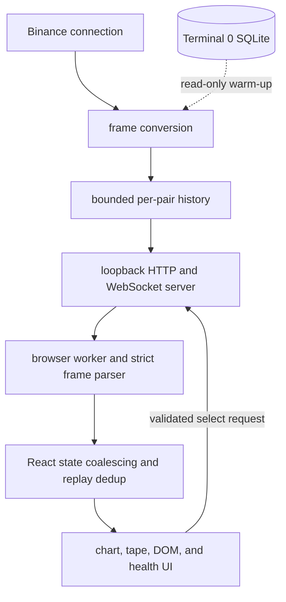

# Market Data WS Server and Frontend Wiring

> **Historical implementation evidence.** This dated page records the result
> of a completed build or audit. It is not a current deployment/health
> statement; use the handbook and final-state overview for supported operation.

Phase 3 connects the hardened Binance layer to a loopback-only WebSocket
relay and a validated browser worker. The relay is restartable independently
of Terminal 0.

## End-to-end flow

## Files

- `apps/runtime/src/server/app.js` — HTTP/WS bind, origin allowlist, client message limits, provider-router wiring, lifecycle
- `apps/runtime/src/server/market-data-server.js` — Binance warm-up, backfill retry, slow-client buffered-bytes cap, health polling, snapshot/frame dispatch
- `apps/runtime/src/server/provider-router.js` — active-provider selection, router-level selection rate limit, cross-provider client migration
- `apps/runtime/src/server/frames.js` — canonical envelope/storage-row to wire-frame conversion and validation for both providers
- `apps/runtime/src/server/history.js` — bounded per-pair bar/trade/marker history and replay-dedup index
- `apps/runtime/src/indicators/large-trade/large-trade-detection.js` — the shared magnitude rule, magnitude ordering and retention parameters behind marker frames

## Backend behavior

`frames.js` converts exact canonical decimal strings to the numeric browser
wire only when they are finite, positive where required, and at most
10,000,000 in magnitude; a value outside that range throws, never
serializing as `NaN` or infinity. `market-data-server.js` catches that
failure at the send boundary and reports it as `WIRE_VALUE_OUT_OF_RANGE`.

The same `try` also catches a **book that is crossed or misordered**, which is
a different condition entirely: the values are perfectly representable, the
ladder is not sound. That case now reports `CROSSED_BOOK` — already a published
reason — rather than being labelled a numeric-range failure
(`L1L2-V2-049`). `bookFailureReason(error)` in `frames.js` is the single place
that decides which of the two a caught error is, so the two call sites cannot
drift apart.
REST rows must also be aligned to the requested interval.

`history.js` keeps at most 10,080 closed one-minute bars and 100 visible
trades per pair. Bars are timestamp-keyed, sorted for snapshots, and replace
historical corrections rather than duplicating them. A separate bounded
5,000-ID replay index rejects reconnect duplicates after they have scrolled
off the visible 100-trade snapshot.

Warm-up first reads storage. REST is skipped only for an exact contiguous
10,080-candle seven-day window whose rows all carry taker-buy volume;
otherwise REST must supply the complete aligned window. A live closed-kline
timestamp jump invalidates the warm marker and invokes the same repair path.
Incomplete attempts retry with bounded exponential delay. Lifecycle
generations prevent late work from a stopped or earlier server session from
mutating current state.

The active `(symbol, marketKind)` is explicitly confirmed with a `selection`
frame before its snapshot/book/health stream. Pair histories remain bounded
in memory, but all inactive TRADE, KLINE, and DEPTH feeds are released; a
revisited pair resubscribes and revalidates its warm-up coverage. Selection
input has an exact field allowlist and a per-client rate limit.

`app.js` binds the local HTTP port before opening Binance sockets, eliminating
hidden upstream connections after `EADDRINUSE`. Bind hosts are restricted to
`127.0.0.1`, `::1`, or `localhost`; a browser origin header, when present,
must match the allowlist (a request with no `Origin` header at all is
let through, since this loopback-only relay also accepts non-browser
local clients); inbound messages are text-only and limited to 16 KiB.
Clients are rejected until upstream startup finishes.
`market-data-server.js`'s 24 MiB slow-client buffered-bytes limit exceeds
the largest permitted initial snapshot while still bounding a stalled
client. Shutdown is idempotent and awaited through both WebSocket and
HTTP server closure.

## Browser behavior

The worker accepts only credential-free `ws:`/`wss:` URLs, validates control
messages, owns reconnect with bounded exponential backoff, and requires a
valid application frame within 10 seconds of connection. An invalid start URL
fails closed instead of leaving the UI in a false connecting state. Stale
socket callbacks cannot act on a replacement socket, and worker-construction
failure is surfaced as a closed connection rather than crashing React.

`types/frames.ts` rejects malformed or excessive data before it reaches React:

- only BTC/ETH and SPOT/PERPETUAL identities;
- bounded snapshot, tape, book, reason, and trade-ID sizes;
- finite positive prices/sizes and bounded numeric magnitude;
- safe timestamps and one-minute grid alignment;
- coherent OHLC ranges and non-negative volume/counts;
- sorted, closed snapshot bars and duplicate-free nested trades;
- strict nested frame types and pair identity;
- sorted, uncrossed books; and
- `stale: true` for every non-READY health state.

`useMarketData.ts` isolates confirmed from requested selection, drops frames
from the wrong pair, coalesces render work to animation frames, bounds all
pending collections, and shares a 5,000-ID dedup window across snapshot and
live trades. Callback failures are contained. Connection loss clears current
health/book identity rather than presenting stale state as current.

The terminal displays `SYNCING` after the browser socket opens and does not
claim `LIVE` until validated upstream health arrives. RECOVERING, UNAVAILABLE,
STALE, and disconnected states remain distinct. Late historical candle
corrections update their actual resampled bucket and cannot regress the latest
displayed price bar. Resampling deduplicates source timestamps before summing
volume and trade count.

## Scope

- The active pair is intentionally server-global for this personal terminal,
  not per browser tab.
- Live trades are memory-only across relay restarts; closed candles warm from
  Terminal 0 or REST.
- Browser wire values are numbers by design; the runtime retains exact decimal
  strings before this explicit presentation boundary.
- Feed health is polled every two seconds, so UI observation can lag a state
  change by up to that interval.

## Selection rate limiting and frame dispatch are shared, not copied

`market-data-server-shared.js` owns `parseHistoryRanges`, the selection rate
limiter, and the frame dispatch (`broadcast`/`safelySend`). All three
market-data servers consume it.

Those four were the only pieces genuinely identical across the three servers.
`parseHistoryRanges` was byte-identical; the other three differed **only** in a
log prefix and — on Binance alone — a hardcoded `Date.now()` where the dxFeed
pair already took an injectable clock. That asymmetry is `L1L2-V2-046` in
miniature: the Binance copy had not merely been duplicated, it had drifted into
being untestable against a frozen clock.

The remaining shared function names differ substantively (session architecture,
provider semantics) and are **not** merged: doing so would be a redesign rather
than a deduplication. Merging the two dxFeed servers specifically remains open
as `L1L2-V2-046(b)`.

The router keeps its own selection window on top of the per-server limiters so
that alternating between providers cannot turn two separate limits into a
higher combined reconfiguration rate.
