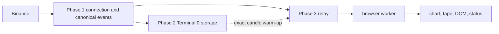

# Phase 3 Exit - Combined Behavior

> **Historical implementation evidence.** This dated page records the result
> of a completed build or audit. It is not a current deployment/health
> statement; use the handbook and final-state overview for supported operation.

Phase 1 normalizes and maintains live Binance state, Phase 2 persists the raw
research substrate, and Phase 3 relays a bounded validated presentation view
to the terminal.

## Files

Each phase's own files are documented separately:
`P1.01-binance-connection-layer-evidence.md` through `P1.06` (Phase 1),
`storage-pipeline-evidence.md` and `storage-continuity-evidence.md`
(Phase 2, `../storage/`), `P3.00-market-data-server-evidence.md`
(Phase 3 backend). Phase 3's frontend files:
`apps/web/src/types/frames.ts`, `apps/web/src/hooks/useMarketData.ts`,
`apps/web/src/workers/marketDataWorker.ts`, and
`apps/web/src/components/chart/Terminal.tsx`.

## Cross-phase guarantees

- The collector and relay are independent processes and connections. Relay or
  frontend restarts cannot interrupt storage capture.
- Storage suppresses REST only after proving every one of the expected 10,080
  aligned closed candles and the taker-buy-volume field required by CVD. Live
  timestamp jumps invoke repair through the same exact-coverage path.
- Every frame is tagged with one confirmed symbol/market pair. Wrong-pair and
  malformed frames are rejected at the browser boundary.
- Replay trade IDs are deduplicated on the relay and browser across a window
  larger than the visible tape.
- A socket-open event alone never produces a false `LIVE` state; validated
  feed health is required.
- Disconnection, staleness, recovery, unavailability, and numeric-wire failure
  are explicit rather than silent freezes.
- Historical candle corrections replace their timestamp and update the proper
  resampled chart bucket.
- Server and app lifecycle generations reject late asynchronous results after
  stop/restart boundaries; shutdown awaits both network servers.

## Interaction and accessibility

Pair controls remain locked until the server confirms the requested pair or a
bounded timeout restores the last confirmed selection. The panel rail uses a
real vertical tablist, roving tab index, arrow navigation, Home/End, and linked
tab/tabpanel ARIA state. Timeframe and indicator menus persist only allowlisted
values and recover safely from malformed local storage.

## Scope boundary

This document covers the Phase 1-3 chart/tape/DOM transport path. Phase 4
indicator behavior is specified separately in the P4 evidence documents;
unimplemented dashboard panels remain explicit placeholders.
