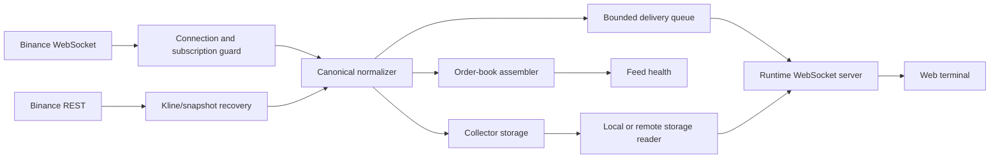

# Binance provider: final-state overview

[Handbook](../../README.md) · [Platform architecture](../../operations/01-hosted-platform.md) ·
[Storage](../storage/storage.md) · [Contracts](../../contracts/README.md)

This is the current entry point for Binance behaviour. Files named
`P*-evidence.md` in this directory preserve dated implementation and audit
results; read them for traceability, not current host health.

## Flow



The runtime and collector own independent upstream connections. Restarting the
local chart runtime does not restart hosted capture. The collector writes the
Binance SQLite store; serving and warm-up paths open it read-only.

## Responsibilities

| Layer | Responsibility | Main implementation |
|---|---|---|
| Connection | Stream construction, subscription lifecycle, reconnect, REST recovery | `src/providers/binance/binance-connection.js`, `binance-http-client.js`, `binance-kline-backfill.js` |
| Normalization | Provider messages to canonical events with bounded event-time policy | `binance-event-normalizer.js` |
| Book | Snapshot plus depth-delta sequencing and explicit degraded states | `binance-book-assembler.js` |
| Health | Per-family freshness, recovery state, and reason priority | `binance-feed-health.js` |
| Delivery | Bounded backpressure and recomputation policy | `binance-backpressure-queue.js` |
| Capture | Single-writer SQLite persistence, continuity evidence, and capacity guards | `src/storage/` and `scripts/collect/run-collector.js` |
| Historical read | Worker-isolated local reads or authenticated host live-storage reads | `storage-reader.js`, `remote-storage-reader.js` |

## Instrument authority

Supported spot/perpetual membership and exact market kinds come from
[`config/market-instruments.json`](../../../config/market-instruments.json).
Do not create a second Binance symbol list in documentation or UI code.

## Recovery and coverage

Binance can use provider REST endpoints for supported kline and order-book
recovery, but successful recovery does not prove that every trade or depth
event existed locally during an outage. The feed-health contract exposes
degraded and recovering states rather than presenting stale data as complete.

Recent host storage is bounded by actual collector coverage and retention.
Curated historical coverage is a separate S3 publication path and must be
confirmed from its catalogs.

## Browser-direct mode (no runtime)

The web app can read Binance spot by itself, for a link that opens anywhere to
test indicators on live data. It is opt-in and off by default: with neither
switch below set, the worker speaks to the runtime over its WebSocket exactly
as before.

- Build-time: `VITE_DATA_SOURCE=browser-binance` baked into the bundle.
- Per page: `?source=browser-binance` in the URL (wins over the build-time
  value; `?source=runtime` switches a baked bundle back).

The market-data worker then uses `BrowserBinanceTransport`
(`apps/web/src/workers/browserBinanceTransport.ts`) in place of the socket to
the runtime. On a selection it fetches the last 900 closed one-minute klines
from Binance's public mirror (`https://data-api.binance.vision`), sends
`selection`, `snapshot` (closed bars only, marked `reconstructed` as the
runtime marks its REST backfill), `health` READY with `reason: "BROWSER_DIRECT"`
and a `book` placeholder, then opens one mirror stream
(`wss://data-stream.binance.vision:9443`) for `kline_1m`, `trade` and
`depth20@100ms` and forwards each event as a `bar`, `trade` or `book` frame.
Side, `buy_volume` and `trade_count` follow `src/server/frames.js`, so
indicators see the same data as from the runtime; every frame still passes the
browser's own frame parser. The status chip reads `LIVE (BROWSER_DIRECT)`.

### Tape-derived frames (L1 parity)

The frames the runtime derives from the tape are computed in the worker with
the runtime's own algorithms. `apps/web/src/lib/tape/largeTradeDetection.ts`
and `aggressivePool.ts` mirror `src/indicators/large-trade/large-trade-detection.js`
and `src/server/aggressive-pool.js` (with `print-floor.js` and `floorAbove`)
line for line, and `lib/chart/markerRetention.ts` is the browser's copy of
`src/server/history.js`'s per-minute retention;
`apps/web/src/workers/tests/tapeParity.test.ts` requires the runtime files and
asserts identical output on 10,000 recorded BTC-USDT aggregate trades
(`workers/tests/fixtures/binance-mirror/aggtrades-btcusdt-10k.json.gz`).

- `marker`: every live trade goes through the retention (four prints of
  largest USD notional per minute and side, 100,000 at most, seven days); an
  admitted print is sent as a `marker` right behind its `trade`, as the
  runtime does. No `baseline_log_*` fields: the runtime sends none for Binance.
- Bootstrap: after the first snapshot, alongside the stream, the worker pages
  `GET /api/v3/aggTrades?symbol=…&limit=1000` from the mirror, newest first by
  `fromId`, at most 30 pages (weight 4 each) or seven days, one 10 s timeout
  per page. Rows are aggregate trades, ids `a<aggTradeId>` (a separate id
  space from the stream's trade ids; a bootstrap print is one taker order at
  one price, so it can be larger than any single fill the runtime saw). A
  page is validated whole (every row well formed, ids consecutive, starting
  at `fromId`): a page with a malformed row is a failed read, retried or
  ending the walk with the pages before it, never a shorter page that would
  leave a hole inside claimed coverage. The pages are staged until the
  stream's first trade is known (or, with a stream connecting or open but
  silent, for a two-second grace), then every row is reconciled against the
  live tape by fill id (`f`/`l` against the span's first and last trade id):
  rows the stream delivered are dropped, an aggregate straddling a span
  boundary (a one-trade span is both boundaries at once) is dropped and its
  millisecond marked unverified, outside every claim. The oldest millisecond
  of the walk is claimed only when the walk reached the exchange's first
  aggregate trade (a short or empty page); a walk stopped by its budget, a
  failed page or the seven-day bound may have cut through aggregates sharing
  that millisecond. Then the `snapshot` is re-broadcast
  (every closed bar held, the last 100 live trades, the newest 5,000 markers,
  the pool), the forming bar is re-sent, and a client that opted in through
  `capabilities` gets the full marker set as `marker_history` (`reset` on the
  first frame, 5,000 rows each). On BTC-USDT 30 pages are about twenty
  minutes of tape; on a quiet pair, hours. The runtime's baseline is seven
  days of storage.
- Observed tape and seams: the transport keeps the stretches of tape it has
  seen in full (the bootstrap's id-contiguous pages, each stream span from its
  first to its last live trade, with the ids at their ends) and claims
  coverage only inside one of them, minus unverified milliseconds. Kline
  recovery repairs bars, not trades, so the hole between the newest page and
  the stream's first trade, and the hole between one stream's last trade and
  the next stream's first, are filled from REST (`aggTrades` by id from the
  row after the last REST row, else by `startTime` from the hole's last
  observed millisecond, every row reconciled by fill id; at most 10 pages,
  three tries); a closed hole merges the stretches, an unclosable one stays a
  hole outside every claim. The bootstrap's snapshot waits for the seam to
  the stream to settle; with no stream delivering, it goes out claiming
  nothing (`aggressive_prints_from` = now) while still carrying the prints.
  The bookkeeping is pruned to the pool's four-hour retention and bounded.
- A lost stream after trades: the transport closes itself, exactly as a lost
  runtime socket reaches the worker, which reports `status: closed` (the
  tick store ends its live stretch there: `AggressiveTape.endLive`) and
  reconnects; the pair's markers, pool and coverage are kept across transport
  instances (four pairs at most), so the connect snapshot carries them, no
  second bootstrap runs, and the hole is filled from REST or left outside
  every claim. A stream lost before any trade keeps the internal retry
  (`RECOVERING`, then `UNAVAILABLE` after five failures), as before.
- `aggressive_prints`, `aggressive_prints_floor`, `aggressive_prints_from`:
  the runtime's pool (floor from the 98th percentile of the last 4,096 sizes
  once 200 are seen, never falling; four hours; 20,000 prints). Live trades
  `record`; the bootstrap's newest fifteen minutes `seed` with
  `calibrate: true`, older rows at the floor; `aggressive_prints_from` is the
  start of the continuous observed stretch that reaches now (never before the
  pool's window), so `coverageOf` is "thin" over the bootstrap and "all" from
  connect, and nothing is claimed across an open seam.
- `aggressive_history`: answered from the pool, `complete: true` only for a
  window inside one observed stretch (the open stream span counts up to its
  last trade seen, never into the future), within the pool's window, at or
  above its floor, 10,000 trades a page with `CAP_REACHED` and a cursor bound
  to the request;
  otherwise `complete: false`, `reason: "STORAGE_UNAVAILABLE"`, which the
  client retries three times and then rests.
- Degraded: when the first page fails three times, the READY health frame
  carries `reason: "BROWSER_DIRECT_NO_TAPE_HISTORY"` (chip
  `LIVE (BROWSER_DIRECT_NO_TAPE_HISTORY)`); markers and the pool start at
  connect; retries continue and a later success publishes the snapshot and
  restores `BROWSER_DIRECT`. A page failing after others keeps what was read.

| L1 indicator | Reads | Browser-direct |
|---|---|---|
| Aggressive Order Flow, Delta Divergence, CVD Divergence, Market Structure Delta, FVG Delta, FVG Boxes, L1 Order Blocks, Volume Profile OHLC | bars via `barSides` | works |
| Large Trade Detector | `markers`, `marker`, `marker_history`; `trade_count` of the snapshot bars for the top-N% target | works: live markers from connect, bootstrap markers for the pages read; the legend appends ` · partial` while the selection is short of its target |
| VWAP Bands, Large Trade Bubbles | the tick store (live tape, `aggressive_prints`, `aggressive_history`) | works: "all" from connect, "thin" over the bootstrap |
| Live Delta Profile, Volume Profile (Ticks) | live trades plus `delta_profile` (every trade per price row) | forming window from connect only; `delta_profile` stays `STORAGE_UNAVAILABLE` because the pool is floor-filtered and cannot give a faithful pre-connect profile |
| VPIN Cloud | `vpin` frames (server study) | unavailable: `vpin_status: "DISABLED"` |

What it does not have: the L2 engine and heatmap, walls, icebergs, exhaustion,
initiative, candle monitor, live profiles and VPIN (their requests get the
contract's unavailable reply, so those indicators show their own "needs the
runtime" state); history past 900 bars; individual trades from before the page
opened (the bootstrap is aggregate trades, bounded as above); a book deeper
than 20 levels. Spot only: perpetual pairs are
attempted on `fapi`/`fstream` and report
`BROWSER_DIRECT_PERPETUAL_UNREACHABLE` when the browser cannot reach them;
dxFeed instruments report `BROWSER_DIRECT_NO_DXFEED`. A dropped spot stream
shows `RECOVERING`, withdraws the book, and reconnects with backoff
(`UNAVAILABLE` after five failures); whenever a stream opens, the closed bars
between the last confirmed close and the live stream are paged from REST,
minute by consecutive minute and marked `reconstructed`, before the feed is
`READY` again. A REST row counts as final only when its minute closed before
the request went out; the minute at the edge takes the stream's own close. A
missing minute keeps the feed recovering; a gap past 11,000 minutes re-reads
the history as a fresh snapshot.

To build a static bundle with the mode baked in and relative asset paths:

```bash
cd apps/web && VITE_DATA_SOURCE=browser-binance npx vite build --base ./ --outDir ../../dist-browser-direct
```

Serve `dist-browser-direct/` from any static host or open `index.html` through
one; nothing else needs to run.

## Contracts

- [Canonical event v1](../../contracts/binance-canonical-event/v1/binance-canonical-event-v1.md)
- [Order book v1](../../contracts/binance-order-book/v1/binance-order-book-v1.md)
- [Order book v2 query surface](../../contracts/binance-order-book/v2/binance-order-book-v2.md)
- [Feed health v1](../../contracts/binance-feed-health/v1/binance-feed-health-v1.md)
- [Storage layer v1](../../contracts/storage-layer/v1/storage-layer-v1.md)
- [WebSocket frame contract](../../contracts/ws-frame-contract/v1/ws-frame-contract-v1.md)

## Operational boundary

Use the [server runbook](../../operations/03-server-runbook.md) for hosted
health, deployment, capture inspection, and incidents. Do not infer that the
collector is running from this documentation or from the presence of a unit
file.
