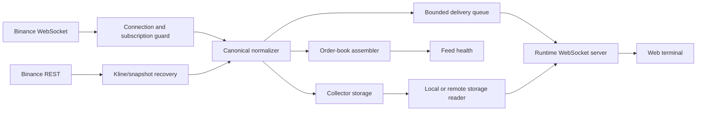

# Binance provider: final-state overview

[Handbook](../../README.md) · [Platform architecture](../../operations/01-hosted-platform.md) ·
[Storage](../storage/storage.md) · [Contracts](../../contracts/README.md)

This is the current entry point for Binance behaviour. Files named
`P*-evidence.md` in this directory preserve dated implementation and audit
results; read them for traceability, not current host health.

## Flow

The runtime and collector own independent upstream connections. Restarting the
local chart runtime does not restart hosted capture. The collector writes the
Binance SQLite store; serving and warm-up paths open it read-only.

## Responsibilities

| Layer | Responsibility | Main implementation |
|---|---|---|
| Connection | Stream construction, subscription lifecycle, reconnect, REST recovery | `src/providers/binance/binance-connection.js`, `binance-http-client.js`, `binance-kline-backfill.js` |
| Normalization | Provider messages to canonical events with bounded event-time policy | `binance-event-normalizer.js` |
| Book | Snapshot plus depth-delta sequencing and explicit degraded states | `binance-book-assembler.js` |
| Health | Per-family freshness, recovery state, and reason priority | `binance-feed-health.js` |
| Delivery | Bounded backpressure and recomputation policy | `binance-backpressure-queue.js` |
| Capture | Single-writer SQLite persistence, continuity evidence, and capacity guards | `src/storage/` and `scripts/collect/run-collector.js` |
| Historical read | Worker-isolated local reads or authenticated host live-storage reads | `storage-reader.js`, `remote-storage-reader.js` |

## Instrument authority

Supported spot/perpetual membership and exact market kinds come from
[`config/market-instruments.json`](../../../config/market-instruments.json).
Do not create a second Binance symbol list in documentation or UI code.

## Recovery and coverage

Binance can use provider REST endpoints for supported kline and order-book
recovery, but successful recovery does not prove that every trade or depth
event existed locally during an outage. The feed-health contract exposes
degraded and recovering states rather than presenting stale data as complete.

Recent host storage is bounded by actual collector coverage and retention.
Curated historical coverage is a separate S3 publication path and must be
confirmed from its catalogs.

## Contracts

- [Canonical event v1](../../contracts/binance-canonical-event/v1/binance-canonical-event-v1.md)
- [Order book v1](../../contracts/binance-order-book/v1/binance-order-book-v1.md)
- [Order book v2 query surface](../../contracts/binance-order-book/v2/binance-order-book-v2.md)
- [Feed health v1](../../contracts/binance-feed-health/v1/binance-feed-health-v1.md)
- [Storage layer v1](../../contracts/storage-layer/v1/storage-layer-v1.md)
- [WebSocket frame contract](../../contracts/ws-frame-contract/v1/ws-frame-contract-v1.md)

## Operational boundary

Use the [server runbook](../../operations/03-server-runbook.md) for hosted
health, deployment, capture inspection, and incidents. Do not infer that the
collector is running from this documentation or from the presence of a unit
file.
