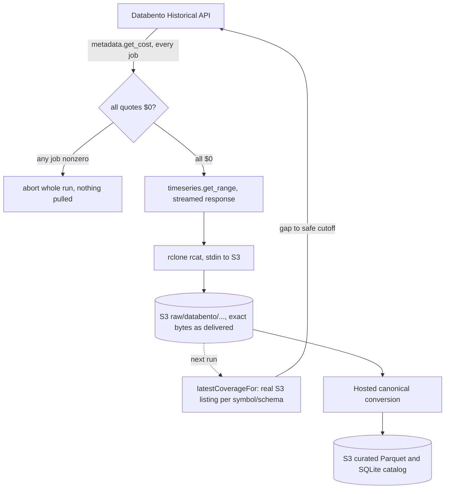
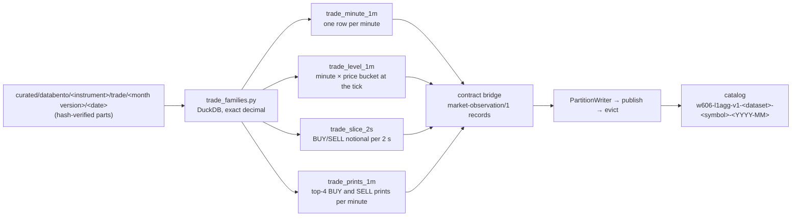

# Databento Historical Data Pipeline

Real, cost-guarded ingestion of historical futures (ES, NQ) and equities
(AAPL, TSLA) data from Databento's Historical API directly into S3. No
local accumulation at any point: every pull streams straight from
Databento's HTTP response into an S3 upload, so the machine running it
never holds more than one in-flight file's bytes in memory. For the
entitlement research, plan decisions, and real per-schema evidence behind
this pipeline, see
[`../../contracts/databento/v1/databento-v1.md`](../../contracts/databento/v1/databento-v1.md)
— that doc is the decision record; this one is the current, standing
architecture.

See the [conversion architecture](../historical-conversion.md) and [archive contract](../../contracts/archive/v1/README.md) for the implemented downstream pipeline. Conversion uses bounded local scratch; streaming without local accumulation describes raw acquisition only. Entitlement observations are dated evidence; new acquisitions still require the cost guard.

## Files

- `apps/runtime/scripts/verify/databento/databento-hist-api.js` — shared HTTP client: auth header, JSON/raw/streaming request helpers against `hist.databento.com`.
- `apps/runtime/scripts/verify/databento/verify-databento-entitlement.js` — real free/paid boundary finder; binary-searches the exact day entitlement changes, per symbol, per schema. Metadata-only, cannot incur cost.
- `apps/runtime/scripts/verify/databento/verify-databento-content.js` — pulls small real samples of every schema for all 4 symbols to confirm field shapes; cost-guarded.
- `apps/runtime/scripts/verify/databento/verify-databento-s3-inventory.js` — read-only: lists everything actually sitting under `raw/databento/` in S3 and reports real file counts, sizes, and date coverage per dataset/schema/symbol (`npm run verify:databento-s3-inventory`).
- `apps/runtime/scripts/collect/historical/ingest-databento-backfill.js` — the real ingestion mechanism (`npm run backfill:databento:live`). Checks S3 directly for the latest file per symbol/schema, cost-guards every gap it finds, then streams only the real missing range.

## Flow



## Real entitlement, as of 2026-09-07

| Schema | Futures (ES, NQ) | Equities (AAPL, TSLA) | Observed scope on assessment date |
|---|---|---|---|
| `ohlcv-1s`, `statistics`, `status`, `definition` | free | free | Every tested day; not a future entitlement guarantee |
| `mbp-1` (L1: quotes + trades, one schema) | free | free (since 2025-09-04) | Futures: tested range. Equities: no — cycles between paid (9mo–3.5yr stretches) and free; currently in a free window |
| `mbp-10` (L2) | free (since 2026-08-03) | free (since 2026-08-03) | No — normally paid most of the year with short (~8-9 day) free windows; current window is unusually long |

`trades` is deliberately not pulled as its own schema — `mbp-1`'s
`action` field already carries trade prints alongside quote updates,
confirmed from real decoded data. Pulling both would store the same
prints twice.

## How data is organized in S3

```
raw/databento/
  dataset=GLBX.MDP3/            (ES, NQ)
    schema=mbp-1/symbol=ES/year=2026/month=08/glbx-mdp3-20260801-20260831.mbp-1.dbn.zst   (real, existing)
    schema=mbp-10/symbol=ES/year=2026/month=09/day=01/glbx-mdp3-20260901.mbp-10.dbn.zst    (real, existing, already daily)
    schema=statistics/symbol=ES/year=2026/month=09/glbx-mdp3-20260901-20260904.statistics.csv  (real, existing)
    schema=definition/symbol=ES/year=2026/month=09/day=05/glbx-mdp3-20260904.definition.csv    (real, existing)
  dataset=XNAS.ITCH/            (AAPL, TSLA) -- same schema shape
```

Two real, current exceptions to the cadence table below, both harmless
and both self-resolving, not requiring any cleanup: `mbp-1`'s existing 12
files are still monthly (that's how the original archive first pulled
it, before this pipeline existed) — new files going forward will be
daily, old ones are left as-is. And that `statistics` file above
(`20260901-20260904`) is a partial-month fragment written by this
pipeline's own predecessor script, before the monthly logic was fixed to
never write an incomplete month — it will simply sit there; the fixed
backfill picks up cleanly after it and won't create more fragments.

| Schema | Cadence | Why |
|---|---|---|
| `mbp-1`, `mbp-10`, `ohlcv-1s` | **daily**, one file per day | high enough volume that daily files land in Parquet's efficient size range later; daily also means the backfill script never has to reopen a file it already wrote |
| `statistics`, `status` | **monthly**, one file per calendar month, only once that month is fully over | too small in daily form (KB-scale) — S3 charges per request, not just per byte, so many tiny daily files cost more than a few larger monthly ones. Never written as a partial month; the backfill waits until a month is complete rather than update the same file repeatedly |
| `definition` | current snapshot, refreshed if the existing one is more than 30 days old | reference metadata (tick size, contract multiplier), not a time series |

Format is exactly as Databento delivers it: `mbp-1`/`mbp-10` stay DBN
(`.dbn.zst`, Databento's native binary format, matching the pipeline's
original archive), the newer schemas use CSV (no decoder needed). Mixed
formats within `raw/` are fine — this tier is a permanent backup, not
something queried directly; the eventual Parquet conversion step reads
whichever format a file happens to be in.

## Backfill mechanics — self-discovering, not hardcoded

`ingest-databento-backfill.js` never assumes what's already in S3. On
every run, for each (dataset, schema, symbol) it lists the real files in
that exact S3 prefix, reads the coverage end-date out of each real
filename (the last 8-digit date in the name), and starts from the day
after the latest one found — or a fixed anchor (2025-09-06) if nothing
exists yet. This makes the script safe to run on any schedule: run it an
hour later and it finds nothing to do; run it in three weeks and it
closes the real three-week gap, nothing more, nothing less.

**Publish lag is dataset-aware, not a single guess.** Databento's own
data isn't available historically the instant a session closes — futures
(`GLBX.MDP3`) settle within about 2 days, equities (`XNAS.ITCH`) need
about 3. Both numbers are real, not assumed: the cost-guard itself
rejected the too-recent boundary (HTTP 422) during real runs before
these were fixed as per-dataset constants. The backfill script never
requests past `today - N days` for either dataset's own lag.

**Cost-guard discipline, unconditional:** every job is re-quoted via
`metadata.get_cost` immediately before the run proceeds, and the entire
run aborts — nothing at all gets pulled — if even one job doesn't come
back at exactly $0.

## Derived trade families — computed once, from the published trades

Historical Mode never receives a raw trade; the laptop link is ~200 KB/s and
a week of ES trades is gigabytes. What it receives instead are four aggregate
families computed on the host from the published `trade` partitions by the
conversion phase `l1agg` (`apps/runtime/conversion/derive_families.py`),
published and catalogued like every other family:



The families are defined as the live storage reads they replace —
`readMinuteRollup`, `readSlicedNotional`, `readLargeTrades`,
`readDailyNotional` — and both implementations are held to one hand-derived
golden file (`benchmarks/fixtures/golden/trade-families.json`). Each family
partition's manifest carries a `derivation` block naming its source partition
and hash, and an independent pure-Python recomputation
(`trade_families_rederive.py`) is the acceptance check. Measured sizes per week
(report 54 §5): a few hundred KB gzip per family per instrument, up to ~2 MB for
the slices of NQ.

## Deliberately out of scope here

- **Parquet conversion, ClickHouse, the VPS** — a separate, later phase.
  `raw/` is the complete, permanent input to that phase; nothing here
  assumes it exists yet.
- **`mbp-10`'s short window is not a bug to fix** — it's bounded by real,
  cyclical entitlement (see the table above), not by choice. Pulling more
  than what's currently free isn't possible regardless of this pipeline.
- **The old `ohlcv-1m` schema** — superseded by `ohlcv-1s`, still sitting
  in S3 as a harmless historical artifact from before this pipeline
  existed. Not actively maintained, not deleted.

For the real, current file counts and sizes, run `npm run
verify:databento-s3-inventory` — the numbers above will drift as the
backfill keeps running; that command is the live source of truth, not
this document.
