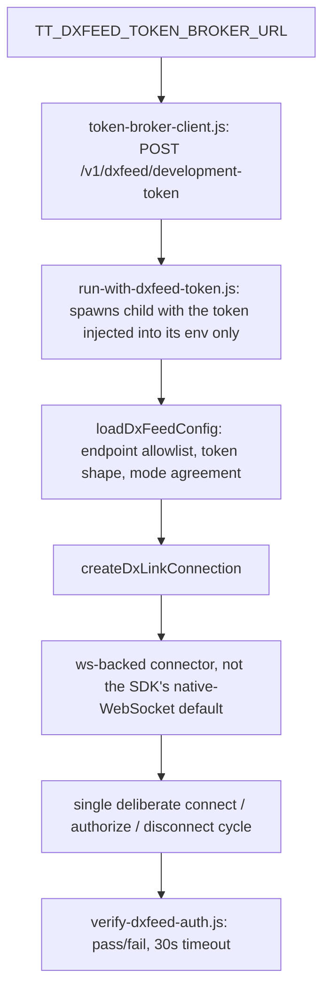

# dxFeed Integration

> **Historical implementation evidence.** This dated page records the result
> of a completed build or audit. It is not a current deployment/health
> statement; use the handbook and final-state overview for supported operation.

An opt-in dxFeed dxLink stack used by manual verification tools, the
bounded dxFeed collector, and the shared browser WebSocket server. It remains
isolated from the always-on Binance collector. A browser selection starts a
bounded dxFeed serving session; it does not start or alter Binance capture.

## Live verification

Proven against the real dxFeed endpoint using a broker-issued token:
`CONNECTED` → `AUTHORIZED` → clean disconnect, zero error events.

```
OK   obtained a dxFeed token from the broker  tokenLength 110
INFO connection state: NOT_CONNECTED -> CONNECTING
INFO connection state: CONNECTING -> CONNECTED
INFO auth state: UNAUTHORIZED -> AUTHORIZED
OK   AUTHORIZED -- zero errors observed, disconnecting now (single deliberate cycle)
INFO connection state: CONNECTED -> NOT_CONNECTED
INFO disconnected, verification complete
```

## Flow



The browser-serving path is separate: `run-ws-server.js` composes the
unchanged Binance server with `dxfeed-market-data-server.js` through
`provider-router.js`. A validated dxFeed selection fetches a fresh broker
token in process, authorizes one session, warms the selected trade view from
dxFeed SQLite, and streams that view until the safe token deadline or a
terminal connection/channel failure. Binance remains available when the
dxFeed component ends.

## Token acquisition

`token-broker-client.js` requests a short-lived, real-time-only token from a
private, Tailscale-only broker via `POST /v1/dxfeed/development-token`,
sending the header `X-Trading-Terminal-Token-Request: 1` the broker
requires (undocumented in the broker's own guide; confirmed directly after
a live 403). No caching — a fresh token is fetched on every run. The
client accepts only an HTTPS origin on a `.ts.net` host, with no
credentials, path, query, or fragment, then appends the fixed broker path.
The client also rejects a broker response whose expiry is more than 35
minutes out (`MAX_TOKEN_TTL_MS`), so a misconfigured or compromised
broker can't hand out a suspiciously long-lived credential and have it
silently accepted. `run-with-dxfeed-token.js` wraps this: it fetches the token in memory, then
spawns the given command with
`DXFEED_TEMP_TOKEN`/`DXFEED_ENDPOINT`/`MARKET_DATA_MODE` set only in that
child process's environment; inherited `DXFEED_*` variables are removed
first. The token itself is never written to `.env` or any other file, and
only its length and expiry are logged. On `SIGINT`/`SIGTERM`, the wrapper
forwards that signal to the child, then sends `SIGKILL` after five seconds
if the child does not exit. It returns the conventional 130/143 interrupted
status, so a stopped wrapper cannot leave a live dxFeed connection running
unattended.

## Config and endpoint validation

`config.js` accepts exactly two allowlisted endpoints (realtime and
delayed) and rejects any other host, path, embedded credentials, query
string, or fragment. `MARKET_DATA_MODE` must agree with the endpoint's
implied mode. A token must be exactly two `[A-Za-z0-9_-]+` segments joined
by one dot; a single-segment value is rejected outright. Token-shape
validation is structural only — a stale but correctly-shaped token is only
ever caught at the live handshake, not locally.

## Connection behavior

`dxlink-connection.js` swaps the SDK's default native-WebSocket connector
for one backed by the `ws` package, after the native connector was found
live to fail the handshake against dxFeed's endpoint from this
environment. The client is constructed with `maxReconnectAttempts: 0`: a
transport close after authentication has started resolves to a clean
disconnect rather than the SDK's default unlimited automatic reconnect,
keeping every run to the single deliberate connect/authorize/disconnect
cycle the project's own dev-use-only constraint requires. An error
listener is attached unconditionally at construction so the SDK's default
unhandled-error behavior — printing the raw error, including its message —
can never bypass redaction. Calling `disconnect()` itself fires a
connection-state event through to registered listeners (a real SDK
behavior, confirmed live) — a consumer that also treats "dropped
unexpectedly" as failure must gate that branch on its own already-settled
state, or a deliberate successful disconnect logs as a false failure. The
connection wrapper snapshots and validates its supplied endpoint, mode, and token at
construction, so mutation of the caller-owned configuration object cannot
alter a later connection attempt or evade the redaction set.
Channel creation validates its service/parameter/options boundary and redacts
synchronous SDK failures. The `ws` transport caps individual payloads at 32
MiB and turns malformed dxLink envelopes, SDK consumer failures, and
synchronous send failures into one terminal transport error. It does not
continue a session after a frame was lost at the protocol boundary.

## Planned token rotation (DX3.17, 2026-08-27)

The live provider rejected same-WebSocket reauthorization: the installed
SDK sends a second `AUTH`, then re-requests active channels and the endpoint
returned `Channel with id already exists 1`. The collector therefore uses
process-level planned rotation instead. At the authoritative safety deadline
it closes the session and exits with a reserved status; its launcher obtains
one fresh token and starts one replacement process after the old process has
exited. The launcher rejects a planned-exit status that arrives before five
minutes of child uptime, preventing a malformed child from turning the broker
into a rapid token-retry loop; normal rotation remains one intentional
replacement per token lifetime and records an explicit continuity window.
Unexpected transport drops still fail closed. The eager server uses the same safe
principle within its still-running WS process: it first disconnects the old
dxFeed client and closes its channels, then obtains one fresh token and starts
one new client/session. Clients see `RECOVERING` during that bounded window and
return to `READY` only after replacement channels stream. A replacement token
or startup failure becomes visible `UNAVAILABLE` with no retry loop. The lazy
server is unchanged.

## Secret handling

The only credential in play is the broker-issued temporary token. It
exists on disk nowhere — fetched in memory by `token-broker-client.js`,
injected only into a spawned child's environment by
`run-with-dxfeed-token.js`, and consumed by `loadDxFeedConfig()` from
`process.env` at connect time. Every error path that could carry it — the
mandatory connection error listener, a caller-registered listener's own
thrown error, a synchronous throw from the underlying client's `connect()`,
and the broker-fetch wrapper's own logging — redacts before the value
reaches a caller, a log file, or the console.

## Files

- `apps/runtime/src/providers/dxfeed/dxfeed-connection-config.js` - endpoint/token/mode validation
- `apps/runtime/src/providers/dxfeed/dxlink-connection.js` - connection lifecycle, redaction, bounded reconnect
- `apps/runtime/src/providers/dxfeed/dxlink-ws-connector.js` - `ws`-backed transport implementing the SDK's connector interface
- `apps/runtime/src/providers/dxfeed/token-broker-client.js` - fetches a temporary token from the private broker
- `apps/runtime/src/providers/dxfeed/dxfeed-token-lifecycle.js` - shared shutdown-deadline math (`SHUTDOWN_MARGIN_MS`, `MAX_TOKEN_LIFETIME_MS`), used by the collector, both WS servers, and `run-with-dxfeed-token.js`
- `apps/runtime/src/providers/dxfeed/redact.js` - secret substring redaction
- `apps/runtime/src/server/dxfeed-market-data-server.js` - bounded browser-serving session lifecycle (lazy server, selection-triggered)
- `apps/runtime/src/server/dxfeed-eager-market-data-server.js` - the always-warm variant (`dev:dxfeed:live`); owns the eager-server half of "Planned token rotation" below (`rotateEagerSession`)
- `apps/runtime/src/server/provider-router.js` - validated, atomic shared-provider switching
- `apps/runtime/scripts/verify/dxfeed/verify-dxfeed-auth.js` - single-cycle connect/authorize/disconnect CLI
- `apps/runtime/scripts/collect/run-with-dxfeed-token.js` - fetches a token and spawns a child with it injected into that child's env only

## Scope

- Not wired into the Binance `run-collector.js`; dxFeed capture remains the
  explicit `collector:dxfeed:live` process. It is wired into
  `run-ws-server.js` as an opt-in, selection-triggered serving component.
- Socket-level transport errors are collapsed into one generic message
  by the `ws`-backed connector; root-causing a specific connection
  failure from logs alone is not possible.
- Token validation is structural, not cryptographic. A broker-supplied expiry
  must be valid and in the future; signature correctness is proven only by a
  live handshake.
- The broker only issues real-time tokens; there is currently no
  broker-backed path to a delayed-mode token.
- The checker is intentionally single-use: its first dxLink error,
  premature disconnect, timeout, setup failure, or interruption is a
  failed verification. It never treats a later authorization event as a
  successful zero-error run.
- Every dxFeed CLI flushes its queued file log before invoking
  `process.exit()`. A persistence failure changes an otherwise successful exit
  to failure, so a successful proof cannot knowingly outrun its durable log.
