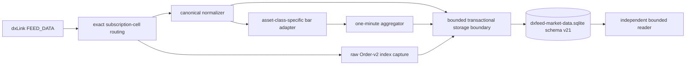

# dxFeed Storage Evidence

> **Historical implementation evidence.** This dated page records the result
> of a completed build or audit. It is not a current deployment/health
> statement; use the handbook and final-state overview for supported operation.

Final-state evidence for the dedicated dxFeed capture path. The executable
contract is documented in
`docs/contracts/dxfeed-storage-layer/v1/dxfeed-storage-layer-v1.md`.

## Files

- `apps/runtime/src/storage/dxfeed/dxfeed-storage-db.js` - schema, offline migrations, and exact live validation.
- `apps/runtime/src/storage/dxfeed/dxfeed-storage-service.js` - boundary validation, transactional commits, bar filtering, and trade-ID continuity.
- `apps/runtime/src/storage/dxfeed/dxfeed-storage-reader.js` - bounded, fail-soft reads.
- `apps/runtime/src/storage/dxfeed/dxfeed-gap-audit.js` - explicit order-book transaction-continuity audit.
- `apps/runtime/scripts/collect/run-dxfeed-collector.js` - production writer and single-writer lock owner.
- `apps/runtime/scripts/verify/dxfeed/verify-dxfeed-storage-capture.js` - 16-cell live capture proof.
- `apps/runtime/scripts/migrate/migrate-dxfeed-storage-schema.js` - exclusive offline schema migration.
- `apps/runtime/scripts/verify/dxfeed/verify-dxfeed-storage-integrity.js` - exclusive offline `quick_check`.
- `apps/runtime/scripts/maintain/audit-dxfeed-order-book-continuity.js` - explicit offline L2 continuity audit.
- `apps/runtime/scripts/qualify/qualify-dxfeed-storage.js` - synthetic write-path capacity qualification.

## Flow

## Audited guarantees

- The dxFeed database is isolated from Binance and protected by a token-owned
  single-writer process lock.
- Canonical Quote, Trade, Order, and TimeAndSale batches are validated again at
  storage and committed atomically.
- Canonical and exact-index batches are capped at 2,000 envelopes. Oversized
  provider frames fail closed before normalization or storage.
- The live writer never migrates or runs a database-wide integrity scan. It
  validates schema v21's exact table layouts and all required indexes.
  Migration and `quick_check` are exclusive offline operator steps.
- Schema v21's migration history includes exact-index Order-v2 storage, stable
  replay indexes, capture-session lineage, an L2 continuity ledger, adaptive
  large-trade baseline median/MAD, causal baseline sample count, generic
  Order-v2 zero-price `TRADE`/`BUST` compatibility, and (v14-v16) the same
  `TRADE`/`BUST` relaxation extended to a missing/unusable `time` on both the
  exact-index Order-v2 path and the generic Order path.
- Corruption, an unsupported version, or an invalid layout stops startup while
  preserving the database and WAL/SHM evidence. No damaged store is silently
  quarantined and replaced.
- The proof run requires 16/16 configured symbol/type/source cells and compares
  physical count deltas with independent writer counters.
- Futures raw Trade remains latest-state evidence; futures bars, tape, warm-up,
  and markers use valid NEW TimeAndSale consistently.
- TimeAndSale corrections, cancels, invalid ticks, and unknown aggressor states
  remain durable. Invalid/correction events do not enter bars; unknown-side
  prints remain in OHLCV and make buy volume unavailable.
- Duplicate IDs and event-time regressions cannot mutate the current bar.
- A candle write failure terminates capture instead of hiding a derived-data gap.
- WAL checkpoint failures and busy results are surfaced in heartbeat telemetry
  and degrade capture-session quality.
- Readers validate symbol/asset-class pairs and distinguish unavailable storage
  from a valid empty result.

## Measured qualification

The 2026-08-31 default offline run committed 100,000 rows through the real
storage service:

- 32,774.8 rows/second, 32.8x the declared 1,000 rows/second nominal load.
- 94.3 ms batch p99 and 103.2 ms event-loop-delay p99.
- 20,000 rows in each of five raw tables, with 5,000 sequential TimeAndSale
  identities for every configured instrument.
- Zero rejects, skips, gaps, or non-monotonic identities; `quick_check=ok`.
- 63,836,160-byte RSS increase and 17,403,904-byte synthetic database.

This qualifies the implementation on the audit host. It is not a provider,
deployment-disk, or sustained live-feed benchmark.

## Production-readiness boundary

Every accepted row remains in one live database; retention and archival are not
implemented. Planned token rotation is supervised, but an unexpected transport
failure is deliberately fail-closed. Off-host backup is a manual operator action
through `apps/runtime/scripts/maintain/backup-to-drive.js`.

Production acceptance still requires: an offline migration to schema v21,
offline integrity verification, a restore-tested backup, a supervised live soak
with real entitlements, physical disk-pressure/power-loss drills, and quarterly
futures-symbol rollover. Arbitrary restarts may split a materialized minute, so
raw events remain the reconciliation authority.

Legacy `dxfeed_orders` rows are evidence, not a reconstructable L2 book. *(Retired at schema v20, `L1L2-V2-039` — a strictly lossier duplicate of `dxfeed_order_book_capture`; Order events now feed the capture path only.)*
`dxfeed_order_book_capture` is the reconstruction input and fails closed on a
capture fault, incomplete snapshot, source mismatch, or crossed book. AUTO
Quote/Trade remain latest-state feeds, not lossless tapes.
