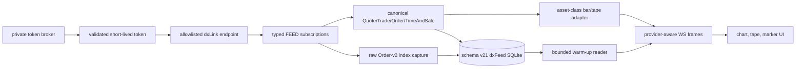

# dxFeed End-to-End Audit

Final-state audit of the implemented dxFeed cycle: broker token, dxLink
connection and probes, canonical normalization, bounded collection, SQLite
storage, WS provider routing, local bars and large-trade display. Each
stage's own files are documented separately:
`DX1.01-dxfeed-integration-evidence.md`, `DX1.02-dxfeed-capability-probe-evidence.md`,
`DX1.03-dxfeed-event-normalizer-evidence.md`, `DX2.01-dxfeed-storage-evidence.md`,
`DX3.02-dxfeed-collector-evidence.md`, `DX3.03-DX3.04-provider-routing-evidence.md`.

## Audited flow

## Closed defect families

- Token shape, authoritative expiry, endpoint/mode agreement, response size,
  channel arguments, payload size, and secret redaction fail closed.
- Signals, disconnects, provider switches, final-client release, and in-flight
  token/handshake cancellation clean up exactly once. dxFeed does not remain
  connected after the UI returns to Binance.
- Capability results correlate exact symbol, type, and Order source. The DOM
  probe now captures errors before channel open instead of converting an
  unknown early failure into a false entitlement verdict.
- Canonical identities enforce approved asset-class/symbol pairs. TimeAndSale
  preserves validity, event kind, spread-leg status, aggressor state, and safe
  ordering fields while refusing to trust unsafe 64-bit numeric identities.
- A single writer owns each dxFeed database. Bounded batch writes are
  transactional; the live writer validates schema v21 and all required indexes
  without migration or database-wide integrity scans. Exclusive offline tools
  own migration, integrity verification, continuity audit, and backfill;
  physical read-back proves all 16 configured capture cells.
- Raw Order-v2 capture preserves the JSON spelling of unsafe indexes before
  parsing, keeps transaction/snapshot flags, and bounds its correlation queue.
  The L2 assembler is source-specific and fails closed on a snipped snapshot,
  source mismatch, crossed book, order-channel fault, or capture fault.
- Both asset classes use TimeAndSale for bars, tape, markers, stored warm-up,
  and live flow. The conflated Trade event is not mixed into derived bars.
- Corrections, cancels, and invalid ticks remain durable evidence but do not
  masquerade as new bar prints. Unknown side classification retains OHLCV,
  invalidates directional volume, and is excluded from historical tape and
  marker ranking as well as live tape/markers.
- Duplicate and event-time-regressing trades cannot revise the active bar.
  Durable candle failure stops capture visibly.
- Provider switching cancels stale async work and prevents cross-provider
  frame contamination. dxFeed chart history no longer displays a false DOM
  unavailability message.
- Futures whale significance and thresholds use contracts; equity/Binance
  significance uses USD notional. The UI no longer labels `price * contracts`
  as dollars. Exact net buy/sell ties produce no directional net bubble;
  gross mode remains available to inspect both sides.

## Evidence boundary

The bounded implementation keeps every accepted row in a single live database
indefinitely — there is no retention, rotation, or archival tier, and
therefore no live/archive boundary to keep honest. Four controls remain
before a gapless institutional capture claim is honest:

1. Automated unexpected-transport recovery. Capture-session lineage is already
   durable and unexpected transport failures remain intentionally fail-closed.
2. Verified quarterly futures rollover/instrument-master control.
3. Disk-alert delivery. Off-host replication now has a concrete, manual tool
   (`apps/runtime/scripts/maintain/backup-to-drive.js`), run at the operator's own
   discretion rather than automatically.
4. Raw-event replay for correction-aware and restart-boundary candle
   reconciliation.

Equity Trade under AUTO remains a conflating latest-state input until daytime
TimeAndSale evidence is obtained. Native Candle is not relied on. Legacy
`dxfeed_orders` (retired at schema v20, `L1L2-V2-039`) was not a book;
`dxfeed_order_book_capture` is the separate
exact-index input for the currently supported source-specific L2 path. Live
entitlement and sustained-volume validation remain operator evidence, not an
assumption made by unit tests.

The offline performance gate committed 100,000 rows through the real storage
service at 32,774.8 rows/second, 32.8x the declared 1,000 rows/second nominal
load, with 94.3 ms batch p99 and 103.2 ms event-loop-delay p99. This qualifies
the implementation on the audit host; it does not replace a live-feed soak on
the deployment machine.

## Verdict

The code is internally consistent and fail-visible as a bounded capture and
live-display system with a fail-closed L2 reconstruction path and a single,
indefinitely-retained live database (no rotation, no archival tier). It must
not yet be described as a weeks-long, gapless dxFeed record; the remaining
items are deployment/data-methodology scopes, explicitly separated from the
defects closed in this audit.
