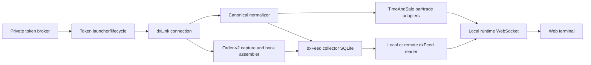

# dxFeed provider: final-state overview

[Handbook](../../README.md) · [Platform architecture](../../operations/01-hosted-platform.md) ·
[Operations](DX-OPERATIONS-RUNBOOK.md) · [Contracts](../../contracts/README.md)

This is the current entry point for dxFeed behaviour. Files beginning `DX` in
this directory are dated implementation or audit evidence. They remain useful
for traceability but do not establish present entitlement, instrument coverage,
deployment, or process health.

## Flow

The token broker returns short-lived credentials; tokens are not stored in the
repository `.env`, logs, or evidence documents. The broker is reachable only on
the owner's tailnet, and a developer's access to it is layer 2 in
[onboarding](../../operations/00-developer-onboarding.md#adding-layer-2-dxfeed-live).
Without it the runtime reports dxFeed instruments as `DXFEED_NOT_CONFIGURED`
and keeps serving their recorded host history, which the terminal labels
"History only". The launcher owns planned
rotation and one bounded retry for an unexpected full-session disconnect.
Permanent authentication, configuration, and capacity failures fail closed.

## Runtime modes

| Mode | Owner and lifetime |
|---|---|
| Lazy local server | Opens dxFeed when selected; switching away or losing the last client ends the session. |
| Eager local server | Connects every instrument in the governed catalog at process start and remains active until stopped. |
| Local collector | Captures every governed instrument to its SQLite store; does not serve the UI. |
| Hosted collector | Same collector under the weekday systemd schedule; starts Monday 00:00 UTC and stops Saturday 00:00 UTC when its timers are enabled. |

The hosted service deliberately has no boot enable target, and its timers are
non-persistent. A mid-week reboot requires an explicit operator decision before
reopening a monitored licensed connection.

## Data semantics

- TimeAndSale is the canonical trade tape and local bar input for both futures
  and equities.
- Futures and equity bar eligibility additionally requires `validTick`; corrections and
  cancels remain evidence rather than being silently treated as new trades.
- Order-v2 capture drives the venue-scoped order-book path. The supported
  `Order` feed is not the unsupported dxFeed DOM service.
- Futures quantities are contracts, not synthetic USD notional. Equity sizes
  remain provider share quantities.
- Source, asset-class, event-kind, and tick-size rules are provider-aware and
  must not be inferred from a display label.

See the [capability reference](dxfeed-data-capability-reference.md) for detailed
event observations and limitations.

## Instrument and rollover authority

Exact symbols, asset classes, order sources, and tick sizes come from
[`config/market-instruments.json`](../../../config/market-instruments.json).
Dated futures require an explicit evidence-backed rollover. The application
does not guess the active contract from the calendar, and documentation must
not hard-code an instrument count as a durable property.

## Storage and laptop consumption

The dxFeed collector is the only writer to its store. Local readers and the
host live-storage service use read-only connections and worker-isolated async
queries. A laptop can request dxFeed history by setting the remote live-storage
URL and per-developer gateway bearer; live ticks still come from the laptop's
own dxFeed runtime session.

Remote warm-up or replay can return only what the host collector captured. A
successful request does not erase gaps caused by market closure, entitlement,
collector downtime, static-contract rollover, or bounded retention.

## Contracts

- [Canonical event v1](../../contracts/dxfeed-canonical-event/v1/dxfeed-canonical-event-v1.md)
- [Order book v1](../../contracts/dxfeed-order-book/v1/dxfeed-order-book-v1.md)
- [Storage layer v1](../../contracts/dxfeed-storage-layer/v1/dxfeed-storage-layer-v1.md)
- [WebSocket frame contract](../../contracts/ws-frame-contract/v1/ws-frame-contract-v1.md)

Use the [dxFeed operations runbook](DX-OPERATIONS-RUNBOOK.md) for deliberate
session, migration, integrity, and recovery work. Use the
[server runbook](../../operations/03-server-runbook.md) for hosted lifecycle and
current process evidence.
