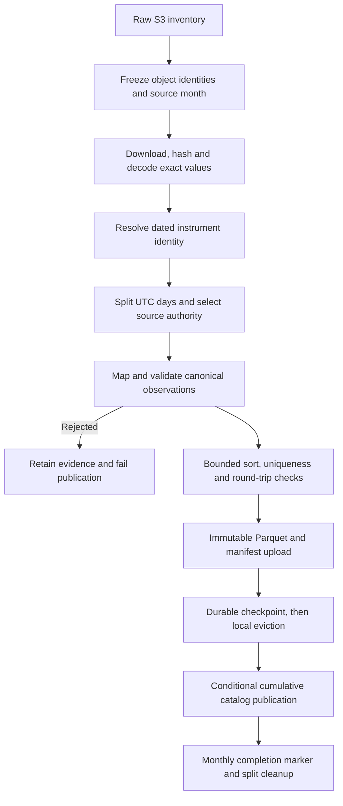

# Historical conversion architecture

[Handbook](../README.md) · [Archive contract](../contracts/archive/v1/README.md) · [Archive runbook](../operations/04-archive-runbook.md)

Conversion turns retained provider data into reproducible Parquet partitions and cumulative SQLite catalog snapshots. The hosted Databento worker is implemented and rollout is in progress. Successful subsets do not establish full-archive acceptance. Tardis conversion, shared query serving and replay integration remain separate work.

## Boundaries and implementation

| Module under `apps/runtime/conversion` | Responsibility |
|---|---|
| `raw_source.py` | S3 discovery, conditional download and verified cache |
| `backfill_sequence.py` | Ordered symbol/month work, worker pool, durable capacity admission and completion receipts |
| `backfill_driver.py` | Per-day execution, publication hook, eviction, quarantine and retry |
| `dbn.py`, `csv_decode.py`, `split.py` | Lossless decoding and reusable day splits |
| `identity.py`, `roll_table.py` | Concrete dated identity and reference facts |
| `source_coverage.py`, `authority.py` | Coverage declarations and overlapping-source selection |
| `job.py`, `checkpoint.py` | Frozen work plan, orchestration and durable progress |
| `bridge.py` | Calls the executable JavaScript canonical contract |
| `writer.py`, `continuity.py` | Parquet validation and depth continuity evidence |
| `catalog.py`, `s3_publish.py` | Local catalog merge and conditional remote publication |
| `convert.py` | Shared conversion helpers, partition publication and source-type dispatch |
| `rejection_evidence.py` | Durable, crash-safe rejection archives backing a quarantined date |
| `throttle.py` | Cooperative pause against live-collector health between batches |
| `budget.py`, `local_lock.py` | Fail-closed scratch reservation and OS-level inter-process locks |
| `preflight_l1.py` | Fail-closed release gate run before a long unattended conversion |
| `coverage_report.py` | Derived coverage, capability and gap model over the published catalog |
| `backfill_cli.py`, `backfill_sequence_cli.py`, `coverage_report_cli.py` | Entry points; the sequence CLI's exit status is the systemd restart contract |
| `qualify_s3_publication.py` | Injected-interruption proof for catalog publication and recovery |

## Meaning that must survive conversion

Epoch nanoseconds and exact decimals must not pass through lossy JavaScript floating-point conversion. Preserve provider identity, source hashes, row lineage, population and original event time. A continuous futures alias resolves to concrete contracts; numeric IDs can be reused, so a symbol guessed from today's name is not sufficient evidence.

CSV futures mappings require provider definitions and validity bounds. DBN continuous inputs require reference-backed roll intervals. Missing or inconsistent identity fails rather than assigning a plausible contract. Definition acquisition must retain genuine provider timestamps and facts.

A continuous input claims coverage only inside its own file window: the roll interval is intersected with the file's metadata start and end, and a partial symbol is never complete. Without that, each daily `ES.n.0` file claimed the whole roll interval. The next day's file, which holds a few book records stamped just before midnight, then won the authority tie for the previous day's depth, so those days were published with one record (report 57 FA-18). Records whose event time precedes midnight but which arrived after it stay in the next file and are not in that day's partition.

OHLCV becomes `candle`; `mbp-1` supplies quote and applicable trade observations; `mbp-10` supplies bounded depth and applicable trades. Top-N rows are not a full exchange book. Tardis incremental depth has different continuity semantics and cannot be treated as a sequence of Databento snapshots.

## Resumption and resource bounds

The sequence freezes source-month inventories, including overlapping monthly/daily objects, and allocates separate versions. Within a month, the job reuses its checkpoint and day splits. It still needs the source month's raw and split working set; “per-day publication” does not mean one day of total scratch usage.

Raw cache identity includes bucket/key and ETag, with local SHA-256 verification. Published partitions are uploaded and verified before their eviction flag is persisted, then removed locally. Recovery checks destination identity and remote artifacts before cleanup. Completed months have a durable receipt and can skip raw downloads after verifying publication evidence.

OS locks coordinate writers on the host; S3 conditional writes protect remote catalog publication. Neither mechanism makes arbitrary distributed concurrent writers safe. Do not modify a frozen input or refresh a failed inventory while completed work still depends on it.

Workers have CPU/memory limits in a separate slice and cooperatively pause between mapping batches when collector health is stale or pressured. A missing or stale health file counts as pressure, so the converter waits rather than assuming the collector is fine; in production that wait is unbounded, which protects live capture but means a dead collector stalls conversion silently. These mechanisms reduce contention; they do not replace measured collector latency and scratch/RSS checks. The [unit](../../ops/linux-host/systemd/terminal-backfill@.service) is the source for configured limits.

## Parallelism and capacity admission

`--pool-size` runs several symbols concurrently. **Parallelism is per symbol, not per day or per month:** the work queue is the phase's symbol list and each worker takes one symbol and processes its months serially, so the pool can never exceed the symbol count and total time cannot fall below the largest single symbol.

Concurrent workers share the staging root, the local catalog and the remote catalog pointer. Every shared mutable file is either disjoint per dataset version or lock-protected: catalog publication holds a publisher lock across reading the parent pointer, the S3 conditional write and advancing the local pointer, so two workers cannot race the pointer, and that lock waits without a deadline rather than failing a slow publication.

Because per-worker free-space checks race, a durable capacity ledger reserves the configured scratch ceiling plus each downloaded source while a month is live. A record left by a killed process is reclaimed only after its host, boot id and process start time prove the owner is gone. The preflight validates the same arithmetic for the configured pool size before a run starts — but only at that moment, so retained staging accumulated later is an operational watch item, not something the gate can see.

## Release gate

`preflight_l1.py`, run through `ops/linux-host/scripts/run-l1-preflight.sh` as the conversion service identity, is a fail-closed gate for a long unattended run. It verifies the deployed release and installed unit, refuses a non-empty target dataset version, HEAD-verifies every frozen raw object, decodes **every row of every input** to census action codes, rebuilds and validates the futures roll tables from the real definition objects, checks capacity for the chosen pool size, proves the locks are free and the collector healthy, and requires the worker stopped. It writes a durable JSON report and returns non-zero if any gate fails.

It never writes raw objects, never changes `CURRENT` and never starts the worker. It is deliberately expensive — a full census of the L1 corpus decodes billions of rows — because the alternative is discovering an unsupported source action days into a conversion.

## Acceptance

Verify completion receipts and current catalog integrity, reconcile raw versus canonical counts with source-authority exclusions, inspect rejected rows and continuity, and prove interrupted retry/idempotence. Record the code version and frozen inventory. Missing source dates remain explicit; schema validation alone cannot establish complete trading-session coverage.

For local setup and fixture tests, use [onboarding](../operations/00-developer-onboarding.md). For implementation details and direct CLI options, see the [conversion README](../../apps/runtime/conversion/README.md).
