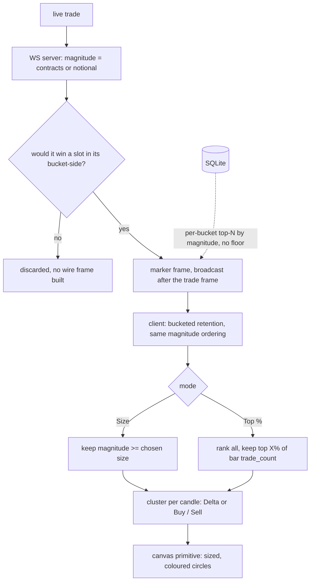

# Large Trade Detector

> **Historical implementation evidence.** This dated page records the result
> of a completed build or audit. It is not a current deployment/health
> statement; use the handbook and final-state overview for supported operation.

A chart overlay that surfaces the largest trades on the active instrument.
"Large" is decided by **rank, not by a statistical model**: the server keeps the
biggest few trades in each short time window, and the user chooses how deep to
cut with one of two dials. There is no learned baseline, no z-score, and no
median anywhere in detection — every step is a comparison of one trade's size
against another's.

## Files

- `apps/runtime/src/indicators/large-trade/large-trade-detection.js` — the magnitude rule,
  magnitude ordering, retention parameters, and percentile resolution, shared by
  the Binance and both dxFeed WS servers
- `apps/runtime/src/server/history.js` — in-memory marker pool, bucketed and
  magnitude-ranked
- `apps/runtime/src/storage/storage-reader.js` /
  `dxfeed/dxfeed-storage-reader.js` — `readLargeTrades`, the historical
  per-bucket top-N read
- `apps/web/src/lib/indicators/whale-detector/whaleTrades.ts` — client magnitude rule and both filters
- `apps/web/src/lib/chart/markerRetention.ts` — client-side bucketed retention
- `apps/web/src/lib/chart/logSlider.ts` — logarithmic slider mapping
- `apps/web/src/lib/indicators/whale-detector/whaleMarkerClusters.ts` — Delta / Buy-Sell clustering
- `apps/web/src/lib/indicators/whale-detector/whaleMarkerGeometry.ts` — radius, opacity, hit-testing
- `apps/web/src/lib/indicators/whale-detector/whaleMarkersPrimitive.ts` — the canvas render primitive
- `apps/web/src/lib/indicators/order-flow/participationRate.ts` — the 5-minute participation readout
- `apps/web/src/lib/indicators/whale-detector/WhaleDetectorSettingsModal.tsx` — mode, dials, reset
  (bespoke; see `whaleDetectorIndicator.ts` below for why)
- `apps/web/src/lib/indicators/whale-detector/whaleDetectorIndicator.ts` — **TA.04**: registers Whale
  Detector with the indicator-authoring core (`kind: "runtime"`, id kept as
  the existing `largeTradeDetector`) for lifecycle consistency only.
  Deliberately minimal, for two directly-checked reasons: (1) rendering
  needs the same custom-primitive escape hatch Killzones' own migration
  already found missing (`IndicatorRuntime.getPrimitive` is still an
  unimplemented stub), and hover tooltips specifically need real hit-test
  geometry (`whaleMarkerGeometry.ts`'s `hitTestWhaleMarkers`) that the
  generic `ctx.markers` system has no equivalent for — losing hover would
  be a real regression, not an acceptable trade; (2) its settings modal
  doesn't fit `SettingsFieldSchema`: two logarithmic range sliders (no
  such field kind exists) and hint text embedding live, externally-
  computed values (`resolvedThreshold`, `truncated`) a static schema has
  no way to receive — the same closure-scope limit VPIN Cloud's dynamic
  sensitivity default already hit, here on more fields. `onBar`/
  `readOutput` are inert; everything else (data flow, rendering, settings
  modal) stays exactly as it is.

## End-to-end flow

## What counts as magnitude

One rule, and it is the only provider-aware line in the detector:

- **dxFeed futures** (`/ES`, `/NQ`) — **contract count**.
- **Everything else** (Binance spot and perpetual, dxFeed equities) — **USD
  notional**, `price × size`.

`price * size` is **not** real USD notional for futures and never was: dxFeed's
price for `/NQ`/`/ES` is an index point, not a per-share dollar price, and the
per-point contract multiplier ($20/pt for `/NQ`, $50/pt for `/ES`) exists
nowhere in this codebase. Building a correct dollar figure would need a
multiplier table that does not exist; that remains out of scope. Contract count
is used instead, and no layer relabels it as dollars.

## Backend: rank, do not classify

Every trade is a retention candidate. The server does not decide whether a trade
is "large" — it decides only whether the trade is **large enough to hold a slot
in its own bucket**.

Retention keeps the **top 4 trades per 60-second bucket per side**
(`MARKER_BUCKET_MS`, `MARKERS_PER_BUCKET_SIDE`), ranked by magnitude with
event-time then trade-ID as a stable tie-break. Both providers use the same
parameters. That is what makes marker density comparable across instruments
whose raw trade rates differ by four orders of magnitude.

Before building a wire frame the server asks `wouldRetainMarker` whether the
trade could possibly win a slot. A trade strictly smaller than every incumbent
in its bucket-side provably cannot, so no frame is constructed for it — which
keeps the hot path cheap now that every trade is a candidate.

The trade frame is broadcast **before** its marker; the marker is derived from
the trade, and this preserves the wire ordering clients already relied on.

### Historical reads

`readLargeTrades` performs the same selection over stored rows: a single
indexed range scan streamed through an O(n) pass that holds a bounded
`perBucketSideLimit`-element list per bucket-side. There is no global sort and
no second query, so cost is linear in the rows scanned rather than
`n log n` — measured at **1,842 ms** for a 6-hour window over 1.23M BTCUSDT
perpetual trades.

Binance uses `idx_trades_symbol_market_ts`; dxFeed uses
`idx_dxfeed_time_and_sales_symbol_time`. Rows are returned in exchange-time /
row-ID order so markers insert chronologically even when storage and live
delivery interleave.

Marker pools are count-capped: 45,000 server-side for Binance
(`DEFAULT_MAX_MARKERS`) and 60,000 in the browser (`MAX_BINANCE_MARKERS`);
5,000 per view on dxFeed on both sides (`RECENT_MARKER_LIMIT`,
`MAX_DXFEED_MARKERS`). The browser's Binance cap is the larger of the two, with
the useful consequence that a client never discards a marker the server still
holds; dxFeed's two caps are equal.
When a bucket-side is full the weakest marker in that bucket is displaced;
when the overall cap is reached the oldest is dropped.

## The two modes

### Size

"Show trades at least this big", in native units. A marker is then a fact about
the **trade**, comparable across sessions and across days.

| unit | range | default |
|---|---|---|
| USD | $20,000 – $50,000,000 | **$75,000** |
| contracts | 1 – 400 | **20** |

Both sliders are **logarithmic**, so half the travel sits below the geometric
midpoint. The contracts default of 20 is that midpoint; the USD default of
$75,000 is a directly chosen number and deliberately sits left of centre.

### Top %

"Show the top X% of trades." A **rank** filter, so it is genuinely
self-adjusting per instrument, needs no distributional assumption, and behaves
identically on discrete contract counts and continuous notional.

Range **0.00125% – 2%**, default **0.05%** (the geometric midpoint). The slider
is inverted: dragging right increases selectivity — fewer, bigger trades.

The percentage is resolved against the **real tape**, not against the markers
that happened to be retained. The denominator is the sum of `trade_count` across
the bars the client already holds; `resampleBars.ts` aggregates that field
correctly across timeframes, so no additional wire field exists for this. The
modal displays the size the current percentage resolves to — "top 0.05% —
currently $65,704 and above" — which is what makes an abstract dial concrete.

Measured raw-tape thresholds (2026-09-02) show the rank filter self-calibrating
without any per-instrument constant:

| | `/ES` | `/NQ` | BTC perp | BTC spot | ETH | AAPL | TSLA |
|---|---|---|---|---|---|---|---|
| top 0.5% | 8 ct | 4 ct | $80,056 | $14,836 | $9,847 | $727,493 | $716,250 |
| top 0.1% | 19 ct | 9 ct | $222,944 | $41,678 | $22,643 | $3,181,722 | $2,737,548 |

## Bubble modes

- **Delta** — one bubble per candle, sized by `|buy − sell|` magnitude, coloured
  by which side won.
- **Buy / Sell** — separate buy and sell bubbles, no netting.

**Min delta (%)** applies in Delta mode only: it hides candles whose net is a
small share of their gross, i.e. where buying and selling nearly cancelled.

A Delta bubble's printed label is the **winning side's own token total**, not
the net token difference, and this is deliberate. Net notional and net tokens
can disagree in direction when per-trade prices differ sharply within one
candle: buy 50,000 × 3 (150,000 notional, 3 tokens) against sell 1,000 × 100
(100,000 notional, 100 tokens) makes the bubble a *buy*, while the net token
figure of 97 is almost entirely the *sell* side's contribution. The winning-side
figure always describes the side actually displayed. The hover tooltip shows net
notional, which is the figure the bubble's radius encodes.

## Visual rendering

Markers render as circles on the chart's own canvas via a custom series
primitive, rather than the charting library's built-in glyphs, which impose a
size ceiling unsuited to a prominent halo.

**Circle radius is a rendering normalisation, not a claim about size.** It
scales each cluster's magnitude against a one-hour local median of the *current
marker population* (`computeLocalMedianBaselines`), bounded between a minimum
and maximum radius. That keeps bubbles legible at any zoom, but it means radius
is relative to the other markers on screen — it is not comparable to any
absolute figure, and it is the one place a median survives anywhere in this
indicator.

Fill opacity rises with **how many trades merged into the bubble**, not with
its magnitude. Green is buy-side aggression, red sell-side. Each circle's number
is fit inside it by shrinking toward a 9px floor, then re-rendered with zero
decimals if it still does not fit; a label is never silently dropped, and
circles under 10px radius carry no label because it would be illegible anyway.

Hovering hit-tests against the exact rendered radius and shows the size, the net
share for a mixed cluster, and a **participation rate** — the cluster's size as
a fraction of total traded volume over the trailing 5 minutes, computed entirely
client-side from bars already streamed. Both the marker size and every bar's
volume are native base-unit/contract quantities, never USD, so that ratio stays
dimensionally consistent regardless of asset class.

## Configuration

Enabled from the Indicators menu. Once enabled, an on-chart legend row exposes
visibility, the mode and its dial, and removal. The legend detail reads
`top 0.05%` in Top % mode and `≥ $75.0k` / `≥ 20 ct` in Size mode.

## Scope and limitations

- **A percentile cannot cut inside a tie.** 85% of `/ES` and 96% of `/NQ`
  prints are exactly one contract, so coarse cuts degenerate: `top 50%`,
  `top 30%` and — on `/NQ` — `top 10%` all resolve to a threshold of 1 contract,
  i.e. every trade. The dial's range stops at 2% for exactly this reason.
- **Top % is bounded by what retention holds.** If a setting needs more markers
  than the pool contains, the UI says so ("showing everything available")
  rather than under-delivering silently.
- **Radius is population-relative**, as described above.
- **The magnitude rule exists twice** — once in `large-trade-detection.js` for
  the three servers, once in `whaleTrades.ts` for the browser — because the npm
  workspaces are `apps/*` only and `apps/web/tsconfig.app.json` includes just
  `src`, so the web app cannot import from the runtime. Both sides are covered
  by tests asserting the same cases. A shared workspace package would remove
  the duplication.
- **In Size mode the population is whatever clears the user's own number**;
  in Top % mode it is the full retained marker set ranked against the tape.
- Time-of-day/session seasonality (a per-hour-of-day baseline) was researched
  and deliberately not built.

## Provider notes

- **Trade-tape time** is rendered and labelled as UTC from `ts_exchange`, so an
  exchange timestamp stays comparable across workstations instead of silently
  changing its displayed clock with the browser locale.
- **`TapePanel.tsx` and the tooltip** show contract counts for dxFeed futures
  rather than a fabricated dollar figure, matching the magnitude rule above.
- **`DomPanel.tsx`** likewise shows native contract counts for dxFeed futures
  order-book levels; the Order-v2 L2 path publishes a ladder only after a
  complete valid snapshot, and unavailable states stay explicit.
