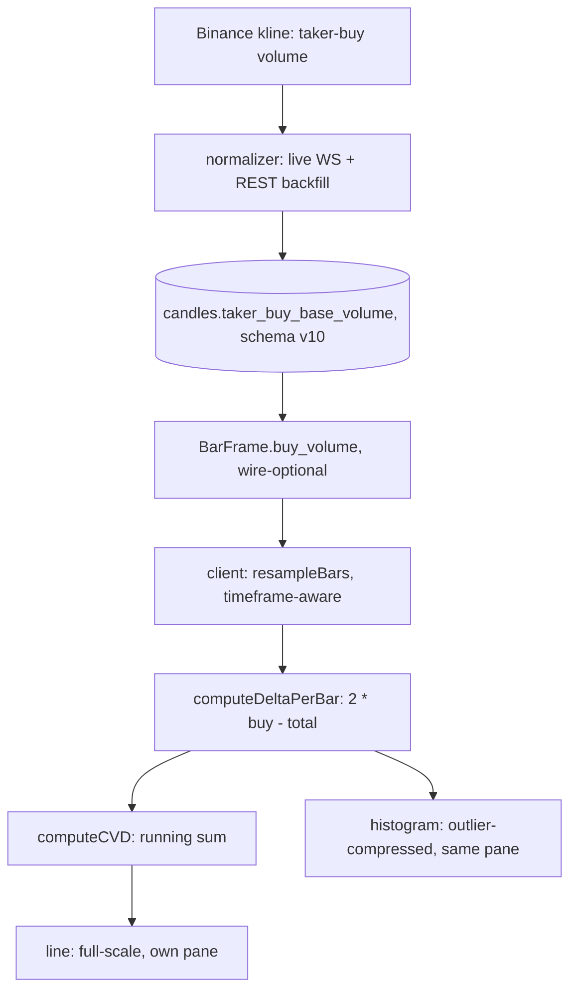

# Aggressive Order Flow (CVD)

> **Historical implementation evidence.** This dated page records the result
> of a completed build or audit. It is not a current deployment/health
> statement; use the handbook and final-state overview for supported operation.

A chart sub-panel showing cumulative volume delta, computed from each
bar's own taker-buy volume rather than reconstructed from raw trade
history. The wire protocol's 100-trade cap makes the latter impossible
over any window wider than "recent."

## Provider provenance and comparability

The indicator formula is the same in every case (`2 * buy_volume - volume`),
but its inputs are **not interchangeable** across providers:

- **Binance:** `buy_volume` is exchange-supplied kline taker-buy base volume,
  available from the live kline stream and REST backfill.
- **dxFeed equity/futures:** `buy_volume` is built locally from eligible,
  terminal-classified `TimeAndSale` prints. Futures require `validTick`; any
  unknown side or incomplete classification makes the bar a visible CVD gap.

The legend names the active source class. CVD is therefore a provider-specific
measurement, not proof that exchange and terminal-classified flow are directly
comparable. No direction, absorption, intent or trade signal is inferred.

## Files

- `apps/runtime/src/storage/storage-db.js` — `candles.taker_buy_base_volume` column and CHECK constraint (`migrateV8ToV10Schema`)
- `apps/runtime/src/storage/storage-service.js` — the authoritative exact-decimal comparison before write
- `apps/web/src/lib/indicators/order-flow/orderFlow.ts` — `computeDeltaPerBar`/`computeCVD`, the gap/epoch-restart semantics
- `apps/web/src/lib/indicators/order-flow/cvdCandles.ts` — `computeCvdCandles`, the intrabar CVD path used by the candle rendering
- `apps/web/src/lib/indicators/order-flow/OrderFlowSettingsModal.tsx` — **removed by TA.04**; the
  line/candles display control now runs through `orderFlowIndicator.ts`'s
  `SettingsFieldSchema`/`GenericIndicatorSettingsModal`, a genuinely clean
  fit (a plain two-option radio group, no sliders or live-derived hint
  text unlike Whale Detector/VPIN Cloud). One small, disclosed, named
  behavior drop: the bespoke modal's conditional hint about the
  1-minute timeframe having no wicks depended on `intervalMs`, chart
  state outside this indicator's own settings object that
  `SettingsFieldSchema`'s `visibleIf` has no path to see — dropped rather
  than inventing a way to inject external context into a schema field.
- `apps/web/src/lib/indicators/order-flow/orderFlowIndicator.ts` — **TA.04**:
  registers Order Flow (`kind: "runtime"`) with a real `settingsSchema`
  (displayMode, `affects: "recompute"` since it swaps series type
  entirely, not just style). `lines: []`: the generic per-indicator series
  creation this SDK builds from `RuntimeIndicatorDef.lines` only ever
  creates a `LineSeries` (confirmed directly in `ChartPanel.tsx`) — there
  is no histogram or candlestick series type in that path, and CVD needs
  a line, a histogram, and a candlestick series simultaneously, so
  `ChartPanel.tsx` keeps owning `cvdLineSeriesRef`/`cvdHistogramSeriesRef`/
  `cvdCandleSeriesRef` directly, unchanged. `onBar`/`readOutput` are
  inert — CVD is computed from `bars`/`delta` directly in
  `recomputeIndicators`, never from `ctx.bar`.
- `apps/web/src/lib/chart/resampleBars.ts` — sum-only-when-every-constituent-bar-has-it resampling rule
- `apps/web/src/lib/chart/chartData.ts` — `computeOutlierThreshold`/`compressMagnitude`, the histogram compression math
- `apps/web/src/components/chart/ChartPanel.tsx` — pane layout, line/histogram series wiring

## End-to-end flow

## Backend behavior

Binance's own kline payload carries taker-buy base volume alongside
total volume, on both the live WS stream and the REST `/klines`
backfill endpoint. Both paths already parsed and validated this field
before this feature existed; neither persisted it.
`candles.taker_buy_base_volume` (schema v10) stores it as a nullable
column with two CHECK constraints: the same decimal-format check every
other stored price/volume field gets, and a cross-column SQLite numeric
check (`CAST(taker_buy_base_volume AS REAL) <= CAST(volume AS REAL)`). The
storage service performs the authoritative exact decimal comparison before
write; the database check is defense in depth for alternate write paths.

Rows written before this migration have `taker_buy_base_volume = NULL` and
the collector does not rewrite them. The relay treats such rows as incomplete
warm-up coverage and obtains the complete aligned seven-day candle window
from Binance REST, including the real taker-buy field. A freshly warmed pair
therefore gets real CVD history independent of local capture age.

## Client-side computation

`BarFrame.buy_volume` is wire-optional: present as a number when the
source bar has it, omitted entirely (not `null`) when it doesn't.
Resampling to a coarser timeframe sums `buy_volume` across the
constituent bars the same way it sums `volume`, but only when every
constituent bar has the field. A bucket straddling the migration
produces no `buy_volume` at all rather than a partial sum presented as
the real total.

Per-bar delta is `2 * buy_volume - volume`, positive when the buy side
was the majority of that bar's volume. A bar with no `buy_volume` produces an
explicit gap, not a fabricated zero. The chart emits whitespace at that bar
and restarts the cumulative epoch at the next complete bar so the line never
bridges unknown flow. Within each complete epoch, CVD is the plain running sum
with no smoothing or decay.

## Visual rendering

The panel occupies its own pane below price, sized identically to the
existing RSI pane. The CVD line is plain black on its own full-height
price scale, with no directional coloring and no fixed range. A
green/red histogram shares the same pane on a separate, compressed
price scale so it reads as a compact flow strip rather than dominating
the panel. The outlier threshold uses the standard modified Z-score / MAD
(median absolute deviation) method (Iglewicz & Hoaglin, 1993): a bar's
magnitude is flagged once it exceeds the median non-zero magnitude across
the currently loaded bars by 3.5 scaled MAD units, so what counts as
"outsized" adapts to how spread out that session's flow actually is,
rather than assuming a fixed ratio regardless of it. With fewer than 20
loaded bars, or when MAD is zero (most bars share one magnitude), it
falls back to four times the median instead. Bars under the threshold
render at their exact raw height; beyond it, magnitude keeps growing past
the threshold at a falling (square-root) rate rather than flattening to a
shared ceiling, so an outlier still reads as visibly, proportionately
larger than an ordinary bar instead of looking identical to every other
outlier. A dotted zero reference line marks the line's own baseline.

## CVD candles

The cumulative total can be drawn either as a **line** (default) or as
**candles**. A candle needs intrabar resolution — per-bar `buy_volume` alone
gives only an open and a close — so `computeCvdCandles` builds the path from
the **1-minute source bars** already retained for the chart:

- **open** — the running CVD entering the bar
- **high / low** — the extremes of the running CVD *within* the bar, walking
  its constituent 1-minute deltas in order
- **close** — the running CVD leaving the bar

Two invariants hold by construction and are pinned by tests: every candle's
**close equals the line's CVD value for the same bar**, so the two renderings
can never disagree; and each candle **opens exactly where the previous one
closed** within an epoch.

Gap and epoch semantics match the line exactly. A bar is a gap — not a flat
candle — when it has no source coverage at all, or when **any** constituent
1-minute bar lacks `buy_volume`; a gap restarts the cumulative epoch, so a
candle never bridges unknown flow.

**On the 1-minute timeframe there is no finer data to build a path from**, so
candles there have a body but no wicks. The settings modal says so rather than
letting the rendering imply detail it does not have.

## Configuration

The indicator is enabled from the terminal's Indicators menu (L1
section) and rendered through the same on-chart legend chip every
indicator now uses, with an independent visibility toggle and removal.
Its one setting is the line/candles display choice above.

## Scope

- No collector rewrite of pre-migration local history. Storage coverage with
  null taker-buy data falls through to REST; any missing field that still
  reaches the browser is rendered as an explicit gap.
- Only base taker-buy volume is stored and used. Quote-denominated
  taker-buy volume is parsed upstream but not persisted, since delta is
  computed entirely in base-asset units.
- The histogram's outlier compression is a rendering concern only. The
  underlying CVD line, the candles, and the cumulative value are never
  compressed or altered.
- **"Outlier" here is not a rare event.** The 3.5-modified-Z cutoff assumes
  roughly symmetric data, while per-bar `|delta|` is right-skewed, so the
  threshold fires far more often than the name suggests. Measured over 3,000
  recent 1-minute bars per instrument (2026-09-02): 8.2% of BTCUSDT spot bars,
  10.3% BTCUSDT perpetual, 9.3% ETHUSDT, 10.0% `/NQ`, 13.5% `/ES`, and
  **24.4% TSLA / 30.0% AAPL**. On the equities a quarter to a third of all bars
  are drawn compressed, so compression is the common case there rather than the
  exception. The dispersion estimate itself is sound — measured MAD/median sits
  at 0.66-0.98 across all seven instruments, nowhere near degenerate.

## CVD epochs and missing bars

CVD is cumulative, so it is only meaningful across a **contiguous** run of
bars. A time bucket omitted by resampling is not a harmless visual hole: the
order flow for that interval is unknown, and carrying the running total across
it would silently splice two separate cumulative epochs into one line.

Both the line series (`computeCVDForBars`) and the candle series
(`cvdCandles.ts`) therefore **reset the running total to zero at a gap**, so the
next observed bar begins a fresh epoch rather than inheriting a total that was
never continuous with it. A displayed bar whose open time is not the previous
bar's open plus one interval is treated as such a gap.
