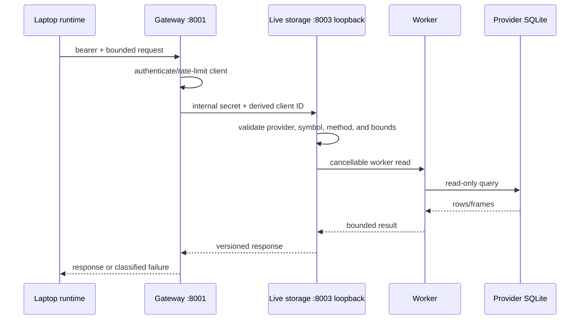

# Storage, warm-up, replay, and archive

[Handbook](../../README.md) · [Platform architecture](../../operations/01-hosted-platform.md) ·
[Archive-query runbook](../../operations/06-archive-query-service.md)

This page is the final-state guide to the repository's three historical-data
paths. They are complementary and must not be described as one interchangeable
backfill system.

## Source selection

| Source | Authority | Consumer | Intended use |
|---|---|---|---|
| Local capture SQLite | Data recorded by a laptop collector | Local runtime readers | Offline/local warm-up and replay |
| Remote live storage | Data recorded by hosted Binance and dxFeed collectors | Laptop runtime through WireGuard gateway | Recent indicator warm-up and P1g L1/L2 replay |
| Curated S3 archive | Published immutable partitions selected by catalog snapshot | Historical Mode through archive-query service | Versioned, coverage-reporting historical charts |

Live memory and derived JSON stores are caches, not additional authorities.
They may accelerate startup but are discarded when validation, geometry, age,
or continuity checks fail.

## Remote live-storage request path

`provider` defaults to `binance` for compatibility. `dxfeed` requests are
validated against the governed instrument catalog and dispatched to the
separate dxFeed reader. The browser does not call this API directly; Terminal C
uses `TT_LIVE_STORAGE_SERVICE_URL` and `TT_LIVE_STORAGE_CLIENT_TOKEN`.

Ordinary storage methods cover recent candles, minute rollups, large trades,
aggressive prints, volume-profile inputs, and other reader methods supported by
the selected provider. The service applies request validation, per-client rate
limits, duplicate-request coalescing, abort propagation, and error
classification. Synchronous SQLite work stays off the HTTP event loop.

## P1g replay pages

P1g is not the same call as an indicator warm-up. `readReplayPage` reconstructs
L1/L2 frames from the provider's recorded tables on a dedicated worker.

Code-enforced defaults and ceilings:

| Property | Value |
|---|---|
| Maximum requested time span | 8 days |
| Default maximum frames per page | 2,000 |
| Default maximum encoded bytes per page | 1,500,000 |
| Worker timeout | 25 seconds |
| Maximum cursor chain | 2,048 pages |
| Providers | `binance`, `dxfeed` |

The request includes provider identity, exact symbol/market, time range, tick
size, and heatmap geometry. dxFeed tick size must match the governed catalog.
A next-page cursor is HMAC-signed and bound to the complete request identity,
page position, and SQLite file fingerprint. It is rejected when altered, used
for a different request, exceeds the page chain, makes no forward progress, or
refers to storage whose identity changed.

An eight-day maximum is a request bound, not an eight-day coverage guarantee.
The response can contain less because the collector started later, stopped,
was not subscribed to that contract, encountered a recorded invalid span, or
retention removed older rows. Consumers must preserve coverage/gap evidence and
must not stretch the last frame across a missing period.

## Failure behaviour

- Client disconnect and deadline cancellation abort the active worker.
- A timed-out, failed, or non-progressing worker returns an unavailable/error
  result; it does not block Binance, dxFeed, or unrelated gateway requests.
- Remote warm-up failure degrades that historical feature. It must not be
  presented as successful empty coverage.
- Authentication failure is distinct from valid zero-row coverage.
- Live ticks remain local and can continue while a historical read fails.

Messages such as “operation was aborted” commonly mean the caller cancelled or
replaced a request, the HTTP deadline elapsed, or shutdown terminated the
worker. Diagnose the surrounding selection/restart/timeout evidence before
treating it as a storage gap.

## Curated archive

The archive-query service does not read collector SQLite. It pins immutable
catalog state, fetches validated curated objects, reports coverage, and pages by
signed/keyset cursor. Historical Mode can resample verified candles and follow
an explicit futures roll manifest. It does not silently convert recent live
capture into a published archive.

## Which path should a feature use?

1. Use live memory for current incremental calculation.
2. Use local or remote live storage when the feature needs recent recorded
   provider events and can tolerate capture-bounded coverage.
3. Use the curated archive when versioned publication, durable catalogs, and
   explicit historical coverage are required.
4. Never query SQLite directly from the HTTP event loop or browser.
5. Never treat a derived cache as the raw recording.

Detailed implementation evidence remains in [storage.md](storage.md),
[storage-pipeline-evidence.md](storage-pipeline-evidence.md), and
[storage-warmup-and-capacity-evidence.md](storage-warmup-and-capacity-evidence.md).
