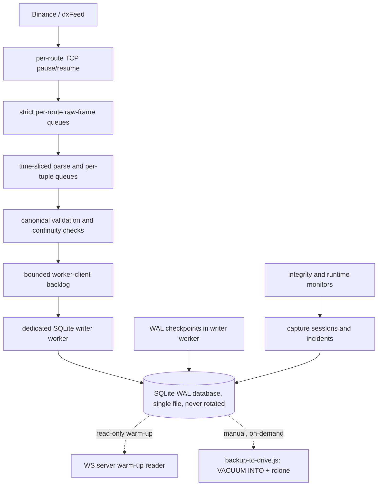

# Market Data Storage Pipeline

> **Historical implementation evidence.** This dated page records the result
> of a completed build or audit. It is not a current deployment/health
> statement; use the handbook and final-state overview for supported operation.

Terminal 0 is the standalone writer for a single, continuously-growing
SQLite market-data store per provider — no rotation, no archival tier,
no rows ever deleted from it. It owns its own Binance/dxFeed connection
independent of the browser-facing relay, so restarting the frontend or
relay cannot interrupt collection. Every run has durable capture-quality
lineage: a session is explicitly `HEALTHY`, `DEGRADED`, or `INVALID`,
and integrity incidents are queryable rather than hidden in console
logs.

There is no archive, rotation, or retention subsystem. Every accepted
row stays in the live database for the life of the deployment; nothing
is ever deleted from it and nothing is exported to a separate file
automatically. `storage-db.js`/`dxfeed-storage-db.js` expose no
`deleteOlderThan` at all.

For the exact row shape of every stored table — column names, types,
and per-field notes — see
`../../contracts/storage-layer/v1/storage-layer-v1.md` (Binance) and
`../../contracts/dxfeed-storage-layer/v1/dxfeed-storage-layer-v1.md`
(dxFeed). This doc covers how and when rows get written; those cover
what each row looks like once it exists.

## Flow

## Files

- `apps/runtime/scripts/collect/run-collector.js` — production composition and coordinated shutdown; passes `useWorker: true`
- `apps/runtime/scripts/maintain/backup-to-drive.js` — manual, on-demand `VACUUM INTO` snapshot + `rclone` upload for both providers; never runs automatically, never touches the collector
- `apps/runtime/src/storage/storage-service.js` — envelope validation, trade-ID continuity, capture sessions, and persistence routing
- `apps/runtime/src/storage/storage-write-queue.js` — synchronous, same-process write path used only when `useWorker: false` (an in-memory test database can't be handed to a worker thread); mirrors the real worker's retry semantics exactly but is not the production path
- `apps/runtime/src/storage/storage-worker-client.js` — bounded asynchronous handoff and durable acknowledgement tracking; the production path (`useWorker: true`)
- `apps/runtime/src/storage/storage-worker-thread.js` — transactions, retry policy, WAL checkpoints, and the daily depth-continuity ledger, off the WebSocket event loop
- `apps/runtime/src/storage/storage-db.js` — schema v12, validated migrations, prepared writes, time-first indexes, and corruption quarantine — no deletion path
- `apps/runtime/src/storage/collector-integrity-monitor.js` — sticky session-quality classification
- `apps/runtime/src/storage/collector-capacity-guard.js` — progress-aware capacity-breach detection (see "Recovery and maintenance" below)
- `apps/runtime/src/platform/runtime-health-monitor.js` — event-loop delay, utilization, memory, and garbage-collection telemetry
- `apps/runtime/src/storage/storage-reader.js` — fail-soft read-only candle warm-up, live table only
- `apps/runtime/src/storage/storage-lock.js` — exclusive token-owned process lock
- `apps/runtime/src/storage/storage-checkpoint.js` — `PRAGMA wal_checkpoint` and bounded incremental vacuum, unrelated to any retention concept
- `apps/runtime/src/storage/archive-schedule.js` — despite the name, just a UTC day-boundary helper (`dayStartMs`); used by both providers' continuity ledgers, not by any archive/rotation subsystem (which no longer exists)
- `apps/runtime/src/storage/collector-feed-maintenance.js` — debounced, cooldown-limited tuple recovery
- `apps/runtime/src/platform/cli-logger.js` and `cli-heartbeat.js` — explicit operational health reporting

`apps/runtime/archive/l2-derivation/` is parked Phase 4 work and is not on the active collection path.

## Stored data and invariants

The four raw market-data tables remain `trades`, `candles`, `l2_depth_events`, and `l2_depth_snapshots`. No indicator threshold, bucket, or significance rule is applied before persistence.

- Trades retain every validated print. IDs are monitored independently per market and symbol with market- and session-aware classification.
- Candles retain closed one-minute bars only. Timestamps must be aligned to the UTC minute grid, OHLC values must be internally consistent, and repeated opens update idempotently. Base/quote volume and taker-buy base/quote volume are retained as exact decimal text.
- Depth events retain validated raw `U`, `u`, `pu`, receipt/exchange times, and JSON level tuples even while the live book is recovering.
- Depth snapshots retain each distinct REST bootstrap/recovery baseline for deterministic future replay.

Schema v12 retains the public raw row shapes, capture lineage, and
exact quote-volume candle fields; it also carries the large-trade
baseline snapshot columns (`baseline_log_median`/`baseline_log_mad`/
`baseline_sample_count`). Those columns are **no longer read by anything** as
of 2026-09-02: the statistical detector that used them was replaced by
magnitude ranking — see
`../indicators/P4.01-large-trade-detector-evidence.md`. They are retained
because dropping a column from a 40 GB table buys nothing. **As of schema v15
(`L1L2-V2-084`) the collectors no longer write them**, so rows from that point
carry `NULL` in all three; the per-trade estimator and the four expression
indexes the detector required are gone from the ingest path entirely. Existing
rows
collected before the v10 migration have `NULL` quote-volume fields;
those source values cannot be reconstructed retroactively. New
collection persists all four Binance kline volume fields. Schema v12
additionally retains a durable per-day/per-pair depth-continuity ledger
— see `storage-continuity-evidence.md`. Capture lineage and time-first
indexes support fast, bounded lookups. A prior process that did not
finalize its session is marked `INVALID` with
`UNCLEAN_PREVIOUS_PROCESS_EXIT` at the next startup. The schema
validates bounded exact-text decimals without SQLite floating-point
casts, enforces bounded depth arrays and SPOT/PERPETUAL `pu` semantics,
and migrates older supported schemas transactionally. Only
`SQLITE_CORRUPT` or `SQLITE_NOTADB` triggers collision-safe quarantine;
locks, permissions, and other operational failures stay visible.

## Loss policy and durability

The production collector does not silently discard accepted data.

- Each physical route has independent strict raw-frame limits of 50,000 items and 64 MiB and drains at up to 1,000 frames or 8 ms per turn before parsing. At 40% of the frame bound (20,000 frames) or 50% of the byte bound (32 MiB) the collector pauses that WebSocket's transport; it resumes below 10% (5,000 frames) and 12.5% (8 MiB). Each non-depth subscription then has a strict normalized FIFO limit of 50,000 events with the same turn limits. Reaching any hard limit is not a drop-oldest event: the incoming item that could not be accepted is recorded exactly and the strict capture session terminates `INVALID`.
- Explicit unsubscribe and terminal shutdown invalidate queued data only after the collector has quiesced. An unaccounted `event_dropped`, storage writer failure, or forced terminal shutdown is `INVALID`.
- The storage worker client accepts at most 100,000 items or 256 MiB and batches at most 1,000 rows or 8 MiB. Its production default sends one transaction at a time, so the parent can name and bound the only unacknowledged batch rather than hide work in an opaque worker-side queue.
- The dedicated worker owns market-row transactions. It retries only `SQLITE_BUSY` and `SQLITE_LOCKED`, with bounded exponential backoff. Before running each transaction it sends a `write_started` acknowledgement, so the parent can tell whether a stalled batch never began or is stuck mid-transaction; overflow, retry exhaustion, protocol failure, worker exit, or an unacknowledged batch beyond 45 seconds is fatal. The client force-terminates a stalled worker rather than leaving a process alive with an unknowable durability state.
- Shutdown first quiesces WebSocket ingress, drains every already-accepted connection event, disconnects routes, then waits for durable storage acknowledgements before closing the session.

Heartbeat telemetry reports queue depth, worker readiness/health, worker state, active-batch identity/size/age, last-ack age, commit duration, accepted-to-ack latency, event-loop delay/utilization, route state, and sticky capture quality. Pressure incidents additionally persist ingress-drain timing, queue high-water marks, process memory, garbage-collection totals, and the last worker-maintenance operation. Live collector status and capture quality are deliberately separate: a recovered live feed may be `HEALTHY` while the session remains `DEGRADED` because its historical gap is retained.

Market ingress does not start until the writer worker has completed initialization and reported ready. This prevents migration, startup retention, or worker construction time from appearing as live durable-ack latency.

## Recovery and maintenance

Tuple staleness must be observed twice before recovery, and each tuple has a 30-second recovery cooldown. Automatic recovery reconnects the affected physical route once and resubscribes its active tuples as a batch. It does not discard sibling traffic or already accepted queued records.

Route silence and tuple staleness recovery are gated by local scheduler health. After a local event-loop pause, recovery waits for a fresh healthy runtime sample instead of rebuilding healthy provider routes using a stale wall-clock delta. Tuple recovery also waits until already accepted raw frames on its route have been parsed, preventing local ingress delay from creating a false provider reconnect. Capacity protection (`collector-capacity-guard.js`) is progress-aware: a pressure window may continue draining even when its oldest item is temporarily old, but terminates after 30 seconds with no reduction in the active backlog signal. Hard queue and byte limits remain independently enforced.

The only scheduled maintenance in the writer worker is: passive `PRAGMA wal_checkpoint` every 30 minutes, with scheduled deep cycles that truncate the WAL and perform bounded incremental vacuum; and once a day, a scan of the previous UTC day's L2 sequence chains that persists a per-pair depth-continuity ledger row (see `storage-continuity-evidence.md`). Worker maintenance waits for the durable write queue to empty first. Both run in the writer worker, not on the WebSocket event loop.

Disaster-recovery backup is a separate, deliberately manual step: `apps/runtime/scripts/maintain/backup-to-drive.js`, run by hand whenever the operator chooses. It acquires each provider's writer lock, so the corresponding collector must be stopped; this prevents a backup and live writer from being mistaken for independent owners. It then takes a consistent point-in-time snapshot via SQLite's `VACUUM INTO` and uploads it through an operator-configured `rclone` remote. A failed upload leaves the local snapshot and manifest for inspection/retry. This script never runs automatically and is never invoked by a collector.

## Scope and operating requirements

- Collection begins when Terminal 0 starts; it does not reconstruct earlier trades or depth deltas.
- Collector and relay intentionally use independent public connections.
- A `DEGRADED` or `INVALID` capture segment must not be treated as research-complete without reconciliation or exclusion.
- Host clock synchronization, disk capacity, process supervision, and alert delivery are deployment controls. The process exposes evidence for them but cannot guarantee them by source code alone. Off-host backup replication has a concrete tool now (`backup-to-drive.js`), but running it is still the operator's own decision, not something the collector does for them.

## Why the live writer does so little

The storage worker thread performs **PASSIVE checkpoints only**. Historical
continuity scans, TRUNCATE checkpoints and vacuuming are offline jobs — they
have no deterministic upper bound and must never stand between an accepted
market-data item and its durable commit. Those jobs now exist as
`npm run maintain:storage` and `npm run audit:storage-continuity`
(`L1L2-V2-033`, `L1L2-V2-032`); before Phase 19 they were deferred to by
comment and implemented nowhere.

Bootstrap and migration are performed once by the owning process **before** the
worker is created. A live writer must never repeat DDL or a full integrity scan
during its readiness window.

The synchronous test/development queue is already durable at the point of
return. Worker mode deliberately waits for its ready handshake first, so a
worker that failed to start cannot create a capture session or accept input.

Warm-up reads take the worker path where they can: `readVolumeProfileAsync`
moves Volume Profile's seed read off the relay's event loop
(`L1L2-V2-056`). Rollover and `profile_config` rebuilds stay synchronous
deliberately — `L1L2-V2-044` was a grid change that did not take effect until
the next period rollover, and making those paths async would reopen it.

The depth-continuity audit treats a state left open exactly at UTC midnight as
**not** evidence of a capture cut until the ordered continuation has had a
chance to close it.
