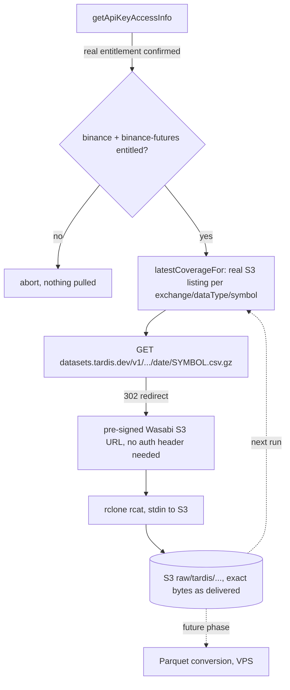

# Tardis Historical Data Pipeline

Real, self-discovering ingestion of historical crypto data (Binance spot
+ perpetual futures, BTC-USDT/ETH-USDT) from Tardis's datasets API
directly into S3. Same no-local-accumulation principle as the Databento
pipeline (see
[`../databento/databento-historical-pipeline.md`](../databento/databento-historical-pipeline.md)):
every pull streams straight from Tardis's HTTP response into an S3
upload. For the plan decision, real pricing, and per-schema evidence
behind this pipeline, see
[`../../contracts/tardis/v1/tardis-v1.md`](../../contracts/tardis/v1/tardis-v1.md).

**Status:** raw coverage is partial and the backfill resumes by re-running
it. For current totals per exchange, data type and symbol, run
`npm run verify:tardis-s3-inventory` (read-only, safe at any time). The
numbers in this document describe the mechanism and measured per-day sizes.

## Files

- `apps/runtime/scripts/collect/historical/tardis-datasets-api.js` — the real HTTP client: builds the exact datasets-API URL, follows Tardis's redirect to the real (pre-signed) file location, and retries with real backoff on transient failures.
- `apps/runtime/scripts/collect/historical/ingest-tardis-backfill.js` — the real ingestion mechanism (`npm run backfill:tardis:live`, or `--dry-run` to preview without pulling). Checks S3 directly for the latest file per exchange/symbol/data-type, then streams only the real missing days.
- `apps/runtime/scripts/verify/tardis/verify-tardis-subscription.js` — real entitlement check, also run automatically at the start of every backfill.
- `apps/runtime/scripts/verify/tardis/verify-tardis-content.js`, `build-tardis-review-samples.js` — earlier probes that established real field shapes; not part of the production pull path.

## Flow



## A real bug this design caught before it could waste hours

The first version of the HTTP client didn't follow Tardis's redirect —
`datasets.tardis.dev` doesn't serve files directly, it responds `302`
with a `Location` header pointing at a pre-signed, time-limited Wasabi S3
URL (auth is embedded in the URL's signature, not a header). The one-file
proof step (run before trusting the mechanism at 7,300-job scale) caught
this immediately; the fix follows up to 3 redirects and drops the
`Authorization` header on the follow-up request. Verified with a
byte-exact match against Tardis's own `x-dataset-size` response header
(7,280,600 bytes, both sides) before the real backfill started.

## Real entitlement, as of 2026-09-07

| | Real value |
|---|---|
| Subscription | Academic, All Exchanges (Tardis's own internal label: `unlimited`), Quarterly |
| Real coverage start | 2025-09-06 (confirmed via `getApiKeyAccessInfo`, not assumed) |
| Publish lag | ~06:00 UTC the day after — documented by Tardis directly, not discovered through trial and error the way Databento's was |
| Transfer cap | 60TB/quarter — the full first-year backfill (~900GB-1TB estimated) uses roughly 1.5% of it |

## How data is organized in S3

```
raw/tardis/
  exchange=binance/                              (spot)
    data_type=trades/symbol=BTCUSDT/year=2025/month=09/day=06/binance_trades_2025-09-06_BTCUSDT.csv.gz
    data_type=incremental_book_L2/symbol=BTCUSDT/...
    data_type=book_snapshot_25/symbol=BTCUSDT/...
    data_type=book_ticker/symbol=BTCUSDT/...
    (same 4 data types under symbol=ETHUSDT)
  exchange=binance-futures/                      (perp)
    data_type=trades/symbol=BTCUSDT/...
    data_type=incremental_book_L2/symbol=BTCUSDT/...
    data_type=book_snapshot_25/symbol=BTCUSDT/...
    data_type=book_ticker/symbol=BTCUSDT/...
    data_type=derivative_ticker/symbol=BTCUSDT/...   (perp only)
    data_type=liquidations/symbol=BTCUSDT/...        (perp only)
    (same 6 data types under symbol=ETHUSDT)
```

**Every data type is daily, uniformly — no monthly rollup anywhere on the
Tardis side**, unlike Databento's `statistics`/`status`. That's a
deliberate correction made after real math: the S3 request-cost concern
that justified monthly rollup for tiny series turned out to be fractions
of a cent at this scale (a year of daily `liquidations` across 2 symbols
is 730 PUT requests, roughly half a cent total) — not worth the real
complexity of stitching Tardis's day-only downloads into a monthly file
(it has no "give me a month" request the way Databento's API does).

`trades`, `incremental_book_L2`, `book_snapshot_25`, and `book_ticker`
apply to both spot and perp. `derivative_ticker` (funding/mark/index
price, open interest) and `liquidations` are perp-only concepts — there's
no equivalent for spot. `book_snapshot_5` and `quotes` are deliberately
not pulled: `book_snapshot_5` is a strict subset of `book_snapshot_25`,
and `quotes` is Tardis's own derived recompute of the same best-bid/ask
`book_ticker` already carries at higher fidelity (see `W5.06`).

## Real measured data volume, per day (single symbol)

| Data type | Real measured size |
|---|---|
| `trades` (BTC-spot) | ~21-24MB/day |
| `incremental_book_L2` (ETH-perp) | ~694MB/day — by far the heaviest series |
| `book_ticker` (ETH-perp) | ~140MB/day |
| `book_snapshot_25` (ETH-perp) | ~93MB/day |
| `derivative_ticker` (ETH-perp) | ~1.7MB/day |
| `liquidations` (ETH-perp) | negligible, KB-scale |

Perpetual futures generate substantially more `incremental_book_L2`
traffic than spot — the same real pattern already observed on the
Databento side (`mbp-10`), and the reason the full first-year backfill's
total volume is dominated by two (symbol, data-type) combinations, not
spread evenly across all 20.

## Backfill mechanics — same self-discovery discipline as Databento

`ingest-tardis-backfill.js` never assumes what's already in S3. On every
run, for each of the 20 (exchange, symbol, data-type) combinations, it
lists the files under that exact S3 prefix and compares them with every
expected day from the entitlement start (2025-09-06) to the publish-lag
cutoff, so interior gaps are found as well as the tail. Missing days form
one flat queue across all 20 combinations, ordered small series first and
perpetual `incremental_book_L2` last, and a pool of lanes works through it
(`TARDIS_BACKFILL_CONCURRENCY`, default 4).

Each day is one job:

- **Request.** The request follows Tardis's redirect and retries the way
  Tardis's own SDK does: exponential backoff with jitter, capped at 120
  seconds, up to 10 attempts, 429 waits a full minute, 400/401/403/404
  never retry.
- **Transfer.** The body streams through a byte counter into `rclone
  rcat`. A transfer fails only when no bytes have moved for
  `TARDIS_STALL_MS` (default 5 minutes), under an overall cap of
  `TARDIS_UPLOAD_MAX_MS` (default 6 hours), so a large day on a slow link
  completes as long as it keeps moving.
- **Size proof.** A day is done only when the provider's size header,
  the bytes streamed and the stored S3 object size all agree. A response
  without a size header is uploaded and reported as unverified.
- **Day retry.** A transfer or size failure repeats the whole day with a
  fresh request, up to `TARDIS_JOB_ATTEMPTS` (default 3). An upload child
  whose exit cannot be confirmed stops the run instead.

`--verify-existing` also checks every object already in S3. It reads only
the response headers for that day from Tardis and compares the size with
the stored object, queueing any mismatch for a fresh pull. With
`--dry-run` it only reports.

Failures are per day, not per run. A 403/404 is reported as a provider gap,
anything else as a failure, and a re-run picks up exactly what is still
missing or short, the same as after an interruption.

## Downstream boundary

This page covers raw acquisition. Object presence does not prove complete content or session coverage.

Trades conversion is phase `tardis-l1` of the conversion sequence (see the
[conversion README](../../../apps/runtime/conversion/README.md#tardis-trades-crypto)):
one ordered stream per series-month, dated by exchange time, published under
`curated/binance`. Book ticker (quotes) is not converted; incremental book and
snapshots wait for the L2 engine conversion and need their own continuity
acceptance. See the [archive contract](../../contracts/archive/v1/README.md) and
[conversion architecture](../historical-conversion.md) for storage boundaries.
Use task-specific protected credentials; a local rclone profile is not a team
access contract.

## Real S3 inventory tool

`apps/runtime/scripts/verify/tardis/verify-tardis-s3-inventory.js` (`npm
run verify:tardis-s3-inventory`) — read-only, lists everything actually
sitting under `raw/tardis/` and reports real file counts, sizes, and date
coverage per exchange/data-type/symbol, safe to run at any point
including mid-backfill. Same shape as `verify-databento-s3-inventory.js`.
