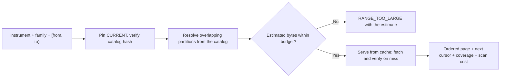

# Archive Query Contract v1

[Handbook](../../../README.md) · [Archive contract](../../archive/v1/README.md) · [Canonical records](../../market-observation/v1/README.md)

The shape of every historical read crossing the boundary between the Node data
service and the isolated Python reader workers. `archive-query-v1.schema.json`
is the authority for every bound in this document.

Those two sides cannot share a module — one is Node, one is Python — so, exactly
as with [ws-frame-contract-v1](../../ws-frame-contract/v1/ws-frame-contract-v1.md)
across the runtime/web workspace boundary, an enforced invariant stands in for
the shared code that is not available. A reconciliation test reads the bounds
back out of the schema and fails if either implementation has drifted.

This describes a contract, not a deployed service. It governs **historical**
reads only; live distribution is W6.11 and the two meet at W6.10.

## What the caller gets, and what it never needs to know

A caller asks for one instrument, one family and a half-open time window, and
receives an ordered page plus a cursor. It never learns that S3 exists, never
sees a file layout, never lists a bucket, and never receives rows from a
different provider silently substituted for the one it asked for.



## Pin the pointer, then never move

Step one is to read `_catalog/CURRENT.json` **once** and pin it for the whole
operation. Every subsequent page of that operation resolves against the same
pointer, and the response echoes it **with the `pointerToken` needed for the
next page**.

This is what makes a scroll or a replay session deterministic: a publish landing
between page three and page four cannot change what the session sees.

**A caller never supplies a pointer.** It supplies an opaque, server-issued
`pointerToken`, or nothing at all — omitting it means "resolve `CURRENT` now,
pin it, and return a token for it". A pointer carries `catalog_key`, which is a
path, and `catalog_sha256`, which a client could pair with any snapshot it
liked; honouring a raw client pointer would let a caller select the catalog the
server reads. Tokens resolve only to snapshots the server has already verified
and approved. `coverage_report.read_catalog()` reads the server's own local
pointer and is **not** an API for arbitrary client input — do not repurpose it
as one. The response echoes the fully resolved pointer, so the caller can still
see exactly what it was served from.

The initial `SnapshotRegistry` is deliberately process-local and tokens do not
survive a service restart. The serving deployment must therefore use one query
worker, route a cursor chain to the worker that issued its token, or replace the
registry with shared server-side state before it runs multiple query workers. A
lost token returns `POINTER_TOKEN_INVALID`; it must never fall back to a newer
`CURRENT` snapshot.

Discovery follows the [archive contract](../../archive/v1/README.md) exactly:
verify `catalog_sha256`, query the SQLite snapshot for the overlapping
partitions, resolve each `s3_prefix`, read only manifest-listed parts. **Never
glob a directory.** Resolution costs 0.57 ms for one instrument-month against
the production catalog, so pruning before reading is always worth it and is not
an optimisation to defer.

Pruning needs no data read at all: the `partitions` table carries `event_ns_min`
and `event_ns_max` per partition alongside `s3_prefix`, `part_count` and
`manifest_sha256`. Window overlap and the byte estimate both come from metadata.

**Resolve the key exactly as the catalog records it.** The stored `s3_prefix`
already begins with `databento/`, and the curated prefix is itself
`curated/databento`, so published keys carry a doubled segment —
`curated/databento/databento/<instrument>/<family>/<version>/<date>/`. Verified
against the live bucket. Reconstructing what the path "should" be returns
nothing against a perfectly correct catalog.

## Windows are half-open

`[from, to)` everywhere — request, response, partition boundaries and page
boundaries. A closed window double-counts the record sitting exactly on the
boundary wherever two ranges meet, and both partition edges and page edges are
such places. `to <= from` is `INVALID_WINDOW`, not an empty result.

Times are epoch nanoseconds **as decimal strings, never JSON numbers.** A
nanosecond timestamp exceeds 2^53, so a JSON number would silently lose
precision — the same reason the canonical record contract keeps exact values as
strings.

## Pagination is keyset, never offset

The cursor encodes the **full canonical sort key**:

```
(event_ns, source_rank, stable_position, ordinal)
```

That is the same key the writer sorts partitions by, so "first" and "last" mean
the same thing here as everywhere else in the pipeline.

Offset pagination is wrong here for a specific reason: **two records can share a
timestamp.** Ordering by `event_ns` alone is not a total order, so an offset into
a tied group is not stable and pages can repeat or drop rows at the seam. The
full key is a total order, so a cursor names exactly one row.

A cursor is bound to **the whole query that issued it**, not merely to a catalog
version. It carries a `queryFingerprint`: the SHA-256 over `contractVersion`,
pointer identity, `instrumentId`, `family`, `[from, to)` and the sort-key
semantics, alongside the pointer's own SHA-256.

Pointer identity alone is not enough, and the gap is not theoretical: one
catalog covers every instrument and family, so a cursor issued for ES trades
would satisfy a pointer check while paginating NQ quotes. That returns wrong
rows rather than an error. A fingerprint mismatch is `CURSOR_POINTER_MISMATCH`;
an undecodable, expired or unauthenticated cursor is `CURSOR_MALFORMED`.
Cursors carry an HMAC over their version, expiration, request binding and key;
base64url is only the transport encoding. The key lives on the serving side and
is passed only to the isolated local worker, so callers cannot rewrite a cursor
to skip or repeat rows.

**The binding invariant:** concatenating every page of a query must equal an
independent sorted read of the same window — including tied timestamps and
including rows that sit on partition boundaries. This is the contract's primary
acceptance test, because it is where a plausible implementation most easily goes
wrong.

## Coverage is reported, never inferred

Every response carries what was actually served against what was asked for, and
names the gaps using the **closed eight-state vocabulary** established by W6.07:
`PUBLISHED`, `QUIET`, `MARKET_CLOSED`, `MISSING`, `QUARANTINED`, `FAILED`,
`CORRUPT`, `UNKNOWN`. That vocabulary is inherited, not redefined here.

The distinction that matters to a caller is between a **valid quiet interval**
and **absent data**. A closed market is not a gap; an unconverted day is. A
response that returned fewer rows because the market was shut must not look like
one that returned fewer rows because a partition is missing.

### A corrupt partition degrades the window, it does not fail it

A partition that fails verification is `CORRUPT` and is **excluded** from the
served rows — being catalogued is a record of publication, never a warrant of
integrity. The response is still a **success**: the surviving partitions are
served, and `coverage.states` names the corrupt one explicitly.

This is a deliberate choice between two defensible readings, and the earlier
draft supported both. Partial-with-explicit-coverage wins because the eight-state
vocabulary exists precisely so a caller can tell a gap from a quiet market — a
chart can draw what is sound and grey out what is not. Failing the whole window
atomically discards good data and leaves the caller with nothing to render and
no way to distinguish the cause.

`PARTITION_VERIFICATION_FAILED` is therefore narrowed: it is raised only when
verification failure makes the **response itself** unsound — the partition
manifest fails its own hash, or the partition the cursor must resume from is the
corrupt one. A caller that requires all-or-nothing inspects `coverage.states`
and decides; the engine does not make that choice on its behalf.

### Rows are flat archive rows

`rows` carries the Parquet row shape, **not** a nested `market-observation/1`
record. Measured on published L1 partitions: 41 columns for `trade`, 38 for
`quote`. The schema names every persisted common column and every
family-specific column; `response.family` selects the only permitted row shape.
It deliberately rejects undeclared fields. That makes a converter or reader
change visible at the boundary instead of allowing an unreviewed field or type
to leak into the terminal.

Every 64-bit integer and exact decimal travels as a **string**. This is measured,
not stylistic: `event_ns` and `stable_position` are `UBIGINT` and price and size
are `DECIMAL(38,12)` in the stored Parquet, all of which lose precision as JSON
numbers. Python reads those columns and Node serves them onward, so the two
sides must agree on representation or the boundary corrupts values silently.

The four trade-derived families (`trade_minute_1m`, `trade_level_1m`,
`trade_slice_2s`, `trade_prints_1m`, report 54) are requestable, with their own
window caps and their own measured bytes-per-row. They are the one exception to
the paragraph above: a derived row carries `event_ns` and its payload, and none
of the identity envelope, because it is a bucket rather than an observation. The
request already names the instrument and the catalog already vouches for the
lineage, so the envelope would be roughly three quarters of the bytes of a row
whose whole purpose is to be cheap to read over a slow link. The families that
existed before them keep every persisted column, and the schema binds each
family to exactly one row shape, so neither can be served in the other's place.
A caller older than the host asks for a family the host does not list and is
refused `UNSUPPORTED_FAMILY`, which is the same degradation as before.

## Refuse before you scan

Before opening the catalog, the server applies a per-family window cap. That is
a deterministic request-shape rule, not a byte estimate: quote and depth
requests may span at most one day, trades seven days, and candles 31 days. The
derived families follow their own density rather than their source's: minute and
print buckets span 31 days, price levels and two-second slices seven, because a
day of NQ price levels is 25,670 rows against 1,157 minute buckets.
Exceeding it is `WINDOW_TOO_LARGE`, carrying the requested and permitted
durations. It is deliberately distinct from `RANGE_TOO_LARGE`, whose required
byte fields would be dishonest before the catalog has been read.

The catalog has `record_count`, not a byte column. Discovery therefore computes
an intentionally high estimate from `record_count ×` a measured per-family
bytes-per-row profile, before any data part is fetched. If it exceeds the
effective limit the request is refused with `RANGE_TOO_LARGE` carrying **both**
`estimatedScanBytes` and `effectiveMaxScanBytes`, so a caller can narrow the
window or request an explicit asynchronous job rather than guess at the bound
it hit.

The estimate is an early admission screen, not a substitute for exact object
metadata. The cache tier must fetch and hash the small manifest first, sum its
declared `parts[].bytes`, and apply the same limit before downloading any
Parquet part. That second check is the hard bound when a new data distribution
is larger than the calibrated profile.

The serving cache has two independent host-side bounds: a provisional **256
GiB** cache cap and **200 GiB** minimum free-space reserve. They are constructor
parameters of the serving process, never client request fields. The cache also
records in-flight byte reservations, so simultaneous cold requests cannot each
pass a capacity check and collectively overrun the volume. D09 still owns the
final retention policy and deployment configuration; these defaults are a safe
interim admission limit, not a claim that the wire schema configures a host.

**The bound is enforced server-side and omission never means unlimited.**
`maxScanBytes` is optional in the request, and an absent value resolves to the
server default — **256 MiB for a synchronous interactive read**. A caller may
lower the bound; it may not raise it, and the schema caps the field at the same
256 MiB so an oversized request is rejected before it is interpreted. An
optional field whose absence meant "no limit" would have made the promise in
this section unenforceable, which is exactly what the first draft did.

An estimate that has not been calibrated for a published family is not an
admission decision. If that family has rows, the server returns
`ESTIMATE_UNVERIFIED` before a part is fetched. This is currently relevant to
future `depth` data: no depth partition has been published yet, so a placeholder
rate must never become an accidental permission to read an unbounded book.

Cancellation must release the worker and its in-flight fetches, not merely
discard the result. Fast scrolling abandons queries continuously; a cancelled
query that still holds a worker is a leak that only appears under real use.

## Cold and warm are different numbers

The response reports `cacheHits`, `cacheMisses`, `bytesRead` and, separately,
`fetchMs` and `queryMs`. Measured on the production catalog for one month of one
instrument's candles:

| Path | Measured |
|---|---|
| Warm — parts already cached locally | **10.7 ms** |
| Cold — parallel fetch (8) then read | **640 ms** |
| DuckDB `httpfs` reading S3 directly | **629 ms, every time** |

`httpfs` ties cold and gains nothing on repeat, so it is **not** the serving
path. That conclusion stands; the numbers behind the table do not generalise and
are corrected below.

### What concurrency is actually worth, re-measured on L1

The 4.0× previously recorded here was measured over a month of **candles** —
many small ~1.18 MB objects, where per-request latency dominates and
concurrency hides it. L1 partitions are a different shape, and the gain is
much smaller:

| Partition | Parts | 1 worker | 8 workers | Speedup |
|---|---:|---:|---:|---:|
| quote, 424.9 MB | 52 (8.17 MB avg) | 7,252 ms | 4,400 ms | **1.65×** |
| trade, 2.6 MB | 1 | 81 ms | 68 ms | not parallelism — one part cannot be split |
| candle, 2.6 MB | 1 | 217 ms | 77 ms | not parallelism — first-touch variance |

Throughput rises 58.6 to 96.6 MB/s at concurrency 8, so larger parts are closer
to **bandwidth-bound** than latency-bound and there is less latency left to
hide. Concurrency 8 is still worth having — 1.65× is real, and a window
spanning many partitions of small parts recovers more — but **the speedup is a
property of part size and count, not a constant**, and 16 workers measured
slower than 8 on the same partition.

**Consequence for the cold target.** At 96.6 MB/s a budget-filling 256 MiB cold
read is roughly 2.8 s of transfer plus about 0.3 s of admission hashing, near
3.1 s against the 5 s target. That is inside it, on roughly **1.6× headroom,
not the 8× implied by the 640 ms single-candle-month figure**. Cold latency is
the tightest D14 target, and any change that adds per-part work spends from a
small margin.

**Fetch and verify in one pass; never verify as a pre-check.** The cache tier
must stream each part once, hashing while it writes, and admit the bytes only
after size and SHA-256 both match — writing to a temporary name and renaming
into the cache on success, so a partial or failed fetch can never be served.

Do **not** reuse `s3_publish.verify_remote_partition()` for this. It is correct
for what it does, but `Store.verify_stored()` only avoids a download when S3
returns a `ChecksumSHA256`; without one it falls through to `Store.verify()`,
which issues a full `get_object` and streams the entire body purely to hash it,
discarding the bytes. As a pre-check in front of the cache that downloads every
part **twice** — doubling both cold latency and egress, invisibly, because both
fetches succeed.

A single aggregate latency figure would hide the only distinction that matters,
which is why the two are separate fields and separate targets.

## Performance targets (D14)

**An acceptance floor, not a product SLA.** Each target states the conditions it
holds under, because a latency number without a stated cache state, page size
and scan bound is not a measurement of anything.

| Measure | Target | Conditions | Measured | Headroom |
|---|---:|---|---:|---:|
| Hot catalog metadata resolution, p95 | **< 10 ms** | Previously verified local snapshot; partition selection only | 0.57 ms | ~17× |
| Warm paged read, p95 | **< 100 ms** | Cache hit, `limit <= 1000`, scan estimate <= 256 MiB | 10.7 ms | ~9× |
| Cold first-touch, p95 | **< 5 s** | Empty cache, verified S3 fetch at concurrency 8, same bounded request | 0.64 s | ~8× |
| Eight concurrent warm reads, p95 | **< 500 ms** | Same page and scan bounds, isolated workers | 101.5 ms | ~5× |
| Correctness | **100%** | No integrity failure, no duplicated or dropped row, concatenated pages equal an independent sorted read | — | — |

The latency numbers are deliberately loose so that meeting them evidences **no
regression** rather than evidence of tuning to the test. They still catch the
four failures that would actually matter: a topology change, a broken cache, a
pagination defect, or loss of process isolation. Whole-system qualification
tightens them later against combined load.

The correctness row is not loose and never will be.

## Readers are separate processes

Not a style preference — a measured requirement. W6.03 recorded eight
**in-process** readers at p95 5.58 s and a maximum of 10.38 s, against p95
101.5 ms for the same load across separate processes. The shared-process
topology is rejected on that evidence.

Workers are spawned and addressed with the same IPC pattern the converter
already uses between Node and Python, inverted: there, Node serves the contract
to Python; here, Python serves reads to Node.

## Errors

| Code | Meaning |
|---|---|
| `INVALID_WINDOW` | `to <= from`, or a malformed nanosecond string |
| `UNKNOWN_INSTRUMENT` | No catalogued partitions for that instrument at all |
| `UNSUPPORTED_FAMILY` | Family outside the closed set |
| `RANGE_TOO_LARGE` | Estimated scan exceeds the effective limit; carries both `estimatedScanBytes` and `effectiveMaxScanBytes` |
| `READER_UNAVAILABLE` | The isolated reader failed, timed out or produced an invalid frame; no partial page is returned |
| `WINDOW_TOO_LARGE` | Request exceeds the deterministic cap for its family; carries `family`, `requestedWindowNs`, and `maxWindowNs` |
| `ESTIMATE_UNVERIFIED` | The family has rows but no calibrated bytes-per-row admission rate; no part was fetched |
| `CURSOR_POINTER_MISMATCH` | Cursor's `queryFingerprint` or pointer hash does not match this query |
| `CURSOR_MALFORMED` | Cursor is not decodable or fails its schema |
| `CATALOG_INTEGRITY_FAILURE` | `catalog_sha256` did not match, a `pointerToken` did not resolve to an approved snapshot, or catalog metadata cannot identify a safe, non-overlapping authoritative partition set |
| `POINTER_TOKEN_INVALID` | `pointerToken` is malformed, unknown, expired, or was discarded. The server never falls back to a newer `CURRENT` snapshot. |
| `CACHE_CAPACITY_EXCEEDED` | Exact manifest bytes cannot fit under the cache cap, free-space reserve, durable in-flight reservations, or the set of parts pinned by active readers. No Parquet part is fetched after this refusal. |
| `PARTITION_VERIFICATION_FAILED` | Verification failure that makes the response itself unsound — a partition manifest failing its own hash, or the cursor's resume partition being the corrupt one. A corrupt partition inside the window is **not** this error: it is excluded and reported in `coverage.states` |
| `CANCELLED` | Caller cancelled; resources released |
| `MALFORMED_REQUEST` | The HTTP body was not one complete, finite JSON request for this contract. It is refused before the query engine is reached. |
| `UNAUTHORIZED` | The caller did not present the service secret, or presented one that did not match, or presented no client identity alongside it. Refused before the body is read. |

The loopback service authenticates its **caller**, not a user. A gateway proves
itself with the shared service secret and passes the identity it has already
resolved in `x-archive-client`; that header is honoured only once the secret
verifies, because otherwise anything able to open the port could spend another
client's concurrency cap and rate budget. End-user credentials are never sent to
this service. A label ending `.study` selects the larger budget the gateway's own
study reads need (360 a minute against 72); it is a class of work, not an
identity, and every client still reads one page at a time. For the same reason a
`pointerToken` belongs to the identity without the suffix: `<client>.study`
resolves a token issued to `<client>` and the other way round, and no other
client resolves either.

The loopback HTTP service enforces the schema-declared `httpLimits` before it
parses a request body. It emits every declared error as the root error envelope;
`httpStatusByError` declares the corresponding HTTP status and is reconciled
against the service implementation.

An empty result inside a covered window is **not** an error — it is a successful
response whose `coverage.states` explains why. It is not automatically `QUIET`:
this component has no venue-session authority, so time before, after or between
catalogued event ranges is reported as `UNKNOWN`.

## Files

| Path | Role |
|---|---|
| `archive-query-v1.schema.json` | Authority for every bound |
| `archive-query-v1.md` | This document |

## Versioning

`contractVersion` is `archive-query/1` on every request and response. An
additive field can stay within v1 only after it is declared in the schema and
covered by the contract test suite; rows are not an open map. Any
change to a bound, an error code's meaning, the cursor encoding or the sort key
is a new version — a cursor's meaning must never silently change under a paging
caller.
