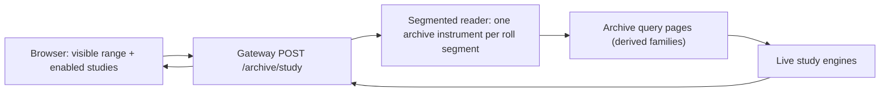

# Archive Study Contract v1

[Handbook](../../../README.md) · [Archive query](../../archive-query/v1/archive-query-v1.md) · [WebSocket frames](../../ws-frame-contract/v1/ws-frame-contract-v1.md)

The request and response of `POST /archive/study`, the gateway route that computes
Historical Mode's heavy order-flow studies — volume/delta profile, VPIN and large
prints — from the archive's derived trade families over any archived range.

The route is a client of [archive query v1](../../archive-query/v1/archive-query-v1.md):
it pages `trade_minute_1m`, `trade_level_1m`, `trade_slice_2s` and `trade_prints_1m`
through the loopback archive service and feeds the rows to the **same** engines the
live terminal uses (`volume-profile-engine`, `vpin-warmup-worker.computeVpin`,
`large-trade-detection`). It never reads raw trades, never touches the live capture
database and never computes a study in the browser.

## Flow

The browser asks only for what is on screen, in fixed chunks, and keeps what it
already has while the user pans: whole profile periods, whole UTC weeks for VPIN,
and 500-bar chunks for prints. There is no range cap beyond the per-request bounds
below; a long range is simply more requests.

## Pace

The route reads the archive under its own client name (`<client>.study`), so a
study never spends the budget the chart's own candle paging uses. That holds for a
study pinned to the chart's `pointerToken` too: the archive resolves a viewer's
token for its `.study` name. Against an archive that still ties a token to the
exact client name, the route retries a `POINTER_TOKEN_INVALID` / `CLIENT_MISMATCH`
once under the viewer's own name and keeps it for the rest of that study; a client
name too long to carry the suffix whole reads a pin under its own name. When the archive
answers `OVERLOADED` with `retryAfterMs` (its per-client rate budget or its queue),
the route waits that long and asks for the same page again. If the wait would pass
the study's deadline it stops at once with `STUDY_TIMEOUT` /
`ARCHIVE_PACE_EXCEEDS_DEADLINE`. No other refusal is retried.

The archive allows 360 reads a minute to a `.study` client and 72 to an
interactive one, and a page is at most 10,000 rows. A study pages whole families
sequentially beside the data while a chart pages what one screen shows; both are
still held to one reader at a time per client, which is what protects the
collector.
The browser therefore keeps each request to work that fits the deadline even at
that pace: at most 16 profile periods and 16 days of profile per request, two VPIN
weeks per request, and print chunks of at most 500 bars or one week, whichever is
shorter.

VPIN reads its two-second slices a week at a time, aligned to the week grid, so
consecutive weeks in one request share the lead-in week they overlap and the
reader fetches it once. The chunk size is a read-shape choice only: the readings
are identical at any chunk size, which a test pins against the live six-hour
chunk that exists to protect the laptop link.

## Request

| field | meaning |
|---|---|
| `contractVersion` | `"archive-study/1"` |
| `requestId` | positive safe integer; echoed back and stamped on every profile (`history_request_id`) |
| `study` | `volume_profile`, `vpin`, `large_prints` or `bar_flow` |
| `symbol` | display symbol, 1–32 characters (e.g. `ES`, `AAPL`) |
| `assetClass` | `FUTURE`, `EQUITY`, `SPOT` or `PERPETUAL`; Binance requests must match the declared archive instrument and reviewed tick size |
| `tickSize` | the instrument's positive tick size |
| `segments` | 1–64 `{instrumentId, fromTs, toTs}`; contiguous (`segments[i].fromTs === segments[i-1].toTs`), minute-aligned, one archive instrument each — a continuous future sends its roll calendar |
| `ranges` | 1–64 `{fromTs, toTs}` in epoch milliseconds, minute-aligned, ordered, non-overlapping, inside the segments |
| `options` | optional; `mode` and `binSizeMultiplier` for profiles, `bucketMs` for prints. Legacy `ticksPerRow` is accepted only when `binSizeMultiplier` is absent. |
| `pointerToken` | optional archive query snapshot token (1–512 URL-safe characters). The gateway sends it with every family page and refuses a changed token; the browser supplies the chart page's token. Without one, the gateway pins the first returned page for the rest of the study. |

Unknown top-level, segment or option fields are refused. The body is at most 64 KiB.

### Per-study rules

| study | ranges | options |
|---|---|---|
| `volume_profile` | one profile per range | `mode` ∈ `continuous`, `per_candle`, `fixed_range`; `binSizeMultiplier` is 0.1–10 (default 1). For an older client, `ticksPerRow` may be a positive integer for an exact tick-width row or `null` for automatic sizing; it must not accompany `binSizeMultiplier`. Legacy requests remain capped at 300 buckets for the older browser parser. |
| `vpin` | exactly one range of whole UTC weeks (Monday 00:00 to Monday 00:00), at most 26 weeks | none |
| `large_prints` | exactly one range aligned to `bucketMs`, at most 5,000 bars | `bucketMs` a whole number of minutes |
| `bar_flow` | exactly one range aligned to `bucketMs`, at most 5,000 bars | `bucketMs` a whole number of minutes |

## Response

A success is HTTP 200 with `contractVersion`, `study`, `requestId`, `missing` (the
ranges the archive could not serve, each `{fromTs, toTs}`; VPIN adds `reason`),
`complete` (`missing` is empty) and one payload:

| study | payload |
|---|---|
| `volume_profile` | `profiles`: profile frames without identity fields, `delivery_scope: "HISTORICAL"`, one per served range, plus `empty`: the requested ranges in which nothing traded |
| `vpin` | `readings`: VPIN readings in `seal_ts` order, as the `vpin_readings` frame carries them |
| `large_prints` | `prints`: `{ts_exchange, price, size, side}`, at most four per side per bucket |
| `bar_flow` | `bars`: `{ts_open, volume, buy_volume, sell_volume, unknown_volume, trade_count}`, one per bar that traded, in time order |

Bodies of 1 KiB or more are gzip-encoded when the client accepts it.

**Empty is not missing.** A weekend, a holiday and an overnight hour on an equity
are ranges the archive covers in which nothing traded. They are returned in
`empty`, they do not make a study incomplete, and the browser stores them as
answered instead of asking again on every pan. `missing` stays what it says: a
range the archive could not read. The two are told apart by the price range read,
which reports availability separately from its trade count, and this rests on one
property of the published archive: the derived families exist on exactly the days
the `trade` family does, which the pointer publication verifies before it moves
the fence. A range with no derived partition is therefore a range with no trades.
The study gateway still inspects every archive page's explicit coverage states:
`MISSING`, `QUARANTINED`, `FAILED` or `CORRUPT` makes the study range missing even
when the archive returned HTTP 200 and some or no sound rows. `UNKNOWN` does not.
The query engine reports uncovered time that way on purpose, because telling a
closed market from an unconverted day needs a venue status reference it does not
read — and on the real host every window longer than a day carries some: a
three-week ES window reports `{PUBLISHED: 18, UNKNOWN: 3}` for its weekends. The
study resolves that ambiguity with the property the pointer publication verifies,
that the derived families exist on exactly the days the `trade` family does, so
uncovered time is time in which nothing traded. `PUBLISHED`, `QUIET`,
`MARKET_CLOSED` and `UNKNOWN` may therefore contribute to an empty answer.
Every requested profile range appears exactly once across `profiles`, `empty`,
and `missing`; overlap or omission is a contract violation.

### Meaning the live terminal would recognise

- **Profiles** use the live bucketing (`deriveBucketingParams` over the range's price
  span, then `rescaleSessionToFit`), so the same range gives the same rows live and
  historically. One known exception is untested: an equity print between ticks is
  stored on its tick, so with automatic row width its range's span, and therefore
  the row width, can differ slightly from live.
- **VPIN** is computed one UTC week at a time. Each week's engine calibrates on the 21
  days before the week starts and warms up over a 7-day lead-in, so a week's readings
  do not depend on what else was requested or on the time of the request. A week is
  not offered until all 21 calibration days are inside archive coverage; the host
  also refuses any internal read that would be clipped at a coverage boundary.
- **Large prints** keep the largest four prints per side per minute (size for futures,
  price × size for equities), then re-rank per bar. Ties go to the later print.
- **Bar flow** sums `trade_minute_1m` into the requested bars, so a bar's split is the
  live reader's own minutes added up. **Volume with no side stays out of both sides**:
  it is counted in `volume`, reported as `unknown_volume`, and never folded into
  selling. Roughly 30% of equity volume arrives unsided, so a consumer that derives
  the sell side as `volume − buy_volume` — as every candle-flow study did before this
  study existed — reads that share as selling. Bars in which nothing traded are
  absent, which is not the same as a range the archive could not read: that is
  `missing`, as everywhere else.

## Refusals

Every refusal is `{contractVersion, error, reason?}`; `OVERLOADED` adds `retryAfterMs`.

| error | status | when |
|---|---|---|
| `MALFORMED_REQUEST` | 400 | not JSON, wrong version, unknown or missing fields, malformed segments or ranges, body too large or too slow |
| `INVALID_STUDY` | 400 | a well-formed request the studies cannot answer: unknown study or mode, ranges outside the segments, non-contiguous segments, VPIN not whole weeks, prints not bar-aligned, too many weeks or bars |
| `UNAUTHORIZED` | 401 | no valid archive bearer token |
| `OVERLOADED` | 429 | the client's rate budget (36 per minute) is spent, it already has a study running, or the route is at capacity (2) |
| `CANCELLED` | 499 | the client disconnected |
| `UPSTREAM_REFUSED` | 502 | the archive service refused a page or returned a different snapshot token (its code is the `reason`) |
| `READER_UNAVAILABLE` | 503 | the archive service is unreachable or not configured, or a study failed unexpectedly |
| `STUDY_TIMEOUT` | 504 | the study passed its 180 s deadline, one page passed 60 s, or the archive's pace would pass the deadline |

The browser retries `OVERLOADED` after `retryAfterMs`, reports every other refusal on
the Historical Mode status line, and asks again the next time the range changes. A
laptop newer than the host sees `UPSTREAM_REFUSED` with `UNSUPPORTED_FAMILY` until the
host serves the derived families.

## What this does not cover

- **Large Trade Bubbles** stay unavailable historically: they need every trade in a
  bar, and the archive keeps only the largest prints of each minute.
- **Calendar timeframes** (1W, 1M) draw continuous profiles and VPIN; per-candle
  profiles and prints need a fixed timeframe of 1D or shorter. Bar flow is the
  exception: the browser asks for daily `bar_flow` and adds the days up into each
  week or month itself, so the route still only sees whole-minute `bucketMs`. A
  week or month is drawn once every day of it inside archive coverage has loaded,
  never with part of its flow.
- The route does not stitch the archive to the live capture; a range past the
  archive's coverage is reported in `missing`, not filled from elsewhere.
