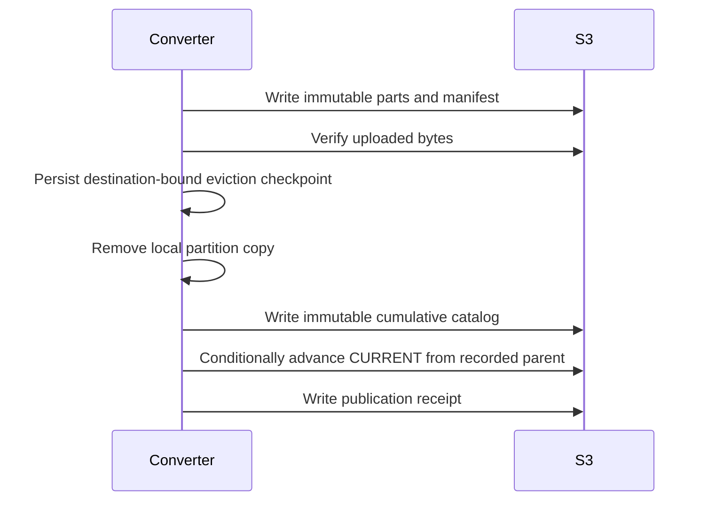

# S3 archive contract v1

[Handbook](../../../README.md) · [Canonical records](../../market-observation/v1/README.md) · [Conversion](../../../architecture/historical-conversion.md)

This documents the implemented Databento publisher and existing raw archive conventions. It does not introduce a new wire-format version or promise a deployed query API. Examples use `<bucket>` and `<namespace>`; obtain credentials and the actual bucket from the operator. The installed worker currently uses namespace `curated/databento`. A qualification namespace is separate, such as `curated/_qualification/<run>`.

## Object layout

```text
s3://<bucket>/
  raw/databento/dataset=<dataset>/schema=<schema>/symbol=<symbol>/
    year=YYYY/month=MM/[day=DD/]<provider-filename>
  raw/tardis/exchange=<exchange>/data_type=<type>/symbol=<symbol>/
    year=YYYY/month=MM/day=DD/<provider-filename>.csv.gz
  <namespace>/
    databento/<instrument-slug>/<family>/<dataset-version>/YYYY-MM-DD/
      part-00000.parquet
      _manifest.json
    _catalog/
      catalog-<dataset-version>.sqlite
      CURRENT.json
      intents/<pointer-hash>.json
      receipts/<pointer-hash>.json
```

The `databento/` below the namespace is part of the publisher's relative partition key. With the default namespace, the full key begins `curated/databento/databento/`; do not remove a component when resolving catalog paths.

Raw files retain provider encoding: Databento DBN/Zstandard or CSV, Tardis gzip CSV. Monthly paths identify storage grouping, not verified full-month coverage. Use decoded metadata, records and an inventory to establish actual bounds. Preserve raw bytes and hashes; acquisition credentials and conversion credentials have different responsibilities.

Instrument slugs are generated by [writer.py](../../../../apps/runtime/conversion/writer.py): a readable normalization plus a hash suffix. They are not authoritative instrument IDs. Futures partitions identify concrete contracts, not continuous aliases. The catalog stores the canonical instrument ID. Dates are UTC event dates, not exchange-session labels.

## Manifest and partition

A partition groups one instrument, canonical family, dataset version and date. Its manifest records identity/version fields, source objects, record and rejected counts, event-time bounds, logical hash, and the exact output parts. Each part entry contains its name, byte size, SHA-256 and row count. Validation flags include `round_trip_ok`, `id_unique`, `sorted` and `count_reconciled`.

Read only manifest-listed parts. Verify the manifest against the catalog's `manifest_sha256`, then verify part sizes/hashes. Do not glob a directory or interpret extra files as published records. Exact physical fields and manifest generation are implemented in [writer.py](../../../../apps/runtime/conversion/writer.py); canonical meaning is defined by the market-observation contract. Writer validation flags do not mean complete provider coverage or promote all record quality to VALIDATED.

## Catalog and reader discovery

1. Read `<namespace>/_catalog/CURRENT.json` once and pin that pointer for the operation.
2. Fetch `<namespace>/_catalog/<catalog_key>` and verify `catalog_sha256`.
3. Query the SQLite snapshot for the required instrument/family/date partitions.
4. Resolve every `s3_prefix` relative to `<namespace>`, then load its verified manifest and parts.

The pointer includes `dataset_version`, `catalog_key`, `catalog_sha256`, `publisher_fence`, `converter_version`, `contract_version`, `roll_table_key` and `published_at`. The current implementation may leave `roll_table_key` null; roll intervals are in the SQLite snapshot. Pointer hashes for intent/receipt names use the publisher's canonical JSON encoding, not arbitrary pretty-printed JSON.

| Table | Meaning |
|---|---|
| `dataset_versions` | Version, converter/contract versions and publication status |
| `partitions` | Instrument/family/version/date key, relative prefix, counts, time bounds and hashes |
| `roll_intervals` | Effective contract mapping and reference economics by roll-table version |
| `continuity` | Recorded depth epochs, states, resets and suspected gaps |

Coverage and capability state is **derived, not stored**: the snapshot records
what was published, and gap classification is computed at read time from these
tables plus the `status`/`statistics` reference mirrors. Do not expect a gap or
capability column here. `coverage_report.py` implements that derivation.

Two rules bind that derivation. A partition that fails remote verification is
demoted to `CORRUPT` and is then excluded from the capability counts and from
freshness — being listed in `partitions` is a record of publication, never a
warrant of integrity, so a catalogued row is not by itself coverage.
`book_reconstructable` is never asserted from the existence of depth partitions;
it requires this `continuity` table's own verdict for that instrument, and
reports `UNKNOWN` when there is no continuity row to read.

The exact DDL is [catalog.py](../../../../apps/runtime/conversion/catalog.py). This SQLite publication index is implemented; a network coverage-catalog service is not implied. `published_to_s3` records publication state, not a quality rating. A cumulative snapshot can reference older dataset versions; do not filter all reads to the pointer's newest version.

## Publication, replacement and recovery



Immutable writes use an absent-object condition; an existing object must match. CURRENT advances conditionally against the parent used to build the snapshot. A changed parent fails publication; fetching a newer ETag is not a valid rebase. Objects can exist before CURRENT references them, so object existence alone is not publication.

A new catalog retains prior non-replaced partitions. A new instrument/family/date partition replaces that date's previous catalog entry; this is full-date replacement, not additive merging. Old objects are not garbage-collected by the publisher. Partial replacements require a separately designed reconciliation policy.

Local checkpoints, inventories and completion markers are operational state, not reader contracts. They bind resumed work to inputs and destination. Readers use CURRENT and immutable snapshots. Single uploaded objects are limited to 5,000,000,000 bytes by this publisher; it does not silently fall back to unconditional multipart publication.

## Coverage and ownership

The staged worker converts Databento `ohlcv-1s`, `mbp-1` and `mbp-10`. Existing raw `definition`, `status` or `statistics` objects do not mean corresponding standalone canonical families were published. Tardis raw acquisition exists; its canonical onboarding is not established by this contract.

Never infer “no trading,” complete depth, or zero volume from absent files. An archive is not a backup of the live SQLite database. IAM, retention, recovery and external alerts require their own operational configuration. No reader should need provider API secrets or write access to raw data.
