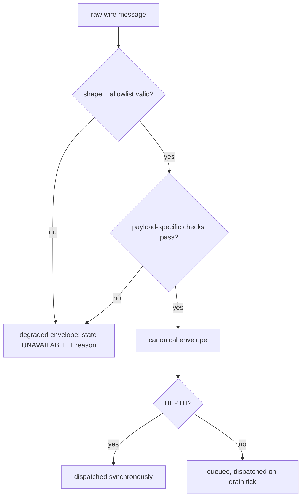

# Binance Canonical Event Contract v1

The canonical envelope shape every raw Binance wire message is
normalized into. `stale`/`recoveryState` carry real, feed-health-computed
values — see
`docs/contracts/binance-feed-health/v1/binance-feed-health-v1.md` for
exactly how they're computed.

## Flow

Machine-readable schema: `binance-canonical-event-v1.schema.json` (same directory).

## Files

- `apps/runtime/src/providers/binance/binance-event-normalizer.js` — implements this contract

## Envelope wrapper

Identical across all 4 event types:

| Field | Type | Notes |
|---|---|---|
| `provider` | `"BINANCE"` | |
| `venue` | `"BINANCE"` | |
| `marketKind` | `"SPOT" \| "PERPETUAL"` | |
| `providerSymbol` | string | e.g. `"BTCUSDT"` |
| `eventType` | `"TRADE" \| "BOOK_TICKER" \| "KLINE" \| "DEPTH"` | |
| `eventTime` | ISO 8601 string | Binance's own event/trade time. For `BOOK_TICKER`, `T` then `E` if usable; if neither field exists (spot book ticker), this falls back to `receivedAt`. A present-but-unusable `T`/`E` degrades rather than silently falling back. |
| `receivedAt` | ISO 8601 string | When this process received the message. |
| `timingClass` | `"REALTIME"` | Only value that exists today — Binance public data carries no delayed/entitlement distinction. |
| `stale` | boolean | Elapsed time since the last real event on this tuple, against a per-event-type threshold. Computed at actual **delivery** time, not message-arrival time — see the delivery-timing note below. |
| `recoveryState` | `"READY" \| "RECOVERING" \| "UNAVAILABLE"` | Same delivery-time computation as `stale`. |
| `payload` | object | Shape varies by `eventType`, see below. |

## Payload shapes

**TRADE**: `tradeId` (non-negative integer), `price` (decimal string),
`quantity` (decimal string), `isBuyerMaker` (boolean).

**BOOK_TICKER**: `updateId` (non-negative integer), `bestBidPrice`,
`bestBidQuantity`, `bestAskPrice`, `bestAskQuantity` (all decimal
strings).

**KLINE**: `interval` (string, Binance's own `k.i`, proven equal to the subscribed interval — never copied from the subscription alone),
`openTime`, `closeTime` (epoch ms), `open`, `close`, `high`, `low`,
`baseVolume`, `quoteVolume`, `takerBuyBaseVolume`, `takerBuyQuoteVolume`
(all decimal strings), `numberOfTrades` (non-negative integer),
`isClosed` (boolean).

**DEPTH**: `firstUpdateId`, `lastUpdateId` (non-negative integers),
`previousUpdateId` (non-negative integer for `PERPETUAL`, explicit
`null` for `SPOT` — never "missing" on spot, since spot's wire format
never carries a `pu` chain field at all), `bids`, `asks` (arrays of
`[price, quantity]` decimal-string tuples, bounded at 5000 entries,
zero-quantity entries preserved as valid price-level deletions).
Depth prices must be strictly positive; quantities are non-negative so
zero remains the deletion instruction.

Decimal values are always strings, never `Number` — Binance's own
price/quantity precision can exceed `Number`'s safe range.

Every decimal token is limited to 1,024 characters and uses unsigned base-10
notation without exponent syntax. Trade price and quantity, book prices, and
kline OHLC are strictly positive. Book quantities and every kline volume may
be zero. Kline `openTime` is aligned to its subscribed interval's UTC epoch
grid and `closeTime - openTime + 1` equals that interval exactly. These are
value constraints inside v1, not new fields.

**Delivery-timing note:** `DEPTH` is dispatched synchronously, so
"arrival" and "delivery" are the same instant. Every other event type
is queued (see `docs/architecture/binance/P1.05-binance-backpressure-evidence.md`) and delivered on a
later, batched drain tick — `stale`/`recoveryState` are computed fresh
at that delivery instant, not baked in when the message first arrived.
A `TRADE` that looked fresh the moment it was received can still
report `stale: true` on delivery if enough real time passed while it
sat queued. `eventTime`/`receivedAt` are unaffected — those still
reflect the message's real arrival time, only `stale`/`recoveryState`
are delivery-time values.

## Degraded envelope

Returned instead of a normal envelope whenever normalization fails.
Never a partial object — always this exact field set, whether the
failure happened before or after payload-specific validation:

| Field | Type |
|---|---|
| `provider` | `"BINANCE"` |
| `venue` | `"BINANCE"` |
| `marketKind` | `"SPOT" \| "PERPETUAL"` |
| `providerSymbol` | string |
| `eventType` | string |
| `receivedAt` | ISO 8601 string |
| `timingClass` | `"REALTIME"` |
| `stale` | boolean |
| `recoveryState` | string |
| `state` | `"UNAVAILABLE"` |
| `reason` | one of the reason codes below (`STREAM_SYMBOL_MISMATCH` fires from two independent trigger sites — top-level and, for KLINE, nested `k.s` — sharing one reason value) |
| `missingFields` | array of field names, empty unless `reason` is `MISSING_OR_INVALID_REQUIRED_FIELD` |

`eventTime` and `payload` are deliberately absent — genuinely unknown
when normalization failed before either could be established.

## Reason codes

| Reason | Trigger |
|---|---|
| `MALFORMED_RAW_MESSAGE` | Raw payload isn't a plain, hostile-input-safe object matching the expected shape for its event type — includes non-plain objects, Proxies, unexpected/extra keys, accessor-defined or non-enumerable fields, and (DEPTH) any bid/ask entry that isn't an exact 2-tuple with a positive decimal price and non-negative decimal quantity. |
| `STREAM_SYMBOL_MISMATCH` | Raw `s` field disagrees with (or is absent from) the subscribed symbol. Checked independently at the top level and, for KLINE, again on the nested `k.s`. |
| `PROVIDER_EVENT_TYPE_MISMATCH` | Raw `e` field, when present, disagrees with the wire name expected for the subscribed event type. Skipped when `e` is legitimately absent (spot book ticker never sends it). |
| `INTERVAL_MISMATCH` | KLINE only: Binance's own `k.i` disagrees with the subscribed interval. |
| `MISSING_OR_INVALID_REQUIRED_FIELD` | Any required payload field, or `eventTime` itself, can't be resolved to a valid value. `missingFields` names each one, including `"eventTime"` when that's the cause. |
| `EVENT_TIME_TOO_FAR_IN_FUTURE` | The resolved `eventTime` sits more than 120 seconds ahead of `receivedAt` (`live-event-time-policy.js`, shared with dxFeed). Checked separately for KLINE's `openTime`. |
| `EVENT_TIME_INVALID` | The resolved event time or receipt time isn't a safe positive epoch millisecond value. |
| `UPDATE_ID_RANGE_INVALID` | DEPTH only: `lastUpdateId < firstUpdateId`. |
| `KLINE_TIME_RANGE_INVALID` | KLINE only: open time is off the subscribed interval grid or the inclusive `openTime`/`closeTime` duration is not exactly one interval. |
| `KLINE_OHLC_RANGE_INVALID` | KLINE only: the bar's own OHLC bounds are inconsistent by decimal-string numeric identity — `high < low`, `high` below `open` or `close`, or `low` above `open` or `close`. Equal values (including trailing-zero spelling differences) are valid, so a flat bar passes. |
| `KLINE_VOLUME_RANGE_INVALID` | KLINE only: `takerBuyBaseVolume > baseVolume` or `takerBuyQuoteVolume > quoteVolume` by decimal-string numeric identity. Taker-buy volume is a subset of the bar total, so it can equal but never exceed it. |

## Versioning

`v1` covers everything above. A future version bumps when the wrapper
or a payload shape changes — not when `stale`/`recoveryState` values
change, since that's a value change within the existing field, not a
shape change.
