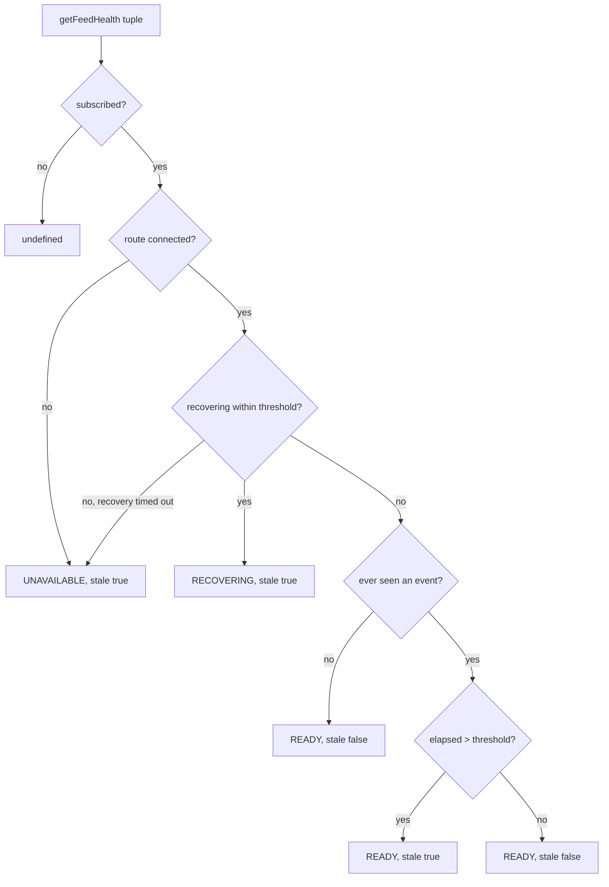

# Binance Feed Health Contract v1

The shape returned by `createBinanceConnection(...).getFeedHealth(marketKind,
symbol, eventType, interval)`, backed by one `binance-feed-health.js`
monitor instance per connection. Tracks two independent things per
`(marketKind, symbol, eventType, interval)` tuple — how long since the
last real event, and whether a recovery is explicitly in progress — plus
one coarser thing per `(marketKind, routeName)`: whether that route's
WebSocket is currently connected at all.

## Flow

Machine-readable schema: `binance-feed-health-v1.schema.json` (same directory).

## Files

- `apps/runtime/src/providers/binance/binance-feed-health.js` — implements this contract

## Query shape

`getFeedHealth(...)` returns `undefined` for a tuple not currently
subscribed to — checked against the live subscription registry, not
inferred from elapsed time or any masked/stale value. For an active
tuple, it returns a frozen `{ stale: boolean, recoveryState: "READY" |
"RECOVERING" | "UNAVAILABLE" }`.

## `recoveryState` priority order

Evaluated in this exact order — each check short-circuits the ones
below it:

1. The tuple's route is not connected → `UNAVAILABLE`, `stale: true`
   (unconditional, regardless of how recently an event arrived).
2. A recovery is explicitly in progress for this exact tuple →
   `RECOVERING`, `stale: true` while it remains within that tuple's
   staleness threshold. Once the threshold is exceeded, it is
   `UNAVAILABLE`, `stale: true`; a successful control command with no
   subsequent valid data cannot report `RECOVERING` indefinitely.
3. No event has ever been recorded for this tuple → `READY`, `stale:
   false` — there is no elapsed silence to measure yet, so nothing
   anomalous has been detected.
4. Otherwise → `READY`, with `stale` computed from real elapsed time
   against the per-event-type threshold below (strict `>`, so a value
   exactly at the threshold is not yet stale).

`UNAVAILABLE` and `RECOVERING` always force `stale: true` — there is no
state where `recoveryState` is not `READY` and `stale` is independently
`false`.

## Staleness thresholds (per event type)

| Event type | Threshold |
|---|---|
| `TRADE` | 30s |
| `BOOK_TICKER` | 5s |
| `DEPTH` | 5s |
| `KLINE` | subscribed interval × 1.5 (e.g. `1m` → 90s, `1h` → 90min, `1d` → 36h) |

An unrecognized event type or `KLINE` interval falls back to `TRADE`'s
30s. Thresholds are reasonable defaults, not yet tuned against real
observed traffic.

## Recovery lifecycle

`beginRecovery`/`endRecovery` are keyed at the same 4-tuple granularity
as staleness tracking. A fresh `subscribe()` calls `beginRecovery`
unconditionally for **every** event type — there is no confirmed live
data immediately after subscribing, so a tuple starts `RECOVERING` until
proven otherwise or its normal stale threshold expires. What proves it
differs by event type:

- **Non-`DEPTH`** (`TRADE`, `BOOK_TICKER`, `KLINE`): a single fresh event
  auto-clears recovery. One trade, one quote, one candle update is
  sufficient proof.
- **`DEPTH`**: recording a delta event does **not** auto-clear recovery.
  Only an explicit `endRecovery` call does — fired by the connection
  layer once the book assembler actually reaches `READY` (either via a
  live delta bridging the gap, or via a REST snapshot that bridges an
  already-buffered delta synchronously). One buffered delta isn't proof
  of book alignment; a confirmed `READY` book is.

Because the dispatched envelope is recomputed *after* that same
message's own `recordEvent` / assembler `endRecovery` call, the very
message that resolves a recovery reports the post-resolution state on
itself — for every event type, including `DEPTH` (whose recovery only
clears once the assembler actually reaches `READY`).

## The unsubscribe/reconnect boundary — no dedicated reset method

There is no `reset()`/`clear()` method on the monitor, and `unsubscribe()`
never calls into it. The boundary is covered by two mechanisms already
described above, not a third one:

- **Unsubscribe**: `getFeedHealth()`'s active-subscription check returns
  `undefined` for anything not currently subscribed — a caller never
  sees stale leftover data for a tuple it's no longer tracking, it sees
  an honest "not subscribed."
- **Reconnect / resubscribe**: `beginRecovery` fires unconditionally on
  every fresh `subscribe()` (including a resubscribe after unsubscribe,
  and every entry the connection layer resubscribes after a route
  reconnects) — since the `RECOVERING` check runs *before* the
  elapsed-time check, a stale leftover last-event timestamp from a prior
  subscription can never read as fresh again until a real new event (or,
  for `DEPTH`, a confirmed `READY` book) proves it.

Internal per-tuple last-event timestamps are never deleted, only masked
by the above or overwritten by a later `recordEvent` — this project's
fixed, small symbol/event-type/interval space (2 symbols × 2 market
kinds × 4 event types × up to 6 intervals) makes unbounded memory growth
a non-concern here, unlike a service with unbounded subscription churn.

## Versioning

`v1` covers everything above. A future version bumps when the query
shape or the `recoveryState` value set changes.
