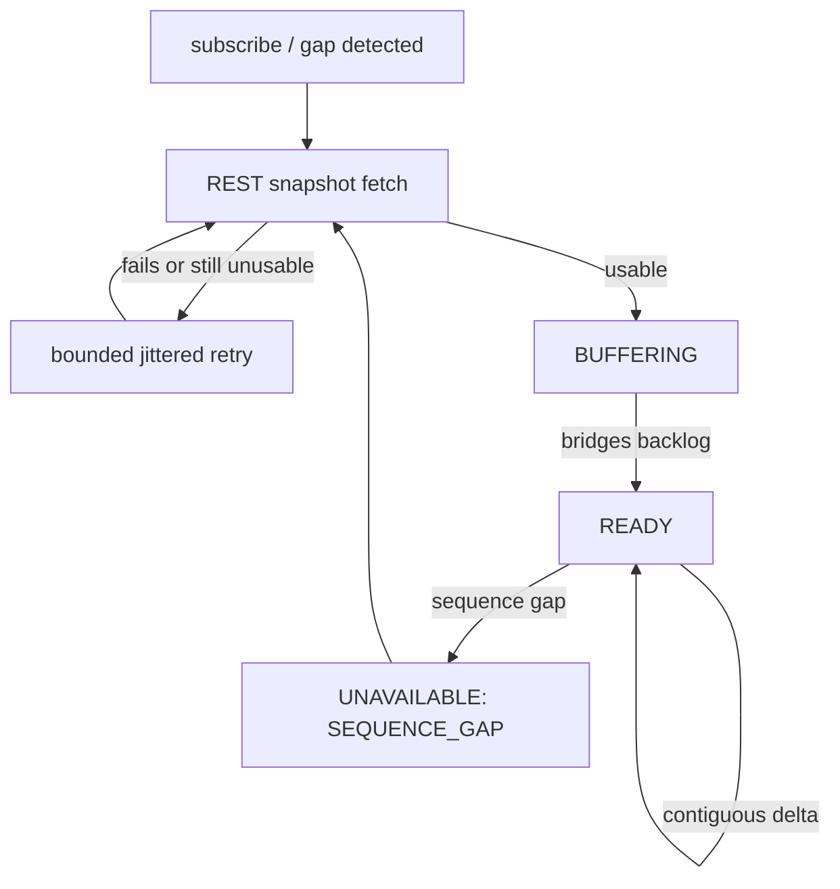

# Binance L2 Order-Book Contract v1

The book **assembler's** own contract — `binance-book-assembler.js`'s
`getState()`, backed by one instance per `marketKind:symbol` pair. Built
from a REST depth snapshot plus the live DEPTH delta stream, per
Binance's own documented local-order-book merge algorithm — spot and
USD-M perpetual diverge in exactly the ways this contract calls out
below, everything else is identical.

`createBinanceConnection(...).getOrderBook(...)` no longer returns this
shape directly — it wraps it with feed-health context. See
[v2](../v2/binance-order-book-v2.md) for that connection-layer query
surface. This doc still fully describes the assembler's own state
machine and reason codes, which v2 doesn't restate.

## Flow

Machine-readable schema: `binance-order-book-v1.schema.json` (same directory).

## Files

- `apps/runtime/src/providers/binance/binance-book-assembler.js` — implements this contract
- `apps/runtime/src/providers/binance/binance-http-client.js` — REST snapshot fetch

## Status values

Exactly three literal `status` values exist — there is no fourth
"recovering" status. A sequence gap surfaces as `UNAVAILABLE` with
`reason: "SEQUENCE_GAP"` while the assembler keeps buffering live deltas
underneath, ready to bridge the instant a fresh snapshot arrives; the
concept of "recovering" is fully observable through `status` + `reason`
together, it just isn't its own status string.

| Status | Shape | Meaning |
|---|---|---|
| `READY` | `{ status: "READY", book: { bids, asks, lastUpdateId } }` | A confirmed, gap-free book. |
| `BUFFERING` | `{ status: "BUFFERING" }` | No confirmed book yet — either nothing has been buffered, or a snapshot was just applied but no live delta has confirmed alignment with it yet. |
| `UNAVAILABLE` | `{ status: "UNAVAILABLE", reason }` | No usable book right now; see reasons below. |

`getOrderBook(...)` returns `undefined` for a `marketKind:symbol` pair
never subscribed to `DEPTH` — distinct from `UNAVAILABLE`, which means
"was subscribed, has no usable book right now."

## Book shape

`book.bids` and `book.asks` are frozen arrays of frozen `[price,
quantity]` decimal-string tuples (never `Number`), sorted so index 0 is
always the best price — bids descending, asks ascending. `lastUpdateId`
is the non-negative integer sequence ID of the most recently applied
event. A price level is present only while its quantity is non-zero; a
zero-quantity delta removes the level rather than appearing as an entry.
Prices are strictly positive. A snapshot or delta whose best bid is at
or above its best ask is never published as `READY`.
Price identity is numeric equality of the decimal strings, not string
identity: `"50.00"` and `"50.0"` are the same level. Internally the
assembler keys the `Map` on a canonical decimal form (the identity
class of `compareDecimalStrings`); the tuple emitted in `book.bids` /
`book.asks` is the last-seen wire spelling and quantity, not that
canonical key.

REST snapshots request Binance's max documented depth so the local book
is not silently truncated: spot `limit=5000` (`/api/v3/depth`), USD-M
perpetual `limit=1000` (`/fapi/v1/depth`). Those limits are also enforced
on the returned snapshot body. A live, READY book may retain at most 10,000
levels per side for spot or 5,000 per side for USD-M perpetual. The terminal
never silently prunes a level to meet that budget: it withdraws the ladder and
resynchronizes instead. The wire `bids`/`asks` shape is unchanged.

## Reason codes

| Reason | Trigger |
|---|---|
| `SNAPSHOT_MALFORMED` | The REST snapshot body failed hostile-input-safe validation (wrong shape, Proxy, accessor-defined field, unexpected extra key, non-positive price, negative quantity, or an update ID beyond `Number.MAX_SAFE_INTEGER`). Never overwrites an already-`READY` book, and never replaces an existing `UNAVAILABLE` reason. |
| `SNAPSHOT_TOO_OLD` | The snapshot's own `lastUpdateId` is older than the buffered backlog can bridge from. Never overwrites an already-`READY` book, and never replaces an existing `UNAVAILABLE` reason. |
| `SEQUENCE_GAP` | A delta (or the buffered backlog against a fresh snapshot) fails the market-kind-specific contiguity check below. |
| `UPSTREAM_EVENT_UNAVAILABLE` | The delta input itself was already a degraded (`UNAVAILABLE`) envelope, or failed the assembler's own hostile-input validation. Never overwrites an existing reason. |
| `BUFFER_OVERFLOW_BEFORE_SNAPSHOT` | More than 1000 deltas buffered before any snapshot was ever accepted (FIFO-evicted). Never overwrites an existing reason. |
| `CROSSED_BOOK` | A validated snapshot or contiguous delta would produce `bestBid >= bestAsk`; the ladder is cleared and resynchronized rather than exposed. |
| `BOOK_LEVEL_CAP_EXCEEDED` | A continuous delta would grow either retained side beyond its provider-specific resource budget. The ladder is cleared and resynchronized; no price levels are silently pruned. |

"Never overwrites an existing reason" means: once `UNAVAILABLE` for one
of these causes, a second, different failure while still `UNAVAILABLE`
does not replace the original diagnostic — the first cause stays visible
until a real recovery (a successful, bridging snapshot) clears it.

## Spot vs. USD-M perpetual: the actual divergence

Both algorithms are driven by the same three checkpoints — snapshot
coverage, snapshot bridging, and ongoing continuity — but use different
boundaries at each one:

| Checkpoint | SPOT | PERPETUAL |
|---|---|---|
| Discard buffered event as covered by snapshot | `lastUpdateId <= snapshot.lastUpdateId` (inclusive) | `lastUpdateId < snapshot.lastUpdateId` (strict — an exact match is kept and can itself bridge) |
| Bridge from snapshot | `firstUpdateId <= snapshot.lastUpdateId + 1` | `firstUpdateId <= snapshot.lastUpdateId && lastUpdateId >= snapshot.lastUpdateId` |
| Ongoing continuity (already `READY`) | `firstUpdateId <= localUpdateId + 1` | `previousUpdateId === localUpdateId` exactly — a strict `pu`-chain match, not `U/u` contiguity. A delta whose `U/u` looks contiguous but whose `pu` disagrees is still `SEQUENCE_GAP`. |

`previousUpdateId` (`pu`) does not exist on spot's wire format at all —
the canonical envelope carries an explicit `null` for spot (see the
canonical-event contract), never "missing."

## Snapshot-fetch async safety

`requestDepthSnapshot` (internal to `binance-connection.js`) captures the
session generation, the assembler object reference, and a monotonic
per-key request epoch before awaiting the REST fetch. If any of the
three changed while the fetch was in flight — a disconnect, an
unsubscribe/resubscribe cycle that replaced the assembler, or a newer
snapshot request racing ahead of an older one against the very same
assembler — the response is discarded rather than applied. This is what
makes automatic re-snapshot-on-gap-detection safe to fire repeatedly
without ever letting a stale response corrupt a book that's already
moved on.

A failed fetch (`ok: false`) **or** an HTTP-successful fetch that still
leaves the assembler `UNAVAILABLE` (`SNAPSHOT_MALFORMED`,
`SNAPSHOT_TOO_OLD`, or a backlog `SEQUENCE_GAP` the snapshot cannot
bridge) schedules one bounded, jittered retry (1s base, 30s cap,
matching the connection layer's own reconnect backoff). The
gap-triggered re-snapshot only fires on the *transition into*
`UNAVAILABLE` from a live delta, so without this retry a single bad
REST body would otherwise be a dead end no further live delta could
ever re-arm. A fetch that leaves the assembler `BUFFERING` or `READY`
resets the backoff for that symbol's next distinct failure episode.

## Recovery outside the assembler

This assembler detects sequence discontinuities. The runtime's
maintenance loop covers the complementary case it cannot infer from IDs:
an active DEPTH tuple that becomes stale rebuilds its route, resubscribes,
and obtains a fresh snapshot.

## Versioning

`v1` covers the assembler's own state machine, book shape, and reason
codes. `getOrderBook()`'s connection-layer wrapping around this shape
is tracked separately as [v2](../v2/binance-order-book-v2.md). A
future v1 bump means the assembler's own shape or reason-code set
changed; a v2+ bump means the connection-layer wrapping changed.
