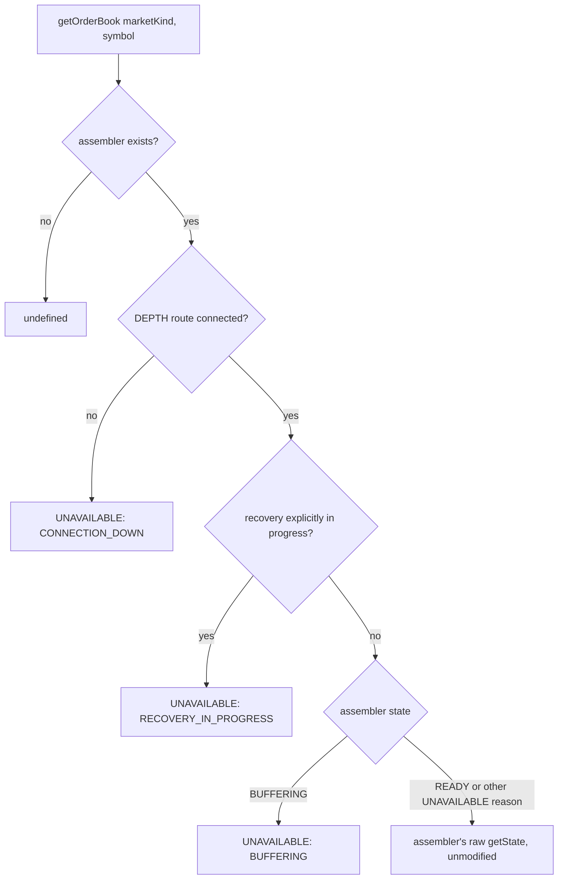

# Binance L2 Order-Book Contract v2

Supersedes [v1](../v1/binance-order-book-v1.md) for
`createBinanceConnection(...).getOrderBook(marketKind, symbol)`
specifically. v1's own state machine, book shape, and reason codes below
are the book **assembler's** contract (`binance-book-assembler.js`'s
`getState()`) — that stays exactly as v1 documented it, unchanged by
this version. What v2 adds is the **connection layer's** wrapping
around it, using feed health.

## Flow

Machine-readable schema: `binance-order-book-v2.schema.json` (same directory).

## Files

- `apps/runtime/src/providers/binance/binance-connection.js` — implements this wrapping
- `apps/runtime/src/providers/binance/binance-book-assembler.js` — the wrapped state
- `apps/runtime/src/providers/binance/binance-feed-health.js` — the health context used to wrap

## Why this is a new version rather than an additive change

`BUFFERING` is not directly observable through `getOrderBook()` — it
always arrives wrapped as `{status: "UNAVAILABLE", reason: "BUFFERING"}`
instead of its own top-level status. A consumer checking
`result.status === "BUFFERING"` would break. That's a real shape change
to this query surface, even though the assembler's own `getState()`
never changed.

## `getOrderBook()`'s wrapping, exact priority order

1. No assembler exists for this `marketKind:symbol` (never subscribed to
   `DEPTH`) → returns `undefined`, matching v1.
2. The `DEPTH` route for this `marketKind` is not connected →
   `{status: "UNAVAILABLE", reason: "CONNECTION_DOWN"}` — regardless of
   what the assembler itself thinks; a `READY` book from before an
   unnoticed disconnect is not distinguishable from one confirmed live
   without this check, which was the exact gap v1 named as deferred.
3. The assembler reports `READY` but feed health's `recoveryState` for
   this symbol's `DEPTH` tuple is `RECOVERING` (e.g. a reconnect just
   re-armed it, or a REST snapshot hasn't confirmed the reconnected
   book yet) **or** `UNAVAILABLE` (that same recovery ran past its
   staleness threshold without resolving) → either way,
   `{status: "UNAVAILABLE", reason: "RECOVERY_IN_PROGRESS"}`. Both
   feed-health substates collapse to this one reason at this query
   surface — the route is already known connected by step 2, so an
   `UNAVAILABLE` health reading here can only mean a timed-out recovery,
   never a dead route.
4. The assembler reports `BUFFERING` → `{status: "UNAVAILABLE", reason:
   "BUFFERING"}` — unconditional, not gated on route/recovery state.
5. Otherwise, the assembler's raw `getState()` is returned unmodified —
   covers `READY`-and-confirmed, and every one of the assembler's own
   `UNAVAILABLE` reasons (`SNAPSHOT_MALFORMED`, `SNAPSHOT_TOO_OLD`,
   `SEQUENCE_GAP`, `UPSTREAM_EVENT_UNAVAILABLE`,
   `BUFFER_OVERFLOW_BEFORE_SNAPSHOT`, `CROSSED_BOOK`,
   `BOOK_LEVEL_CAP_EXCEEDED`) pass through
   unwrapped.

## Full reason set at this query surface

Ten possible `UNAVAILABLE` reasons at *this* surface: the assembler's own seven
plus three connection-layer-only reasons that never
come from the assembler at all: `CONNECTION_DOWN`, `RECOVERY_IN_PROGRESS`,
`BUFFERING`.

**One more reason exists downstream of this surface.** `frames.js` validates
again when it builds the wire frame, and `market-data-server.js` catches that
failure at the send boundary. A value that cannot be represented on the numeric
wire becomes `WIRE_VALUE_OUT_OF_RANGE`, which is **not** one of the ten above
and is produced by the frame layer alone. A ladder that is crossed or
misordered at frame-build time reports `CROSSED_BOOK`, which is already one of
the assembler's seven — the same condition, named the same way, wherever it is
detected.

A client therefore sees eleven distinct reasons across both boundaries, and
`WIRE_VALUE_OUT_OF_RANGE` genuinely means what it says: a representation
failure, never a market-data condition.

## Versioning

`v2` covers the wrapping above. A v3 bumps when this wrapping's own
priority order or reason set changes — not when the underlying
assembler contract changes (that's v1's own versioning to track).
