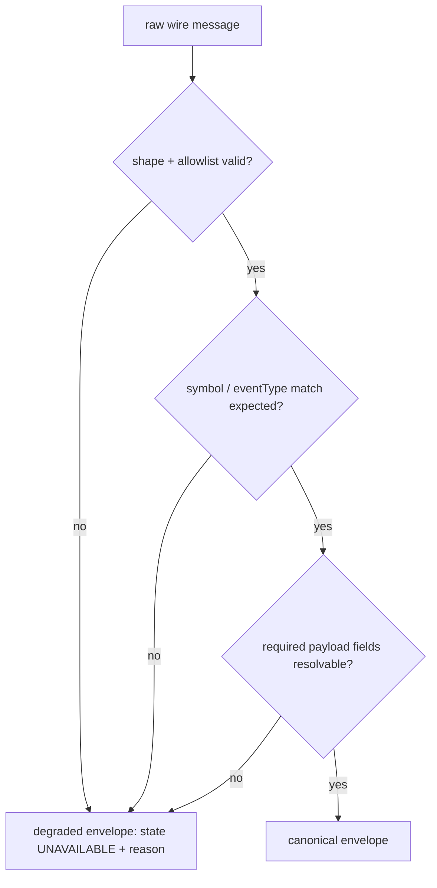

# dxFeed Canonical Event Contract v1

The canonical envelope shape every approved raw dxFeed
`Quote`/`Trade`/`Order`/`TimeAndSale` wire message is normalized into.
`stale`/`recoveryState` are real, caller-supplied feed-health fields —
the subscription resolver passes in whatever it currently knows about
connection health, and the normalizer enforces internal consistency
(a non-`READY` `recoveryState` requires `stale: true`) rather than
computing health itself. They keep the same field names/shape as the
Binance envelope for structural parity. Both the collector and the WS
server (lazy and eager) drive these dynamically in practice —
`RECOVERING` while a session is connecting, `READY` once live data has
actually been observed, `UNAVAILABLE` when a session ends or fails to
start.

## Caller context is a checked precondition

The subscription resolver must supply a plain context with a non-empty
symbol, an allowed `assetClass`/`eventType`, a boolean `stale`, and an
allowed `recoveryState`. Invalid caller context fails fast; it does not
produce an envelope outside this contract. A non-`READY` recovery state
requires `stale: true`. In contrast, provider raw-message failures always
produce the degraded envelope below, so a valid subscription context still
has a uniform output for every provider message.
An explicitly supplied `receivedAtMs` must be a usable positive epoch-
millisecond timestamp. Only omission invokes the local `Date.now()` default;
an invalid caller clock is never silently replaced.

Native `Candle` is deliberately excluded. Bounded probes observed no data,
but silence is not an entitlement denial. The implemented candle path instead
aggregates canonical trades locally.

## Flow

Machine-readable schema: `dxfeed-canonical-event-v1.schema.json` (same directory).

## Files

- `apps/runtime/src/providers/dxfeed/dxfeed-event-normalizer.js` — implements this contract
- `apps/runtime/src/providers/dxfeed/dxfeed-instrument-catalog.js` — `assetClass`/`eventType` constants

## Envelope wrapper

Identical across all 4 event types:

| Field | Type | Notes |
|---|---|---|
| `provider` | `"DXFEED"` | |
| `venue` | string or `null` | Futures: parsed from `providerSymbol`'s venue suffix (e.g. `/ESU26:XCME` → `"XCME"`) — venue is fixed for the life of a dated futures contract. Equities: always `null` at envelope level — dxFeed carries no fixed venue for equities, only a per-print `exchangeCode` inside the payload (confirmed real: the same TSLA symbol showed `exchangeCode:"Q"` on a Quote and `"L"` on a Trade in the same probe run) — a top-level equity venue would be fabricated, so this deliberately doesn't synthesize one. |
| `assetClass` | `"FUTURE" \| "EQUITY"` | Passed in and validated from the caller's subscription context, never inferred from the raw message — same convention as Binance's `marketKind`. |
| `providerSymbol` | non-blank string | Raw `eventSymbol`, passed through, e.g. `"AAPL"`, `"/ESU26:XCME"`. A `FUTURE` context must end in a non-blank `:VENUE` suffix. |
| `eventType` | `"QUOTE" \| "TRADE" \| "ORDER" \| "TIMEANDSALE"` | |
| `eventTime` | ISO 8601 string | See per-type resolution below. dxFeed's own top-level wire `eventTime` field is observed as a constant `0` on every real capture and is not usable — this contract deliberately ignores it in favor of the type-specific timestamp fields. |
| `receivedAt` | ISO 8601 string | When this process received the message. |
| `timingClass` | `"REALTIME"` | Only value this account has — the token broker only issues realtime tokens; delayed/Candle access isn't in scope. |
| `stale` | boolean | Caller-supplied, driven dynamically by session state — see the feed-health note above. |
| `recoveryState` | `"READY" \| "RECOVERING" \| "UNAVAILABLE"` | Caller-supplied, driven dynamically by session state — see the feed-health note above. |
| `payload` | object | Shape varies by `eventType`, see below. |

**`eventTime` resolution per type:**
- `QUOTE`: `max(bidTime, askTime)` when both are usable timestamps; whichever one is usable if only one is; unresolved (degrades) if neither is.
- `TRADE`: raw `time`.
- `ORDER`: raw `time` for the generic Order path. A structural Order-v2
  `REMOVE_EVENT` may legally omit a usable provider timestamp; its separate,
  lossless L2 path uses `receivedAt` as the envelope time solely so that an
  empty snapshot can be applied. That fallback is explicitly local arrival
  time, not a claimed provider event timestamp.
- `TIMEANDSALE`: raw `time`.

## Payload shapes

**QUOTE**: `bidPrice` (positive number), `bidSize` (non-negative
number), `bidTime` (epoch ms), `bidExchangeCode` (string),
`askPrice`/`askSize`/`askTime`/`askExchangeCode` (same shapes, ask
side). All 8 fields required — every real captured Quote has carried
both sides fully populated; no partial-side Quote has been observed.

**TRADE**: `price` (positive number), `size` (positive number), `time`
(epoch ms), `exchangeCode` (string), `change` (number, signed — trade
prints can move price down), `dayVolume`/`dayTurnover` (non-negative
numbers), `tickDirection` (string), `extendedTradingHours` (boolean).

**ORDER**: `index` (non-negative safe integer, or **`null`** — see the
precision note below; not required), `time` (epoch ms, required),
`action` (string, required), `orderId` (non-negative safe integer, or
**`null`**; not required), `price` (positive number, required), `size`
(non-negative number, or **`null`**; not required), `side` (string,
required), `scope` (string, required), `source` (string, required,
`"GLBX"` for futures / `"NTV"` for equities on this account),
`marketMaker` (string, equity-only — absent on futures, never
required).

**TIMEANDSALE**: `price`/`size` (positive numbers), `time` (epoch ms),
`timeNanoPart`/`sequence` (safe non-negative integers), `exchangeCode`
(non-blank string), `extendedTradingHours`/`spreadLeg`/`validTick`
(booleans), `aggressorSide` (`BUY`, `SELL`, or `UNDEFINED`), `type`
(`NEW`, `CORRECTION`, or `CANCEL`), and nullable safe identifiers `index`
and `tradeId`. Unsafe 64-bit identifiers are represented as `null`; ordering
and local deduplication use the safe `time`/`timeNanoPart`/`sequence` tuple.
Corrections, cancels, spread-leg status, and invalid-tick status remain in the
canonical event and durable store. Only valid `NEW` prints feed locally
materialized bars, and an unclassified aggressor leaves directional volume
unavailable without removing that print from OHLCV.

**Decimal fields stay native JSON numbers, not strings — a deliberate
deviation from the Binance contract.** Binance mandates decimal-as-
string because its own price/quantity precision can exceed `Number`'s
safe range. dxFeed's raw wire already sends native JSON numbers, and
every real captured price/size value is well within float64-safe
territory — converting to strings here would add a lossy round-trip
for no real precision benefit. (See the `index` precision note below
for the one field where this project's own consuming layer, not this
contract, already has a real precision limitation.)

**Order `size`'s `null` mapping**: `size` (and, on the raw wire only,
`executedSize`/`tradePrice`/`tradeSize`, which are excluded from the
canonical payload entirely — see below) arrive as the literal string
`"NaN"` on every real captured Order event, both futures and equity.
`"NaN"` is mapped to `null` — a valid, documented value, not a
validation failure. A `null` `size` does not trigger
`MISSING_OR_INVALID_REQUIRED_FIELD`.

**`index`/`orderId` precision note — revised after cross-checking the
sibling `Trading-Terminal` repo's own closed finding on this exact
field** (`docs/qa/d006-dxfeed-contract-validation.md`, defect #5:
"Raw Order#GLBX receipt had been promoted to canonical observed
fields... raw action/index values survive only in internal evidence").
dxFeed's real `index` value is a 64-bit number; both of DX1.02's real
captured Order samples (one `GLBX`, one `NTV`) already exceed
`Number.MAX_SAFE_INTEGER` (`9007199254740991`). That precision loss
happens upstream, at JSON parsing, before this normalizer ever sees
the value.

An earlier version of this contract validated `index` as merely
*integer-valued* (`Number.isInteger`) rather than *safe*
(`Number.isSafeInteger`), reasoning that the stricter check would
spuriously degrade most real Order events. That undersold the actual
risk: this isn't only lost trailing precision, it's a genuine
**identity collision** — distinct real 64-bit values round to the
identical JS double once parsed (directly reproduced:
`Number.MAX_SAFE_INTEGER + 1 === Number.MAX_SAFE_INTEGER + 2` is
`true`). Presenting a collision-prone number as a trustworthy
identifier is worse than presenting nothing. `index` and `orderId` are
now both **optional and nullable**: a value is passed through only
when it's a genuine safe non-negative integer (`Number.isSafeInteger`);
anything else — absent, wrong-typed, or precision-lossy — normalizes
to `null`, the same honest-unknown treatment `size`'s `"NaN"` already
gets. Neither field triggers `MISSING_OR_INVALID_REQUIRED_FIELD`
regardless of its value. `orderId` gets the identical defensive
treatment even though no real captured sample has shown it unsafe yet
(every real sample has `orderId: 0`).

The generic Order path intentionally retains this limitation. The separate
Order-v2 L2 path now intercepts raw JSON before `JSON.parse` and carries the
exact decimal `index` spelling; it is not a replacement for this generic
payload and must be used for book assembly.

**Fields observed on the wire but excluded from the canonical
payload**: `eventFlags`, `sequence`, `timeNanoPart`, `actionTime`,
`auxOrderId`, `count`, `exchangeCode` (Order's own copy, distinct from
top-level `source`), `tradeId`, `tradePrice`, `tradeSize`,
`executedSize`, `dayId`. These are accepted at the wire-allowlist layer
(so real messages aren't rejected as malformed) but deliberately left
out of the canonical payload — same "deliberately out of scope"
pattern as Binance's normalizer excluding book-assembly concerns.
`eventFlags` in particular is dxFeed's own order-book snapshot/remove
bit-flag field. It remains excluded from the generic Order payload, while the
separate Order-v2 L2 path retains it exactly for reconstruction.

## Order-v2 L2 companion path

`normalizeDxFeedOrderV2Event` is the distinct, lossless input to
`dxfeed-book-assembler.js`. Raw-frame interception supplies the exact decimal
`index` spelling before JSON parsing; the payload retains `eventFlags`,
`action`, `price`, `size`, `side`, `scope`, and `source`. Non-removal events
require the normal book-mutating fields. A structural `REMOVE_EVENT` requires
only an exact index, safe flags, and source because dxFeed can encode an empty
snapshot with sentinel price/size/time fields. The assembler applies all
events transactionally, including a `SNAPSHOT_END | TX_PENDING` boundary, and
does not expose a book until the transaction has subsequently completed.

This companion path is not represented by the v1 generic Order schema. Its
additional fields and raw-index guarantee are intentionally versioned at the
implementation/storage contract boundary so existing generic consumers retain
their current shape.

## Degraded envelope

Returned instead of a normal envelope whenever normalization fails.
Never a partial object — always this exact field set:

| Field | Type |
|---|---|
| `provider` | `"DXFEED"` |
| `venue` | string or `null` |
| `assetClass` | `"FUTURE" \| "EQUITY"` |
| `providerSymbol` | string |
| `eventType` | string |
| `receivedAt` | ISO 8601 string |
| `timingClass` | `"REALTIME"` |
| `stale` | boolean |
| `recoveryState` | string |
| `state` | `"UNAVAILABLE"` |
| `reason` | one of the reason codes below |
| `missingFields` | array of field names, empty unless `reason` is `MISSING_OR_INVALID_REQUIRED_FIELD` |

`eventTime` and `payload` are deliberately absent — genuinely unknown
when normalization failed before either could be established.

## Reason codes

| Reason | Trigger |
|---|---|
| `MALFORMED_RAW_MESSAGE` | Raw payload isn't a plain, hostile-input-safe object matching the expected shape for its already-resolved event type — includes non-plain objects, Proxies, unexpected/extra keys, accessor-defined, or non-enumerable fields. |
| `STREAM_SYMBOL_MISMATCH` | Raw `eventSymbol` disagrees with the subscribed `providerSymbol`. Also fires when `eventSymbol` is entirely absent from the raw message (`undefined` never equals a real symbol). |
| `PROVIDER_EVENT_TYPE_MISMATCH` | Raw `eventType` field disagrees with the wire name expected for the subscribed event type (`"Quote"`/`"Trade"`/`"Order"`/`"TimeAndSale"`), including when the field is entirely absent. Revised from an earlier "only checked when present" version, found during the 2026-08-28 grand-scale audit: that let a raw message missing `eventType` bypass this check entirely while an equivalent missing `eventSymbol` was already caught, an unjustified asymmetry between two structurally identical wire-identity fields at the same trust boundary. Closed to match `eventSymbol`'s existing unconditional check — every real captured fixture already includes `eventType`, so this only hardens the fail-closed boundary against malformed/corrupted input with no behavior change for legitimate traffic. |
| `MISSING_OR_INVALID_REQUIRED_FIELD` | Any required payload field, or `eventTime` itself, can't be resolved to a valid value. `missingFields` names each one, including `"eventTime"` when that's the cause. |

No DEPTH/KLINE-specific reason codes — those event types (Binance's
`DEPTH`, and dxFeed's own `Candle`) aren't in scope for this contract.

## Versioning

`v1` covers Quote/Trade/Order/TimeAndSale. TimeAndSale is an additive event
branch under the existing envelope version. A future version bumps when the
wrapper or an existing payload shape changes, when native Candle is added, or
when the `stale`/`recoveryState` field *shape* itself changes (e.g. new
recovery states) — not when the caller-supplied values driving them change,
since that's already within the existing contract.
