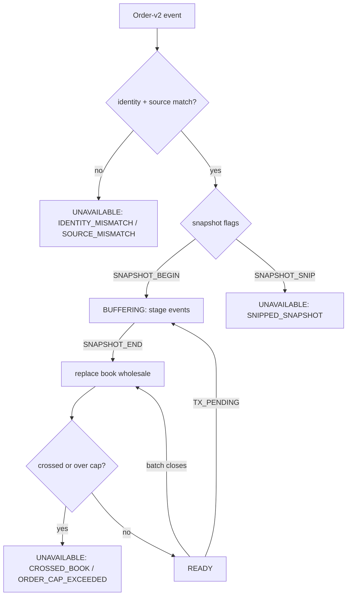

# dxFeed L2 Order-Book Contract v1

The dxFeed book **assembler's** own contract —
`dxfeed-book-assembler.js`'s `getState()`, one instance per
`symbol:assetClass:orderSource` view. Built from the Order-v2 event
stream only; dxFeed's native Candle and DOM services are not used, and
there is no REST snapshot path.

This is the dxFeed counterpart to
[`binance-order-book/v1`](../../binance-order-book/v1/binance-order-book-v1.md).
The two solve the same problem from opposite ends: Binance sends price
levels with sequence numbers, dxFeed sends individual orders keyed by a
64-bit index. None of Binance's `U`/`u`/`pu` reasoning applies here.

## Flow

Machine-readable schema: `dxfeed-order-book-v1.schema.json` (same directory).

## Files

- `apps/runtime/src/providers/dxfeed/dxfeed-book-assembler.js` — implements this contract
- `apps/runtime/src/providers/dxfeed/dxfeed-order-v2-capture.js` — raw-index capture feeding it
- `apps/runtime/src/server/dxfeed-market-data-server.js`, `dxfeed-eager-market-data-server.js` — publication and staleness

## Status values

Three literal `status` values, the same vocabulary as Binance's v1.

| Status | Shape | Meaning |
|---|---|---|
| `READY` | `{ status: "READY", book: { bids, asks, lastUpdateId } }` | A complete, source-consistent, uncrossed book. |
| `BUFFERING` | `{ status: "BUFFERING" }` | No usable book yet — no snapshot has completed, or one is mid-flight. A previously-READY book is withdrawn while a new snapshot builds. |
| `UNAVAILABLE` | `{ status: "UNAVAILABLE", reason }` | No usable book; see reasons below. |

## Venue scope — what this book is a book *of*

The order source is venue-specific, and the two asset classes are not
equivalent in coverage.

| Asset class | Source | What that covers |
|---|---|---|
| Futures (`/ES`, `/NQ`) | `GLBX` | **CME Globex — the venue itself.** Essentially all screen liquidity for these contracts trades here, so futures depth is complete. |
| Equities (`AAPL`, `TSLA`) | `NTV` | **Nasdaq TotalView — one lit venue** of roughly sixteen, plus dozens of ATSs. This is Nasdaq's book, not the consolidated US book. |

TotalView is a real institutional depth product and nothing here is
reconstructed incorrectly. But an equity book from this feed is **not** *the*
order book, and a consumer that reads it as one will be wrong in a specific,
directional way.

**The consequence to know about.** The trade tape is consolidated — prints
arrive from every venue — while the equity book is Nasdaq-only. Any indicator
that compares executed volume against displayed size therefore takes its
numerator and denominator from **different universes**, and will overstate how
much liquidity was hidden: trades that executed away from Nasdaq are measured
against depth that was never Nasdaq's to show. Iceberg and Absorption are the
two shapes this bites hardest, and Liquidity Vacuum reads thin Nasdaq depth as
thin consolidated depth.

This applies today, to any equity depth already being captured — not only to
indicators not yet built. Futures are unaffected: `GLBX` genuinely is the
venue.

## Book shape

`book.bids` and `book.asks` are frozen arrays of frozen
`[price, size]` tuples. Unlike Binance's decimal strings, dxFeed prices
and sizes are **numbers** — the dxLink wire delivers numbers, so no
exact decimal representation exists upstream to preserve.

Bids sort descending and asks ascending, so index 0 is the best price on
both sides. `lastUpdateId` is a local monotonic revision counter, not a
provider sequence number: dxFeed's Order-v2 stream has no equivalent of
Binance's update IDs, so it is only meaningful for change detection
within one assembler instance.

A price level is the aggregate of every live order at that price, and is
present only while at least one order backs it. Levels track their
constituent order count and are removed when it reaches zero, rather
than when their summed size reaches zero — summing fractional sizes does
not return to exactly zero, and a size-based test left drained levels
behind as float residue (`L1L2-V2-021`).

A book whose best bid is at or above its best ask is never published as
`READY`.

## Reason codes

| Reason | Trigger |
|---|---|
| `IDENTITY_MISMATCH` | The envelope's `provider`/`eventType`/`providerSymbol`/`assetClass` does not match the view's expected identity, or the order's `source` differs from the expected `orderSource`. |
| `SOURCE_MISMATCH` | The order source changed after the assembler had already bound to one. Distinct from `IDENTITY_MISMATCH`, which is a mismatch against the configured expectation. |
| `SNIPPED_SNAPSHOT` | A snapshot carried the `SNAPSHOT_SNIP` flag — the provider truncated it, so it cannot be treated as complete. |
| `PENDING_EVENT_LIMIT_EXCEEDED` | More than 250,000 events staged without a snapshot or transaction completing. |
| `ORDER_CAP_EXCEEDED` | Retained orders exceeded 250,000. The book is discarded rather than trimmed: trimming would make later removes and modifies mathematically unsafe. |
| `CROSSED_BOOK` | A validated snapshot or batch would produce `bestBid >= bestAsk`. |
| `UPSTREAM_EVENT_UNAVAILABLE` | The event was already a degraded (`UNAVAILABLE`) envelope, or failed the assembler's own hostile-input validation — including a non-numeric or over-long order index. |
| `ORDER_CAPTURE_ERROR` | Supplied externally through `invalidate()` when raw-index correlation fails (see below). Not produced by the Order-v2 event grammar itself. |

Every reason clears all retained orders, both level maps, and both best
prices. An incremental event cannot recover an `UNAVAILABLE` book — only
a fresh complete snapshot can.

## 64-bit index handling

Order identity is a 64-bit index, which a JavaScript number cannot hold
exactly above 2^53. `dxfeed-order-v2-capture.js` therefore never lets
`JSON.parse` see it: it intercepts each frame's raw text, scans out the
exact `index` digits as a string, and pairs those positionally with the
SDK's parsed objects. The assembler requires a digit string of at most
20 characters that `BigInt` accepts, and keys its order map on that
string. No index is ever converted to a number.

The pairing is defended strictly — the parsed Order count must equal the
raw index count with no missing index, on the bound channel, within a
bounded backlog (2,048 frames / 250,000 index values). Any mismatch
**latches** a correlation failure: capture stops entirely and does not
resume until the channel is re-established, at which point the server
calls `invalidate("ORDER_CAPTURE_ERROR")`. A capture fault is never
treated as a one-frame warning.

## Snapshot and transaction semantics

Continuity is expressed through event flags rather than sequence
numbers:

| Flag | Bit | Effect |
|---|---|---|
| `TX_PENDING` | `0x01` | Stage the event; do not apply until a batch-closing event arrives. |
| `REMOVE_EVENT` | `0x02` | Delete the order, regardless of action, price, or side. |
| `SNAPSHOT_BEGIN` | `0x04` | Discard staged events and begin a new snapshot; status becomes `BUFFERING`. |
| `SNAPSHOT_END` | `0x08` | Complete the snapshot; staged events wholesale replace the book. |
| `SNAPSHOT_SNIP` | `0x10` | The snapshot was truncated — refuse it. |

Order actions: `NEW`, `REPLACE`, `MODIFY` and `PARTIAL` upsert; `DELETE`
and `EXECUTE` remove; `TRADE` and `BUST` are book no-ops and may carry a
zero price. A zero or null size removes the order.

## Publication and staleness

`getState()` is the assembler's own view. The servers wrap it:

- `BUFFERING` is published as `{status: "UNAVAILABLE", reason: "BUFFERING_SNAPSHOT"}`.
- Book frames carry a `stale` boolean. After 5 seconds without an order
  event (`BOOK_QUIET_THRESHOLD_MS`) the book is marked stale and
  re-broadcast — it is not withdrawn, because an unchanged book in a
  quiet market is still valid; the flag says only that it has not been
  confirmed recently.
- Ending a session pushes an explicit `UNAVAILABLE` book frame to
  clients.

`frames.js`'s `dxfeedBookFrame` re-checks ordering and crossing at the
wire boundary and throws rather than emitting a malformed book, and caps
the frame at 20 levels per side.

## Versioning

`v1` covers the assembler's own state machine, book shape, and reason
codes, plus the capture correlation contract it depends on. A bump means
one of those changed. Server-side wrapping is described here for
context; if it gains its own priority order the way Binance's did, it
should get its own version the way
[`binance-order-book/v2`](../../binance-order-book/v2/binance-order-book-v2.md) did.

## Why a breached book is discarded rather than trimmed

Order-v2 is order-keyed, so an active book can grow for the life of a
subscription even after the initial snapshot has been applied. Retained state is
bounded separately from the transactional staging queue, and on a breach the
book is **discarded, not trimmed**: trimming would make subsequent removes and
modifies mathematically unsafe, because the assembler would no longer know
whether an unknown index was never seen or was silently dropped.

Public invalidation is deliberately narrow. Transport and correlation failures
sit outside the Order-v2 event grammar, but must still clear every retained
order before a server can publish another book — which is why `invalidate()`
exists as a separate entry point rather than being folded into the event path.
