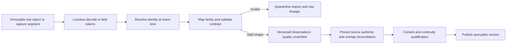

# Market observation contract v1

Status: executable historical observation contract, alongside the existing live pipeline. It is not a replacement WebSocket schema, a production DBN decoder, a published historical dataset or a book reconstruction engine.

The executable validator is [record.js](../../../../apps/runtime/src/data-contracts/v1/record.js). [Provider mappings](../../../../apps/runtime/src/data-contracts/v1/adapters.js), [identity resolution](../../../../apps/runtime/src/data-contracts/v1/identity.js), [exact values](../../../../apps/runtime/src/data-contracts/v1/exact.js) and [authority/corrections](../../../../apps/runtime/src/data-contracts/v1/authority.js) are independently callable CommonJS modules. No new runtime dependency is required.

## D05: identity and exact representation

| Field | Contract |
|---|---|
| `schemaVersion` | `market-observation/1`; incompatible interpretation requires a new version |
| `instrument` | Venue, market, exact symbol, currency, quantity unit; futures additionally require actual contract. Canonical ID is a JSON-encoded tuple, avoiding delimiter ambiguity. |
| Identity mapping | Provider + dataset + source symbol/numeric ID + half-open event-time interval `[fromNs,toNs)`. Mapping version and reference evidence required. No matches or overlapping mappings fail. |
| Continuous futures | `ES.n.0` is a mapping/query alias, not a raw identity. Actual contract and roll dates must come from effective-dated reference data. No production roll table is guessed here. |
| `time.eventNs` | Epoch nanoseconds as a decimal integer **string**, preserving precision beyond JavaScript Number. This is the original observation time, including for late corrections. |
| `time.receiveNs` | Provider/local reception time or null. It is not interchangeable with exchange time. |
| `time.ingestNs` | Explicit ingestion timestamp; mapper never injects the current clock implicitly. |
| `time.precision`, `origin` | Preserve source precision and clock meaning. Converting milliseconds to nanoseconds does not create nanosecond accuracy. |
| Price, quantity, rates | `{coefficient: "integer", scale: integer}`; exact decimal value is coefficient × 10^-scale. Up to 18 decimal places. Negative prices/rates are representable; quantities are nonnegative. Decimal source fields must arrive as strings, not already-rounded floats. |
| Numeric source tokens | Safe integer Numbers may enter the conversion helpers. Unsafe Numbers fail; string/BigInt-preserving decoding belongs before this boundary. No `parseFloat` conversion. |
| Null | Explicit absence; never automatically zero, buy or sell. Databento undefined price sentinel becomes null only for optional book sides; it is rejected as an execution price. |
| `lineage` | Raw object/segment reference, SHA-256 and row ordinal. Caller must verify the hash against raw bytes; a well-formed hash alone is not proof. |
| `source` | Provider, dataset, source schema, population, dataset version, mapper method version, source identity, mapping version/reference and stream identity |
| `order` | Original source sequence when supplied; caller-provided monotonic capture position within stream; raw-derived ordinal. Sequence alone is not assumed globally unique. |
| `quality` | `UNVERIFIED`, `VALIDATED`, `GAP`, `SNAPSHOT_PENDING` plus named flags. Mappers always start UNVERIFIED. Coverage qualification owns promotion after real checks. |

Original raw bytes remain the authority for textual formatting and provider-native detail. Canonical decimals preserve value and scale; redundant signs/leading zero formatting are not a separate market meaning. Existing normalized live numeric fields cannot regain precision already lost: Conversion must adapt from retained exact raw payloads or report the input's precision limitation.

## Family contracts

| Family | Required meaning | Explicit limits |
|---|---|---|
| `trade` | Entity ID, NEW/CORRECTION/CANCEL, price/size, aggressor BUY/SELL/UNKNOWN, valid-tick flag; correction target | Cancellation may lack price/size. Do not count Quote, dxFeed last-Trade snapshots, or book removals as executions. |
| `quote` | Nullable paired bid price/size and ask price/size, depthLimit=1 | Venue-specific BBO; not automatically consolidated NBBO. A crossed quote is retained for quality assessment, not silently “fixed.” |
| `candle` | Half-open bar interval, OHLC, nonnegative volume, nullable buyVolume, closed state and derivation method | OHLC bounds validated. No inferred buy volume from ordinary OHLCV. Forming bars require causal reconstruction in the replay engine. |
| `depth` | SNAPSHOT or absolute SET_LEVELS; model, depth limit, levels, source sequence range, batch ID/end/reset | Zero size removes a price level. TOP_N requires an explicit positive bound. A snapshot spread across rows is not ready until its complete batch is known. |
| `order` | Provider entry index, source, scope, action, flags, remove flag, optional order ID and price/size | An indexed aggregate entry is not necessarily an exchange order. Keep transaction/snapshot flags; The replay engine must materialize them atomically. |
| `derivative` | Nullable funding rate/time, mark/index price and open interest; at least one observation | Funding schedules and OI units are source metadata, not assumptions of shared timing. |
| `liquidation` | Execution-like observation with explicitly separate family | Never mix with ordinary trades to inflate traded volume; retain provider-specific liquidation side meaning. |
| `reference` | Source symbol, validity interval, reference version, positive tick size and multiplier | Conversion must retain additional source definitions; one observed reference day cannot establish a year of mappings. |
| `status` | Provider code and scope | Market halt/closure is not automatically a capture gap. |
| `statistic` | Name, exact value, unit and update action | Keep provider statistic type and update semantics; not an inferred trade. |
| `trade_minute` | Derived from `trade`: one UTC minute's `volume`, `buyVolume`, `sellVolume`, `undefinedVolume`, `buyNotional`, `sellNotional`, `tradeCount`, derivation method | Aggregates `NEW` executions with a valid tick only; sides must sum exactly to volume; an aggregate is not an execution and carries no price. The minute is grid-aligned and exactly 60 s. |
| `trade_level` | Derived from `trade`: one minute × one price bucket at a declared `tickSize` (`priceBucket` = floor(price / tickSize) in exact integer arithmetic), `volume`, `buyVolume`, `sellVolume`, `tradeCount` | Undefined-side executions count in `volume` and `tradeCount` but in neither side; a coarser bucket is a read-time regrouping, never a stored rewrite. |
| `trade_slice` | Derived from `trade`: one 2 s slice's `buyNotional`, `sellNotional`, `tradeCount` and `lastTradeNs` | BUY and SELL executions only, matching the live sliced-notional read; a slice with no sided execution does not exist; `lastTradeNs` lies inside the slice. |
| `trade_prints` | Derived from `trade`: the ranked largest BUY and SELL executions of one minute (`side`, `rank`, `tradeNs`, `price`, `size`, `tradeEntityId`) | Magnitude is `size` for futures and `price × size` for equities, as the live large-trade read ranks them; ties resolve to the later execution; the rank cap is a stored geometry, not a query parameter. |

These are distinct validators, not one permissive “market data” payload. Additional provider fields can be retained in the data payload; their meanings are method-versioned and do not override required core fields. The four `trade_*` families are derived aggregates: their `source` names the provider and population of the executions they summarise, their `lineage` is the published `trade` partition they were computed from, and their filters are those of the live storage reads they must equal (report 54).

## Provider boundaries implemented here

| Provider | Executable mapping surface | Rule |
|---|---|---|
| Binance | Individual `trade`, BBO, incremental depth | Buyer-maker means SELL aggressor; source symbol must match. Preserve first/last/previous depth sequence. Missing exchange time is explicitly tagged receive fallback. Aggregated-trade conversion is not implicitly enabled. |
| Tardis CSV | Trades, BBO, incremental depth, derivative ticker, liquidations | Microsecond tokens become exact ns strings. Provider fallback ambiguity is retained. Incremental snapshot start/end must be supplied by a row/batch assembler; mapper cannot infer readiness from a single row. |
| dxFeed | TimeAndSale, indexed Order | TimeAndSale index is correction identity; millisecond time plus sub-millisecond nano part. Nonzero TimeAndSale transaction flags require materialization rather than unsafe direct trade admission. Order flags are preserved without claiming a completed book. |
| Decoded Databento | Fixed-price integer `mbp-1` / `mbp-10` and compatible `tbbo` rows, projected to trade/quote/depth | Only action T produces a trade. A/C/M/R are book actions. The same raw record can produce one quote and one trade with distinct deterministic family IDs. Preserve flags, source schema and publisher ID. |

Unsupported provider shapes fail explicitly. CSV parsing, DBN versions/compression, other family adapters, atomic snapshot assembly, full archive conversion and publication belong to the conversion pipeline. Generic family validators are available for those converters now. The test-only DBN reader is intentionally narrow and must not become the production archive decoder.

## D06: capture versus publication

**Selected contract:** publish committed capture prefixes. Live transport must carry durable cursor, stream/generation identity and quality; acknowledgements cannot advance past durable commit. Capture and downstream transport must implement and measure this guarantee. Today's separate provider-serving path is unchanged and is not claimed to comply yet.

A local SQLite commit does not imply S3 archival. Remote durability is the latest verified archived prefix; capture gaps, transport drops and archival lag are separate states. No end-to-end “exactly once” guarantee is declared. Downstream transport must establish its durability and envelope contract before claiming this guarantee.

## D07: authority, ordering and corrections

1. Publish a versioned authority manifest for **instrument + family + equivalent population + half-open interval**. It pins provider, dataset, source schema, dataset version and mapper version. No overlapping rules are admitted for the same key.
2. An alternate source is excluded inside the selected source's interval. If the selected source is missing, do not silently fall back or fabricate continuity. Coverage qualification reports the missing interval.
3. Binance/Tardis trade equivalence must be proven for the exact market and event population. dxFeed and Databento populations are not presumed identical. Keep XNAS.ITCH venue scope distinct from broader/composite feeds.
4. Exact repeated raw records are idempotent. A repeated ID with conflicting content fails. Equal price/time/size is **not** sufficient to deduplicate distinct trades. Repacked/monthly/daily files require semantic overlap reconciliation before publication; this batch selector does not certify them equivalent.
5. Same-family production inputs must come from a non-overlapping, verified raw manifest. MBP-1, MBP-10 and standalone trade files must not all contribute the same executions. Pin one extraction path per authority interval.
6. Event-time presentation order is deterministic: event time, stream ID, capture position, family, ID. Cross-source ties are a reproducibility convention, not proof of physical exchange order. Reconstruct each book/transaction in its own capture/sequence order before cross-stream presentation.
7. NEW/CORRECTION/CANCEL materialization uses source capture order. Corrections replace an existing entity; cancellations remove it; orphan corrections, repeated NEW identities, backward positions and ledger capacity overflow fail visibly. Tombstones remain bounded and prevent accidental re-addition without reconciliation.

Replay publication policy: immutable, pinned **corrected-history** dataset versions initially. This describes the archive's selected correction state, not what a trader knew at that moment. “As-known” replay requires receive-time/version visibility and retained corrections; it is not silently promised. Even corrected-history replay may not use future bars or calibration values before its cursor. Query and replay consumers must make this distinction explicit.

## Reconciliation rules for source inventory

Monthly labels, daily labels and September fragments are candidates for requested ranges, not record coverage. Definition partition dates can describe request end while filenames describe start. Decode first/last events and effective reference validity, retain all raw lineage, and publish one authoritative non-overlapping version. Do not schedule costly replacement downloads merely because legacy objects use a different layout.

## Verification and references

Run from repository root: `npm run test --workspace @terminal-l1-l2/runtime -- --runInBand test/contracts/market-observation-v1.test.js`.

Provider documentation checked 2026-09-08:

- [Databento MBP-1](https://databento.com/docs/schemas-and-data-formats/mbp-1): field layout, action/side semantics and fixed-point price representation.
- [Databento DBN source and fixtures](https://github.com/databento/dbn/tree/a7d8ee93a5d5d0b7082d0ca15ab85c01e3cce550): pinned binary fixtures and encoding reference.
- [Tardis CSV data types](https://docs.tardis.dev/downloadable-csv-files/data-types): CSV units, row meanings and snapshot requirements.
- [dxFeed TimeAndSale](https://docs.dxfeed.com/dxfeed/api/com/dxfeed/event/market/TimeAndSale.html) and [indexed events](https://docs.dxfeed.com/dxfeed/api/com/dxfeed/event/IndexedEvent.html): correction identity, timestamps and transaction flags.
- [Binance spot streams](https://developers.binance.com/en/docs/catalog/core-trading-spot-trading/api/ws-streams/~): raw trade fields and maker-side interpretation. Perpetual adapter input remains the existing raw `trade` shape; Conversion must qualify actual futures samples separately from spot fixtures.
