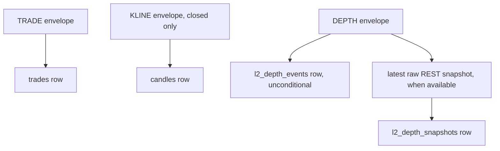

# Market Data Storage Layer Contract v1

The row shape for each of the four **raw market-data** SQLite tables the
storage layer writes — `trades`, `candles`, `l2_depth_events`, and
`l2_depth_snapshots`. All four are raw:
nothing is thresholded, bucketed, or derived before being written.

The same database also holds three **operational** tables that are
deliberately outside this contract's row-shape scope, because they
describe the capture process rather than the market:
`capture_sessions` and `capture_incidents` (per-session quality lineage,
schema v6) and `depth_continuity_audits` (the durable depth-continuity
ledger, schema v11). Their integrity story is in
[the storage continuity evidence doc](../../../architecture/storage/storage-continuity-evidence.md).
See
[the storage pipeline evidence doc](../../../architecture/storage/storage-pipeline-evidence.md)
for how and when each row gets written; this contract only covers what
each row looks like once it exists.

## Flow

Machine-readable schema: `storage-layer-v1.schema.json` (same directory).

## Files

- `apps/runtime/src/storage/storage-db.js` — table definitions, insert statements
- `apps/runtime/src/storage/storage-service.js` — `recordTrade`/`recordCandle`/`recordDepthEvent`

Zone-scanning/change-detection (`l2-zone-scanner.js`, `l2-change-detector.js`)
used to write two additional derived tables from this data. They're parked
at `apps/runtime/archive/l2-derivation/`, not part of this contract — that's
Phase 4 (indicator/derivation) work, not raw collection.

## Shared conventions

Every table carries `id` (an auto-incrementing integer, strictly
increasing regardless of write order or timestamp collisions — the
monotonic key anything reading these tables back chronologically
should sort on) plus `symbol` (`BTCUSDT`/`ETHUSDT`, the connection
layer's own wire format, not the frontend's hyphenated form) and
`market_kind` (`SPOT`/`PERPETUAL`). There is no retention, rotation, or
archival step for any table — every accepted row stays in the single live
database for the life of the deployment. The read path's 7-day candle
backfill window (`readRecentCandles`) is a warm-up payload bound for the
frontend, not a retention limit; the live table itself keeps every candle
ever captured. Off-host backup is a separate, manual, on-demand step
(`apps/runtime/scripts/maintain/backup-to-drive.js`), not part of this contract's
write path. Each run produces a distinct UTC-timestamp/UUID SQLite snapshot,
verifies SQLite integrity locally, and uploads a SHA-256 manifest; it does not
overwrite a prior backup artifact.
Exchange identities make retries idempotent: trades use
`(symbol, market_kind, trade_id)`, closed candles use
`(symbol, market_kind, ts_open)`, and depth deltas use
`(symbol, market_kind, first_update_id, last_update_id)`. A repeated
closed candle replaces its prior OHLCV values; repeated trade and depth
rows are ignored.

## `trades`

One row per executed trade, full resolution — no sampling.

| Column | Type | Notes |
|---|---|---|
| `ts` | integer | Exchange event time, ms epoch |
| `price` | decimal string | Strictly positive source value, retained exactly |
| `size` | decimal string | Strictly positive source value, retained exactly |
| `side` | string | `buy` or `sell` |
| `trade_id` | string | Exchange trade ID |
| `baseline_log_median` | real or `null` | **Retired (`L1L2-V2-084`).** Held a log-magnitude median for the statistical large-trade detector removed in Phase 15. The column is retained — dropping one from a 40 GB table is a full rewrite — but is never written from schema v15 onward, so new rows are always `null`. |
| `baseline_log_mad` | real or `null` | **Retired**, as `baseline_log_median`. Never written from schema v15 onward. |
| `baseline_sample_count` | integer or `null` | How many trades the baseline snapshot above was built from, `>= 0`; `null` for rows written before schema v13. The large-trade z-score index only scores a row once this reaches the detector's minimum-sample floor, so a baseline built from too little history is excluded rather than trusted |

## `candles`

One row per **closed** 1-minute bar. A still-forming bar never appears
here.

| Column | Type | Notes |
|---|---|---|
| `ts_open` | integer | Bar open time, ms epoch |
| `open`, `high`, `low`, `close` | decimal string | Strictly positive source values, retained exactly |
| `volume` | decimal string | Non-negative source value, retained exactly |
| `quote_volume` | decimal string or `null` | Binance quote-volume source value; `null` only for rows written before schema v10 |
| `trade_count` | integer | Non-negative |
| `taker_buy_base_volume` | decimal string or `null` | Binance source value; bounded by `volume` when present |
| `taker_buy_quote_volume` | decimal string or `null` | Binance source value; bounded by `quote_volume` when present |

`ts_open` is constrained to the one-minute UTC epoch grid. Decimal text is
bounded to 1,024 characters and checked without floating-point conversion,
so very small valid exact values retain their source identity.

## `l2_depth_events`

One row per DEPTH diff message, stored exactly as Binance sends it —
unconditionally, regardless of whether the live book-assembler currently
has a coherent book for that pair. A delta arriving mid-gap-recovery is
exactly the data a future replay-based rebuild needs most; gating storage
on book readiness would silently drop precisely those messages.

| Column | Type | Notes |
|---|---|---|
| `ts` | integer | Exchange event time, ms epoch |
| `received_at` | integer | Local receipt time, ms epoch — provenance, lets a future consumer reason about delivery latency/ordering |
| `first_update_id` | integer | Binance's `U` |
| `last_update_id` | integer | Binance's `u` |
| `previous_update_id` | integer or `null` | Binance's `pu` — only present on PERPETUAL (used there for continuity checking); always `null` for SPOT |
| `bids`, `asks` | string | JSON-encoded array of `[priceString, qtyString]` pairs, exactly as received — no numeric parsing, no filtering. May be `[]` if this delta only touched the other side |

No thresholding, no zone-bucketing, no significance judgment. Every
message that reaches `storage-service.js` with `state !== "UNAVAILABLE"`
gets a row.

The physical `bids` and `asks` columns are JSON text. Their decoded
contents are arrays of two-string tuples; the service validates that a
price is positive and quantity is non-negative before serializing them.

## `l2_depth_snapshots`

The collector also retains every distinct Binance REST depth snapshot that
the connection layer obtains for initial book bootstrap or recovery. Diff
events without one of these snapshots cannot establish a historical book
baseline, so this table is required for a future deterministic L2 replay.
It is not a derived order book: `bids`, `asks`, and `last_update_id` are
the raw REST response values.

| Column | Type | Notes |
|---|---|---|
| `captured_at` | integer | Local capture time, ms epoch |
| `last_update_id` | integer | Binance REST snapshot `lastUpdateId` |
| `bids`, `asks` | string | JSON-encoded raw `[priceString, qtyString]` arrays |

The exchange identity is `(symbol, market_kind, last_update_id)`, so
observing the same cached snapshot alongside multiple subsequent deltas
does not create duplicate baseline rows.

## Versioning

`v1` covers the four raw tables as built. A future bump means one of those
row shapes changed. SQLite's internal `storage_schema` is currently version
**14**; that migration number tracks physical constraints, indexes, and
operational lineage, and is separate from this public row-shape contract.
Every version from 2 onward migrates in place, cascading to the current
version inside a single transaction, so a migration either completes or
rolls back entirely.

| Schema version | Adds |
|---|---|
| 10 | Quote-denominated candle volume fields (`quote_volume`, `taker_buy_quote_volume`) |
| 11 | The operational depth-continuity ledger (`depth_continuity_audits`) |
| 12 | `baseline_log_median` / `baseline_log_mad` on `trades` (large-trade detector, see `../../../architecture/indicators/P4.01-large-trade-detector-evidence.md`) |
| 13 | `baseline_sample_count` on `trades`, and rebuilds the large-trade z-score index to require it |
| 14 | `idx_trades_vpin_covering`, the covering index behind VPIN's warm-up reads (see `../../../architecture/indicators/P4.12-vpin-cloud-evidence.md`) |

The v14 index is a performance optimisation, not a correctness
dependency: both reads that name it via `INDEXED BY` fall back to
non-indexed paths (`readMinuteRollup`, and the paged trade replay), so a
database that has not yet migrated warms VPIN more slowly rather than
incorrectly.
