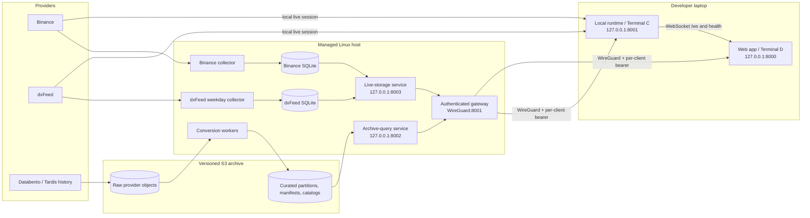

# Platform architecture

[Handbook](../README.md) · [Onboarding](00-developer-onboarding.md) ·
[Access](02-developer-access.md) · [Server runbook](03-server-runbook.md)

This page defines the supported laptop, host, network, storage, and S3
boundaries. It is not a live health dashboard. A committed unit means the
service can be installed; it does not prove that a particular revision is
deployed, enabled, running, or currently healthy.

## End-to-end topology

The gateway does **not** distribute live provider ticks. Terminal C owns the
laptop's live Binance or dxFeed session and serves the local WebSocket. The
gateway exposes three bounded historical surfaces:

- `/live-storage/*` relays recent collector history to the laptop runtime for
  supported warm-up and replay/backfill reads, and the heatmap pyramid
  (`heatmap-columns`, which the runtime serves on to the chart at
  `/heatmap/columns`) with its walls and events (`wall-history`,
  `event-history`, taken into the runtime's own histories), and the iceberg
  history (`iceberg-history`: the settled icebergs the host's builder saw,
  taken into the runtime's own history for the spans it did not watch).
- `/archive/query` relays versioned curated queries used by Historical Mode.
- `/archive/study` computes Historical Mode's profile, VPIN, large-print and
  bar-flow studies from the derived trade families over the same loopback
  archive service, under each client's own `<clientId>.study` read budget
  ([contract](../contracts/archive-study/v1/archive-study-v1.md)).

## Trust and network boundaries

| Boundary | Rule |
|---|---|
| Public network | No archive, live-storage, SQLite, or browser-query service binds here. |
| WireGuard data plane | The gateway may bind to its reviewed private address and port. Each developer has their own peer and bearer, issued and revoked together by `developer-access.sh`. |
| Tailscale | Reaches the dxFeed token broker only. Access is granted per developer in the Tailscale admin console. |
| Host loopback | Archive query listens on `127.0.0.1:8002`; live storage listens on `127.0.0.1:8003`. Neither accepts a developer credential directly. |
| Laptop loopback | The runtime normally owns `127.0.0.1:8001`; Vite normally owns `127.0.0.1:8000`. |
| SSH control plane | Separate operator access for host administration. WireGuard application access does not imply SSH. |
| S3 | Query has curated read-only credentials. Conversion has separately scoped publication credentials. The gateway and browser hold no S3 key. |

The gateway authenticates the developer bearer, derives a client identity, and
uses separate internal secrets for the query and live-storage services. Never
give those internal secrets to a laptop or browser.

## Process ownership

| Process | Identity | Data authority | Lifecycle |
|---|---|---|---|
| `terminal-collector.service` | `ttcollect` | Writes Binance capture SQLite | Long-running system service after explicit activation |
| `terminal-dxfeed-collector.service` | `ttcollect` | Writes dxFeed capture SQLite | No boot install target; weekday timers control the approved window |
| dxFeed start/stop timers | systemd | Start Monday 00:00 UTC; stop Saturday 00:00 UTC | Enabling timers is an explicit operator action |
| `terminal-live-storage.service` | `ttcollect` | Read-only access to both capture stores | Loopback-only, supervised |
| `terminal-archive-query.service` | `ttquery` | Curated S3 read plus local catalog/cache | Exactly one loopback process |
| `terminal-archive-gateway.service` | `ttgateway` | No capture, curated, or S3 file access | Authenticated relay; private bind only |
| Conversion/backfill units | `ttconvert` | Raw read and bounded curated publication | Explicit jobs, separate resource slice |

The dxFeed collector's lack of an `[Install]` section is intentional: a reboot
must not open a monitored licensed connection merely because the service file
exists. The non-persistent weekday timers also do not replay a missed Monday
start after a mid-week reboot. The operator must verify the schedule and make a
deliberate recovery decision.

## Data paths

### Live provider delivery

The laptop runtime connects directly to the selected provider and emits the
canonical WebSocket frames consumed by the web application. Binance needs no
credential; dxFeed sessions take a short-lived token from the token broker,
which is reachable only on the owner's tailnet. Collector lifetime
is independent of this local runtime.

### Recent live-storage history

Hosted collectors persist provider-specific SQLite databases under the capture
data root. The live-storage service opens those databases read-only while the
collector remains the sole writer. Provider selection is explicit in the
request; Binance remains the default for backward compatibility. Expensive
reads run in worker isolation and are bounded and cancellable.

Remote storage can supply history that the host actually captured. It cannot
fill a collector outage, an instrument that was not subscribed, or data outside
the store's retention and query bounds.

### Curated Historical Mode

Historical acquisition retains provider objects in S3. Conversion publishes
versioned observations, manifests, and immutable catalog snapshots. The query
service pins a catalog snapshot and performs bounded reads; the browser never
lists S3 or chooses arbitrary object paths.

Recent live storage and the curated archive solve different problems. A
successful live-storage warm-up is not proof of a published archive partition,
and an archive partition is not proof that the live collector is healthy now.

## Storage locations

| Location | Purpose |
|---|---|
| Laptop checkout | Development, fixtures, local runtime, and UI |
| `/opt/terminal-l1-l2/src` | Managed deployment source checkout |
| `/opt/terminal-l1-l2/releases` | Immutable application releases |
| `/opt/terminal-l1-l2/current`, `previous` | Selected and rollback release pointers |
| `/opt/terminal-l1-l2/ops` | Selected, manifest-recorded operational release |
| `/srv/terminal-data/capture` | Live SQLite databases and WAL companions |
| `/srv/terminal-data/curated-staging` | Conversion inventory, checkpoints, cache, and splits |
| `/srv/terminal-data/curated` | Local curated working copies that may be evicted after publication |
| `/srv/terminal-data/query-catalogs` | Query-service catalog snapshots and source map |
| `/srv/terminal-data/query-cache` | Bounded query cache |
| `/etc/terminal-l1-l2` | Root-managed protected service configuration |
| `/run/terminal-l1-l2/collector-health.json` | Collector pressure signal used by conversion |
| S3 raw prefixes | Retained provider bytes |
| S3 curated namespace | Published immutable partitions, manifests, and catalogs |

The OS and data disks are not mirrored backups. Services must refuse to fall
back onto the OS disk when the data mount disappears. S3 publication and
consistent live-database backups protect different failure domains.

## Governed and deliberately incomplete areas

- Exact supported instruments and provider properties come from
  [`config/market-instruments.json`](../../config/market-instruments.json).
- Dated dxFeed futures require an explicit, evidence-backed rollover; the
  runtime does not guess the active contract.
- Provider entitlements and market coverage can change independently of code.
- External alert delivery is not accepted merely because an `OnFailure` unit
  exists; delivery and recovery require their own test.
- Historical coverage must be read from catalogs and query coverage fields,
  not inferred from a successful process or the presence of a directory.

For live process evidence use the [server runbook](03-server-runbook.md). For
published formats use the [archive contract](../contracts/archive/v1/README.md).
For conversion execution use the [archive runbook](04-archive-runbook.md).
