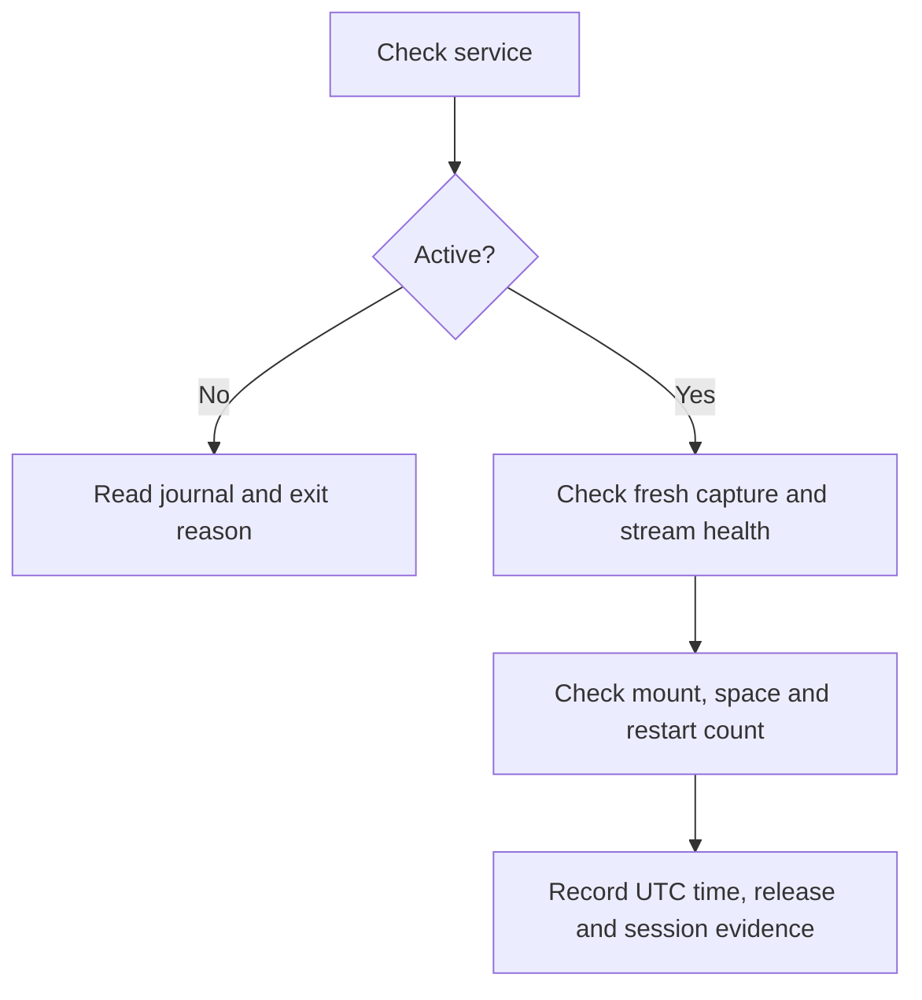
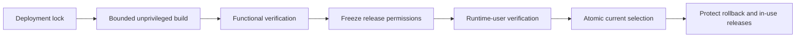
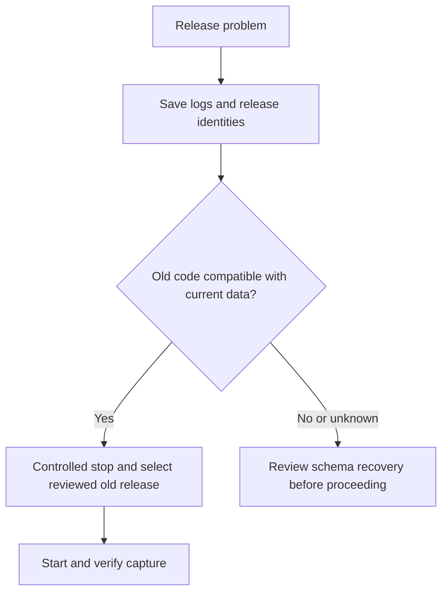

# Server runbook

[Handbook](../README.md) | [Archive operations](04-archive-runbook.md)

[Architecture and status](01-hosted-platform.md) · [Developer access](02-developer-access.md)

Commands below run **inside the Ubuntu SSH session**. `sudo` actions require operator authorization. Do not run a second collector manually alongside the service.

## Service inventory

The unit file defines what can run. `is-enabled`, `is-active`, the selected
release, and the journal establish what is configured and running now.

| Unit | Identity | Bind/data access | Protected environment | Expected lifecycle |
|---|---|---|---|---|
| `terminal-collector.service` | `ttcollect` | Writes Binance capture under `/srv/terminal-data/capture` | `collect/service.env` | Enabled long-running service after explicit acceptance |
| `terminal-dxfeed-collector.service` | `ttcollect` | Writes dxFeed capture under the same data root | `collect/service.env` | Started/stopped by weekday timers or explicitly by an operator; cannot be enabled directly |
| `terminal-dxfeed-collector-start.timer` | systemd | Starts dxFeed Monday 00:00 UTC | none | Explicitly enabled; non-persistent |
| `terminal-dxfeed-collector-stop.timer` | systemd | Runs the stop action Saturday 00:00 UTC | none | Explicitly enabled; non-persistent |
| `terminal-live-storage.service` | `ttcollect` | Read-only capture access; reads the heatmap pyramid (columns, walls, events); `127.0.0.1:8003` | `live-storage/service.env` | Supervised internal service |
| `terminal-heatmap-pyramid.service` | `ttcollect` | Read-only capture access; writes `/srv/terminal-data/heatmap` (one SQLite store per pair, 7 days of 10 s / 30 s / 1 m / 5 m heatmap columns with each window's ended walls and folded trade events, `status.json`) | none | Supervised long-running builder; needs `/srv/terminal-data/heatmap` owned by `ttcollect` before its first start |
| `terminal-iceberg-history.service` | `ttcollect` | Read-only capture access; writes `/srv/terminal-data/iceberg-history` (one SQLite store per pair, 7 days of settled native and probable icebergs with the watched spans and gaps, `status.json`) | none | Supervised long-running builder; needs `/srv/terminal-data/iceberg-history` owned by `ttcollect` before its first start; live-storage reads the stores through `TT_ICEBERG_DIR` |
| `terminal-archive-query.service` | `ttquery` | Curated/catalog read, cache write; `127.0.0.1:8002` | `query/service.env` | Exactly one supervised internal process |
| `terminal-archive-gateway.service` | `ttgateway` | No capture/S3 filesystem access; loopback or reviewed private address on port 8001 | `gateway/service.env` | Supervised authenticated relay |
| `terminal-backfill@{ohlcv,l1,l2}.service` | `ttconvert` | Staging and curated publication paths | `convert/service.env` | Explicit bounded oneshot job |
| `terminal-backfill-binance@{tardis-l1,tardis-l1agg}.service` | `ttconvert` | `binance-staging`, `curated-binance` | `convert/service.env` | Explicit bounded oneshot job (crypto from Tardis) |
| `terminal-disk-space.timer` | systemd/`ttquery` | Filesystem statistics only | optional `monitoring.env` | Persistent five-minute monitor |
| `terminal-capture-freshness.timer` | systemd/`ttquery` | Binance collector unit state and `/run/terminal-l1-l2/collector-health.json` only | optional `monitoring.env` | Two-minute monitor: alerts when the collector is down, its health file is older than 180 s, its oldest pending write is older than 120 s, recovery stays open over 300 s, or integrity is invalid. It requires the new `collectorStatus` and `recoveryAgeMs` health fields; enable only after the upgraded collector writes them. It does not monitor the separate dxFeed collector. |
| `terminal-log-retention.timer` | systemd/root | Prunes eligible dated file logs | none | Five-minute maintenance timer |
| `terminal-capture-export.timer` | systemd/`ttcollect` | Reads both collector databases, writes `raw/live-capture/` in S3 and `/var/lib/terminal-l1-l2/capture-export` | systemd credential `/etc/terminal-l1-l2/capture-export/s3.credentials` | Daily at 01:00 UTC; enable after its first manual run (section 6) |
| `terminal-capture-retention.timer` | systemd/`ttcollect` | Deletes exported capture rows older than 21 days from both collector databases under `/srv/terminal-data/capture` | none | Daily at 03:30 UTC; enable after the export's first run and its own first manual run (section 6) |
| `terminal-alert@.service` | `ttquery` | Executes the configured notification helper | optional monitoring/alert files | Failure hook; delivery needs separate acceptance |

All service environment files live below `/etc/terminal-l1-l2`, outside the
checkout and immutable application releases. `check-service-env.sh` verifies
owner, mode, type, and required keys before protected services start. Never
diagnose by printing a complete environment file.

`terminal-worker.service.example` is a fail-closed template. It must not be
installed or enabled as an application service.

## Change-to-action matrix

Deployment selects code for the next process start; it does not replace an
already-running process. Apply only the smallest action required by the change.

| Change | Install ops? | Deploy app? | Intentional lifecycle action |
|---|---:|---:|---|
| Node/Python application code | No, unless an ops artifact also changed | Yes | Restart only affected services after interruption approval |
| systemd unit, host script, or host template | Yes | Only if application code also changed | Reload is done by installer; enable/start/restart remains explicit |
| Developer access (peer + bearer) | No | No | `developer-access.sh` issues or revokes both and restarts only the gateway (section 8) |
| Gateway internal URLs/secrets | No | No | Restart gateway and the matching internal service when its shared secret changes |
| Query S3 identity | No | No | Restart archive query; gateway normally remains running |
| dxFeed broker URL or collector environment | No | No | Restart dxFeed collector only inside an approved collection window |
| Governed instrument catalog | No, unless units changed | Yes | Coordinate runtime and collector restarts; perform the rollover procedure |
| Archive source map/catalog snapshot | No | No | Follow archive-query synchronization procedure; restart only if the runbook requires it |
| Monitoring or alert destination | No | No | Start a controlled alert test; do not restart collectors merely to test delivery |
| A setting in a service env file | No | No | Run `node apps/runtime/scripts/verify/check-config.js <process> --env-file <file>` first: services refuse to start on an invalid value ([configuration](09-configuration.md)) |
| Roll back to the previous release | No | No (`select-release.sh`) | Restart only the services whose code differs; section 4 |

Before restarting a service, record its current release, PID, restart count,
session evidence, and dependent services. A shared `current` symlink means a
later restart can move one service to newer code while another still runs the
old release; treat mixed-release operation as an explicit compatibility
decision.

## 1. Check health without changing anything

```bash
systemctl is-active terminal-collector.service terminal-dxfeed-collector.service terminal-live-storage.service terminal-archive-query.service terminal-archive-gateway.service
systemctl is-enabled terminal-collector.service terminal-live-storage.service terminal-archive-query.service terminal-archive-gateway.service terminal-dxfeed-collector-start.timer terminal-dxfeed-collector-stop.timer
systemctl show terminal-collector.service -p ActiveState -p SubState -p MainPID -p NRestarts -p MemoryCurrent -p MemoryHigh -p MemoryMax -p CPUQuotaPerSecUSec -p TasksMax -p ControlGroup
findmnt -rn -M /srv/terminal-data -o TARGET,SOURCE,FSTYPE,OPTIONS
df -h / /srv/terminal-data
readlink -e /opt/terminal-l1-l2/current
sudo -n journalctl -u terminal-collector.service --since "15 minutes ago" --no-pager
systemctl list-timers --all terminal-disk-space.timer terminal-capture-freshness.timer terminal-log-retention.timer terminal-capture-export.timer terminal-capture-retention.timer terminal-dxfeed-collector-start.timer terminal-dxfeed-collector-stop.timer
ss -lntp | grep -E ':(8001|8002|8003)[[:space:]]'
```

Expected for ongoing Binance collection: active, enabled, correct data mount, adequate free space, stable restart count and fresh healthy capture evidence. `active` alone proves only that the process is running. The tracked `terminal.slice` is the collector resource boundary; record its effective values with each release.

The dxFeed collector (`terminal-dxfeed-collector.service`) is weekday-scheduled, not enabled at boot — check it the same way, plus its two timers:

```bash
systemctl is-active terminal-dxfeed-collector.service
systemctl show terminal-dxfeed-collector.service -p ActiveState -p SubState -p MainPID -p NRestarts
systemctl show terminal-dxfeed-collector-start.timer terminal-dxfeed-collector-stop.timer -p ActiveState -p NextElapseUSecRealtime
sudo -n journalctl -u terminal-dxfeed-collector.service -u terminal-dxfeed-collector-stop.service --since "15 minutes ago" --no-pager
```

Between Saturday 00:00 UTC and Monday 00:00 UTC, `terminal-dxfeed-collector.service` being `inactive` is the expected weekday-off state, not a fault.
Both timers are deliberately non-persistent: a mid-week reboot does not replay
Monday's missed start. Resume that week's collection only with an explicit,
recorded `systemctl start terminal-dxfeed-collector.service` after health and
single-writer checks.



Before sharing logs, redact tokens and sensitive connection details. Do not dump `service.env` or process environments into reports.

For the serving path, inspect each hop separately:

```bash
systemctl show terminal-live-storage.service terminal-archive-query.service terminal-archive-gateway.service -p ActiveState -p SubState -p MainPID -p NRestarts -p FragmentPath
sudo -n journalctl -u terminal-live-storage.service -u terminal-archive-query.service -u terminal-archive-gateway.service --since "15 minutes ago" --no-pager
curl --fail --silent --show-error http://127.0.0.1:8002/health
curl --fail --silent --show-error http://127.0.0.1:8003/health
```

The laptop WebSocket server's `/health` response separates operational facts
that must not be collapsed into one "healthy" flag:

- `ready` means the HTTP/WebSocket process completed startup.
- `readiness.dimensions.transport` reports the selected Binance feed path;
  `capture` reports collector freshness; `storage` reports query availability;
  and `analytics` summarizes analytic availability. A process may be ready
  while one of these dimensions is degraded.
- `readiness.warmups` reports each active-pair job independently. Governed
  states are `DISABLED`, `IDLE`, `STARTING`, `RUNNING`, `READY`, `DEGRADED`,
  `UNAVAILABLE`, and `FAILED`; reasons are bounded machine codes. In
  particular, `DISABLED_BY_CONFIG` is intentional and is not an outage.
- liquidity has separate `liquidity_recent` and `liquidity_deep` entries. The
  recent tier becoming ready does not claim that the deep tier has finished.
- `dxfeed.readiness.dimensions` and `dxfeed.readiness.instruments` provide the
  equivalent transport, capture, storage, analytics, and L2 facts for dxFeed.

Treat transitions as the primary lifecycle evidence. Routine progress is
sampled; successful rebuilds log at info, partial/unavailable states at warn,
and failed work at error. Repeated identical states are not repeated as new
incidents. The one-minute heartbeat is a summary, not proof of historical
coverage: read its explicit degraded reason and then inspect `/health`.

Use the exact health paths implemented by the selected release if either
service does not expose `/health`; a connection refusal and an authenticated
application error are different failures. Do not test the private gateway by
placing a real bearer on a shared command line or in shell history. Perform its
authenticated acceptance from an approved developer client using the procedure
in [Developer access](02-developer-access.md#verify-the-tunnel-from-the-laptop).

## 2. Understand lifecycle actions

For a bounded database snapshot, run the reviewed inspector from your checkout as an operator with permission to read capture data:

```bash
sudo -n -u ttcollect python3 ops/linux-host/scripts/inspect-capture-soak.py /srv/terminal-data/capture/live/market-data.sqlite
```

The script opens SQLite read-only and reports recent sessions, grouped incidents, latest timestamps per pair/family and file sizes. It does not checkpoint the WAL or scan all event rows. An active session's quality field is finalized at shutdown: consult its incidents as well. Fresh records and a HEALTHY heartbeat do not erase earlier gaps. Save separate snapshots to measure change; a single sample cannot prove a memory plateau or daily storage rate.

| Action | Effect |
|---|---|
| Status and journal commands | Inspect without interrupting collection |
| Deploy a release | Select code for the next start; does not restart the running process |
| `systemctl stop` | Interrupt capture and request a graceful drain |
| `systemctl start` | Start the selected release |
| `systemctl enable` | Configure startup at boot; does not start now |
| `systemctl enable --now` | Enable at boot and start now |
| Restart, reboot or fault injection | Causes an interruption; schedule and record it |

`terminal-dxfeed-collector.service` and its two timers (`terminal-dxfeed-collector-start.timer` / `-stop.timer`, report 49 P1i) are shipped by `install-ops.sh` like every other unit, but installing an ops release never starts or enables anything. Enabling the non-persistent timers is one explicit operator decision; if activation happens mid-week, starting the collector for that partial week is a second explicit decision. Before either action, coordinate with any laptop-local collector session first (`docs/architecture/dxfeed/DX-OPERATIONS-RUNBOOK.md`) — only one writer may own `dxfeed-market-data.sqlite`; do not assume independent stores are automatically reconciled. The service has no `[Install]` section and therefore cannot be enabled directly, although an operator may still start it manually after the required checks.

## 3. Deploy reviewed code

First deliver the reviewed source commit through the team's approved Git workflow. Confirm schema/configuration compatibility, available disk space and the installed ops-script version. Replace `APPROVED_COMMIT` with the reviewed full commit ID:

```bash
cd /opt/terminal-l1-l2/src
git rev-parse --verify 'APPROVED_COMMIT^{commit}'
test -z "$(git status --porcelain -- ops/linux-host)"
sudo -n ops/linux-host/scripts/install-ops.sh
sudo -n /opt/terminal-l1-l2/ops/scripts/deploy.sh APPROVED_COMMIT
```

The first migration of an existing `/opt/terminal-l1-l2/ops` directory or
managed unit/journald file is a separately reviewed change: use
`install-ops.sh --adopt` and record every archived legacy path. The installer
validates all managed units, records `OPS_MANIFEST.sha256`, selects the ops
release atomically, and reloads systemd without starting application services. If it reports
`JOURNALD_RESTART_REQUIRED=1`, schedule that restart separately. Record:

```bash
readlink -e /opt/terminal-l1-l2/ops
cat /opt/terminal-l1-l2/ops/OPS_METADATA
(cd /opt/terminal-l1-l2/ops && sha256sum -c OPS_MANIFEST.sha256)
systemctl show terminal-collector.service terminal-backfill@.service -p FragmentPath -p MemoryHigh -p MemoryMax -p CPUQuotaPerSecUSec -p TasksMax
```

### Iceberg history, first rollout

The unit ships with `install-ops.sh` like every other one; nothing starts it.
In this order, each step an operator decision:

```bash
sudo -n ops/linux-host/scripts/provision-data-dirs.sh   # creates iceberg-history/ owned by ttcollect
sudo -n systemctl enable --now terminal-iceberg-history.service
sudo -n systemctl restart terminal-live-storage.service  # picks up TT_ICEBERG_DIR and the iceberg-history route
sudo -n systemctl restart terminal-archive-gateway.service
cat /srv/terminal-data/iceberg-history/status.json       # one entry per pair: state and reason, cursor, settledThrough, icebergs, gaps, droppedGaps
```

A Binance pair serves nothing for its first 24 h of capture (the learned
cuts warm up); futures serve from the first chunk. `TT_ICEBERG_HISTORY=0` in
the unit stops the builder at start with exit 2. The 7-day backlog builds at
replay speed (about 10 s per pair-hour of Binance capture on the laptop);
`TT_ICEBERG_CHUNKS_PER_CYCLE` bounds how long one pair holds the turn. A stop
or restart takes effect after the chunk in hand. The unit's start check looks
for the Binance capture only: while the dxFeed capture cannot be opened, its
pairs show `WAITING` with `CAPTURE_UNREADABLE` and are picked up once the file
opens, without a restart. `droppedGaps` counts gaps the store could not hold
(that time reads as watched); it should stay 0.



Inspect the outcome:

```bash
readlink -e /opt/terminal-l1-l2/current
cat /opt/terminal-l1-l2/current/RELEASE_METADATA
readlink -e /opt/terminal-l1-l2/previous
```

`previous` may be absent after the first deployment. Read warnings as well as the success marker. Application and ops releases have separate, recorded pointers; deploy only after the compatible ops manifest has been selected.

When ready for an intentional interruption:

```bash
sudo -n systemctl stop terminal-collector.service
systemctl is-active terminal-collector.service
```

Confirm the process exited and the journal/session evidence shows a clean drain. Then:

```bash
sudo -n systemctl start terminal-collector.service
```

Repeat health checks and verify a new session and fresh writes. The `current` link by itself does not prove which code an already-running process uses.

## 4. Rollback is a compatibility decision



Swapping code never reverses a database migration, so first confirm the old
release can run against today's data. Then select it with
`ops/linux-host/scripts/select-release.sh`. It takes the same deployment lock as
`deploy.sh`, accepts only a frozen, root-owned release under
`/opt/terminal-l1-l2/releases/` that `deploy.sh` activated, swaps `current`
atomically, records the outgoing release as `previous`, and deletes nothing.

```bash
readlink -e /opt/terminal-l1-l2/current /opt/terminal-l1-l2/previous
sudo -n /opt/terminal-l1-l2/ops/scripts/select-release.sh previous
```

Selecting a release restarts nothing. Restart only the services whose code
differs between the two releases, one at a time, and verify each as in
section 1:

```bash
sudo -n systemctl restart terminal-archive-gateway.service
curl --fail --silent --show-error http://127.0.0.1:8002/health
```

To roll forward again, run `select-release.sh` with the newer release directory
and restart the same services. Record both pointers, the PIDs and the time of
each step. Do not delete lock files or release directories as an improvised
recovery step.

## 5. Configuration, storage and alerts

| Item | Operational rule |
|---|---|
| Server secrets | Protected files under `/etc/terminal-l1-l2`; use [configuration templates](../../ops/linux-host/config/) without putting real values in Git |
| `TT_DATA_ROOT` | Hosted collector uses `/srv/terminal-data/capture`; confirm effective configuration before changing paths |
| `TT_LOG_DIR` | Collector file logs are separate from the systemd journal |
| Log retention | Periodic pruning preserves the active day; its budget is not a hard disk quota |
| Disk monitor | Detects pressure; does not safely decide which market data to delete |
| Alert hook | A local journal message is not external alert delivery; configure and test a real destination |
| Backups | Use a consistent SQLite backup/snapshot procedure; do not copy only the main file while WAL writes continue |

## 6. Incident response

The host capture limits are `TT_MAX_DB_BYTES=483183820800` (450 GiB per collector
database, raised from 400 GiB on 2026-10-24) and `TT_MIN_FREE_DISK_BYTES=21474836480`
(20 GiB reserve), both in `collect/service.env`. These are application safety
thresholds on the database, WAL and SHM file bytes, not filesystem quotas.
A sustained breach stops capture with exit 78, and both collector units refuse to
restart on 78: a restart would breach again, and each dxFeed start takes a broker
token. The `OnFailure` alert still fires; the dxFeed weekday timer still makes its
one Monday start. Never raise the limit repeatedly without addressing capacity.
Both collectors log once when their database crosses 80 % and 90 % of the limit.

`terminal-capture-retention.service` retains a 21-day UTC window. Each daily run
deletes expired Binance `trades`, `l2_depth_events` and `l2_depth_snapshots` and
dxFeed time-and-sales, quotes and trades by event time, using indexed, bounded row
batches beside the live writers. Event timestamps need not follow insertion order.
The dxFeed order-book table instead loses only its contiguous arrival-order prefix
before the cutoff: native order times inside a fresh snapshot can be much older.
At the first row received at or after the cutoff it stops, retaining every later
id, including older timestamps after a receive-clock reversal. It never removes
an interior row from that suffix. A snapshot or transaction straddling the removed
prefix cannot seed replay; the reader waits for the next complete snapshot. The
window therefore does not promise uninterrupted L2 coverage at its oldest edge.
Binance trades not yet in the daily notional rollup are kept. Candles, sessions, incidents, audits and rollups
are not touched. Deleted rows leave free pages that SQLite reuses, so the files stop
growing instead of shrinking; never run `incremental_vacuum` on these databases
while the free pages sit at the front of the file (measured 2026-10-24: about 13
minutes per 50,000 pages). Retention frees reusable pages; it does not lower a
collector's physical-file capacity reading. A collector already above its byte
limit needs a separately reviewed capacity recovery before restarting.
A run stops starting delete batches at `--max-seconds`; an in-flight SQLite
statement can finish later. Remaining time is shared across databases and tables,
so a large backlog or blocked WAL cannot monopolize every pass. A WAL stat error
fails the target; a WAL above 2 GiB pauses deletions within that target's budget.
The next run resumes from remaining rows, without a progress file.
Each pass logs one `capture retention pass finished` line per database with the
cutoff, the exclusive id ceiling and rows deleted per table, and whether it
finished. The ceiling is frozen at the start of each table, capped by the rollup
watermarks for Binance trades; it is not a promise to delete every preceding id.
`done=true` means the eligible work for that plan finished, and can coexist with
`heldBy` rollup protection. A time-bounded partial pass exits successfully with
`done=false`; inspect that field and growth rather than service exit alone.
Dry runs open the capture databases read-only, never migrate them, and report the
same cutoff and id ceilings without counting or deleting the backlog.

Retention deletes only rows the capture export has copied to S3. Each table's id
ceiling is also capped at `exportedThroughId + 1` from
`/var/lib/terminal-l1-l2/capture-export/watermark.json` (`heldBy: "export
watermark"`); a table the watermark does not name is not pruned (`"export watermark
missing"`); a missing or unreadable watermark file stops the whole pass with exit 1.

`terminal-capture-export.service` (daily 01:00 UTC, before retention) copies the
seven pruned tables unchanged to
`s3://chartprime-historical-data/raw/live-capture/<binance|dxfeed>/<table>/date=<UTC day of the chunk's earliest time>/ids-<from>-<to>.sqlite.zst`
(the time column retention uses: `ts`, `captured_at`, `received_at` or `event_time`).
Each object is one sealed id range, bounded by a per-table grid (2,000,000 ids; Binance
depth events 150,000; snapshots 3,000) as a zstd-compressed SQLite file with the
table's own schema, next to a `.json` manifest (rows, id and time range, sha256,
schema and source-file identity). A pass freezes each table's committed maximum id
and exports its final partial range too, so quiet tables do not wait for millions
of later rows. The daily pass includes all rows present at its snapshot, including
the closed day's capture and any newer arrivals already committed. A date folder
is the earliest time in a range, not a claim that the object contains only that day;
future consumers must select manifests by their full time ranges.
Before uploading, the exact pending range is atomically saved and fsynced in the
version-2 watermark; retrying after a crash uses that same range even if new rows
have arrived. Only after both objects pass read-back does `exportedThroughId` move.
On Linux, checkpoint directory updates are fsynced as well.
Objects are written once (`If-None-Match: *`), read back and hashed before the
watermark advances; a different existing object fails the run. It reads the capture
databases read-only in short read transactions and holds one chunk in staging under
`/srv/terminal-data/capture/export-staging` at a time. Rows are read in batches of
about 32 MB, and each chunk is compressed, hashed, uploaded and read back as a
stream, so memory does not grow with the chunk's size. The exporter can address only
`raw/live-capture/`. Each pass logs one `capture export pass finished` line per
database with chunks, rows, `exportedThroughId` per table and `done`.
`done` refers to that pass's frozen id ceiling, not to rows arriving afterward.
The watermark binds the destination and each source's canonical path, file id and
first capture-session id (from the session history that retention never deletes);
retention refuses a mismatched source before deleting. A single host-wide advisory
lock at `<watermark>.lock` prevents the daily and manual backlog units from sharing
staging concurrently; an overlapping run fails without starting an export.
The source tables must remain append-only apart from this gated retention. Any
restore, in-place rewrite, file replacement or relocation requires stopping the jobs
and reviewing the source/checkpoint together; reusing a checkpoint after restoring
older contents is unsafe even if an in-place restore preserves the file id.

Its own IAM user, with only this policy:

```json
{
  "Version": "2012-10-17",
  "Statement": [
    {"Effect": "Allow", "Action": ["s3:PutObject", "s3:GetObject"],
     "Resource": "arn:aws:s3:::chartprime-historical-data/raw/live-capture/*"},
    {"Effect": "Deny", "Action": "s3:PutObject",
     "Resource": "arn:aws:s3:::chartprime-historical-data/raw/live-capture/*",
     "Condition": {"Null": {"s3:if-none-match": "true"}}},
    {"Effect": "Allow", "Action": "s3:ListBucket", "Resource": "arn:aws:s3:::chartprime-historical-data",
     "Condition": {"StringLike": {"s3:prefix": ["raw/live-capture/*"]}}}
  ]
}
```

Unconditional uploads are denied even though `PutObject` is granted: no-delete
permission alone does not prevent an overwrite. This exporter uses conditional
single-object PUTs; multipart uploads are not part of this policy. `ListBucket`
is needed for the checkpoint bootstrap check. A 403 is always an error, never
assumed to mean the object is missing. Its
keys go in root-owned `0600` `/etc/terminal-l1-l2/capture-export/s3.credentials` as
`AWS_ACCESS_KEY_ID=…` and `AWS_SECRET_ACCESS_KEY=…` lines; systemd passes them to the
unit as a credential, and no other unit can read them.

First runs after installing the units:

```bash
sudo -n systemctl start terminal-capture-export.service
sudo -n journalctl -u terminal-capture-export.service --no-pager | grep "capture export pass"
sudo -n cat /var/lib/terminal-l1-l2/capture-export/watermark.json
sudo -n systemctl enable --now terminal-capture-export.timer
sudo -n -u ttcollect env TT_DATA_ROOT=/srv/terminal-data/capture TT_LOG_DIR=/var/log/terminal-l1-l2/collect /opt/terminal-l1-l2/node-v24.21.0-linux-x64/bin/node /opt/terminal-l1-l2/current/apps/runtime/scripts/maintain/prune-capture-retention.js --dry-run --export-watermark /var/lib/terminal-l1-l2/capture-export/watermark.json
sudo -n systemctl start terminal-capture-retention.service
sudo -n journalctl -u terminal-capture-retention.service --no-pager | grep "capture retention pass"
sudo -n systemctl enable --now terminal-capture-retention.timer
```

The backlog exports oldest ids first, and retention follows the watermark, so it
never overtakes the export. The first backlog is large (on 2026-10-25 about 270M
Binance trades, 100M depth events and 740M dxFeed order-book rows); run it once by
hand with a longer budget, then read the summary before enabling the timer:

```bash
sudo -n systemd-run --unit=capture-export-backlog --wait --collect -p User=ttcollect -p Group=ttcollect \
  -p StateDirectory=terminal-l1-l2/capture-export -p StateDirectoryMode=0750 \
  -p LoadCredential=s3:/etc/terminal-l1-l2/capture-export/s3.credentials \
  -p Environment=TT_DATA_ROOT=/srv/terminal-data/capture -p Nice=10 -p IOWeight=50 -p MemoryMax=1G \
  /opt/terminal-l1-l2/converter-env/.venv/bin/python /opt/terminal-l1-l2/current/apps/runtime/conversion/capture_export.py \
  --bucket chartprime-historical-data --region eu-central-1 --target all \
  --watermark /var/lib/terminal-l1-l2/capture-export/watermark.json \
  --staging-dir /srv/terminal-data/capture/export-staging --credentials '${CREDENTIALS_DIRECTORY}/s3' --max-seconds 21600
sudo -n journalctl -u capture-export-backlog --no-pager | grep "capture export pass"
```
A changed chunk grid (`TARGETS` chunk sizes), source identity, destination or an
existing object with different bytes stops the export; it never overwrites.
Recovery needs the owner: preserve the source, checkpoint and remote objects,
reconcile their exact id ranges, then restore a verified checkpoint or choose a
reviewed new export namespace. Do not clear the watermark or delete conflicting
archive objects as a retry shortcut. Version-1 watermarks are refused; there is no
automatic migration of an unbound checkpoint.
Before rolling application or ops back to a release without export gating, stop
and disable the retention timer and ensure the retention service is inactive,
on the owner's go. Keep it off until a reviewed application/ops pair preserves
the gate; rollback must not restore ungated deletion.
On first initialization the exporter checks this prefix for existing objects. If
objects exist but the local checkpoint is absent or empty, it refuses to bootstrap;
recover the checkpoint first, so previously archived id ranges cannot overlap a
newly chosen range after retention has removed part of the source.

Watch both collectors' journals during the first real run; a backlog or busy
checkpoint warning means the batches are too large for that host.
Do not delete the active database or its WAL.

External delivery is off until an alert env file is installed. The preferred
channel is a Discord webhook: copy `ops/linux-host/config/alert-webhook.env.example`
to root-owned `0600` `/etc/terminal-l1-l2/alert-webhook.env` and set
`TT_ALERT_WEBHOOK_URL`; it takes precedence over the email file. A check that
keeps failing alerts on every timer run. Keep free-space floors in
the non-secret root-owned `0644` `monitoring.env`. The optional
`ops/linux-host/config/alert-email.env.example` describes authenticated SMTP
configuration in the separate root-owned `0600` `alert-email.env`; the sender
helper must be installed executable and configured before enabling it. Do not
put `TT_ALERT_COMMAND`, `TT_ALERT_WEBHOOK_URL`, `TT_SMTP_*`, `TT_ALERT_FROM`, or `TT_ALERT_TO` in
`monitoring.env`. Changing `TT_ALERT_TO` changes the recipient on subsequent
alert-unit starts.
An alert emitted by this server cannot detect the server itself being offline;
external host-down monitoring belongs to recovery qualification.

What each alert means:

| Alert text begins with | Meaning | First response |
|---|---|---|
| `capture stopped` | `terminal-collector.service` is not active | Read its journal and exit reason; start it only after the cause is known |
| `capture health unknown` | The health file is missing: the collector never wrote one, or runs a release older than the check | Confirm the running release; do not enable the timer before the collector writes the file |
| `capture health unreadable` | The health file lacks a field the check needs | Same as above: an older collector release fails closed on purpose |
| `capture stalled` | The collector runs but stopped writing its health file (over 180 s) | Check the journal and event loop; a hung process needs a controlled restart |
| `capture writes stalled` | Captured events wait over 120 s to be written | Check disk space, WAL size and a long reader holding a checkpoint |
| `capture recovery stalled` | A route has been reconnecting for over 300 s (the FA-1 shape) | Read the Binance route lines in the journal; the gap it leaves is permanent |
| `capture invalid` | The integrity monitor reported a fatal failure | Preserve the journal and session incidents before any restart |
| `capture freshness check misconfigured` | A check setting is not a whole number | Fix `monitoring.env`; the check proves nothing until then |
| a disk-space failure | Free space is under a `monitoring.env` floor | Inspect growth; never delete the active database or WAL |
| a unit name (`terminal-alert@<unit>`) | That unit exited with an error | Read its journal; restart only after the cause is known |

| Problem | First response |
|---|---|
| Data mount missing | Keep collection stopped; restore the correct mount before starting |
| Disk pressure | Inspect growth and retention; never remove active DB/WAL files to gain space |
| Repeated crashes | Preserve exit reasons and session evidence; diagnose before clearing start limits |
| Suspected corruption | Stop the writer, preserve evidence and follow a reviewed restore procedure |
| SSH unavailable | Use the owner's recovery-console path; do not expose new management ports as a shortcut |
| Provider unavailable | Preserve provider/session evidence; report the coverage gap instead of presenting stale or absent data as complete |

## 7. Handoff and qualification

Record the UTC window, exact release, service state, capture-session identifiers, stream coverage, incidents, storage growth and observed resource usage. A healthy early soak is not a completed reliability test.

Sustained capture, graceful stop, crash recovery, duplicate-writer rejection and admitted-versus-committed reconciliation need recorded evidence. Destructive disk tests belong on isolated fixtures. Reboot recovery, external alerts and off-host restore remain explicit acceptance items until demonstrated.
## 8. Issue, rotate and revoke developer access

Developer access is layer 1 in [onboarding](00-developer-onboarding.md): one
WireGuard peer and one gateway bearer per developer, always issued and revoked
together. `developer-access.sh` does both in one step. It edits
`/etc/wireguard/wg0.conf` and the gateway's `TT_ARCHIVE_CLIENT_TOKENS`, records
the developer in a root-only registry, and never handles a developer's private
key. Each run is a host state change and needs the owner's go-ahead.

The script ships in the ops tree. After `install-ops.sh` it is
`/opt/terminal-l1-l2/ops/scripts/developer-access.sh`; before that, the copy in
the selected release works the same way:
`/opt/terminal-l1-l2/current/ops/linux-host/scripts/developer-access.sh`.

### Issue

The developer sends their name and their tunnel's public key. Preview first;
a dry run reads the real files and changes nothing:

```bash
sudo /opt/terminal-l1-l2/ops/scripts/developer-access.sh --dry-run issue sam '<public-key>'
sudo /opt/terminal-l1-l2/ops/scripts/developer-access.sh issue sam '<public-key>'
```

`issue` refuses a duplicate name, key or token. Then it:

1. takes the next free address in `10.88.0.0/24`, never one that an earlier
   developer held;
2. backs up both files as `<file>.bak-<UTC stamp>` (mode `0600`), appends a
   marked `[Peer]` block and applies it with `wg syncconf`, so no other tunnel
   drops;
3. appends `dev-<name>:<secret>` to the token list, restarts only the gateway
   and waits up to 30 s for it to report ready;
4. writes the registry row, then checks the new bearer against the archive;
5. prints the tunnel settings to send in chat, and the bearer, which is shown
   only this once.

If the gateway does not come back, both files are restored and the old
configuration is reapplied. The restart refuses requests for every developer
for a few seconds, so issue access outside someone's active session.

Send the bearer only through a one-time secret link. The host keeps it only in
the root-only gateway environment, and the registry holds no secret.

### Revoke, rotate, record, list

```bash
sudo /opt/terminal-l1-l2/ops/scripts/developer-access.sh revoke sam
sudo /opt/terminal-l1-l2/ops/scripts/developer-access.sh note sam 'tailscale broker access granted 2026-09-22'
sudo /opt/terminal-l1-l2/ops/scripts/developer-access.sh list
```

- `revoke` removes the peer and the token together, restarts the gateway, and
  marks the registry row revoked. The address is not reused.
- To rotate a bearer, revoke and issue again with the same public key. The
  developer keeps their tunnel's private key, replaces its `Address` line with
  the new one (addresses are never reused) and updates the bearer in `.env`.
- `note` records anything outside this tool, such as layer-2 Tailscale access,
  so the registry stays the one list of who has what.
- `list` prints the registry with each peer's last WireGuard handshake, and
  counts peers in `wg0.conf` that this tool does not manage.

The registry is `/etc/terminal-l1-l2/access/developers.tsv`. A run holds
`developers.tsv.lock` for its duration; a leftover lock after a crash must be
removed by hand once no run is active. Paths can be pointed at copies with
`--wg-conf`, `--gateway-env` and `--registry`.

### Layer 2: the dxFeed broker

The token broker is reachable only on the owner's tailnet. Grant a developer
access in the Tailscale admin console, limited to the broker node, and record
it with `note`. Removing it is also a Tailscale admin action; `revoke` does not
touch the tailnet.

### Limits and one-time checks

- The archive service admits two reads at a time across all developers and one
  per developer; studies get 360 reads a minute per developer (their
  `<clientId>.study` budget). Two or three developers running studies at once
  is comfortable; beyond that their studies queue.
- Live-storage allows each developer 576 requests a minute, at the gateway and
  again at the service. A refused request answers 429 with `retryAfterMs` in the
  body and a `Retry-After` header; Terminal C waits that long and retries (up to
  20 s per read, 60 s per deep-backfill page) before it reports the read
  `RATE_LIMITED`. Terminal C's own count of requests and 429s over the last
  minute is on its `/health` under `runtime.hostReads`, and in the heartbeat.
- Peers created by hand before this tool are listed as unmanaged. Re-issue them
  through the tool with a key generated on the developer's own machine, then
  remove the old block by hand and delete any client private key kept under
  `/etc/wireguard`.
- `wg0` must come back after a reboot. `systemctl is-active wg-quick@wg0` must
  print `active`; if the interface was raised by hand it prints `inactive`, and
  should be moved under the unit in a quiet window:
  `wg-quick down wg0 && systemctl start wg-quick@wg0`.

