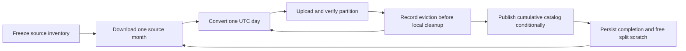

# Archive operations runbook

[Handbook](../README.md) · [Archive contract](../contracts/archive/v1/README.md) · [Conversion architecture](../architecture/historical-conversion.md)

The background worker runs OHLCV, L1 and L2 as separate stages. A successful stage means its frozen source inventory was converted and published; it does not prove that the provider archive covers every expected trading session. The service resolves its dataset version from the reviewed phase registry; the current L1 recovery is `w606-l1-v2`. Record the resolved version from the structured worker log before treating a run as a resume of prior work.



Monthly and daily overlapping sources stay together for authority resolution. Each dataset/schema/symbol/month gets its own deterministic version. Source ETags and local content hashes protect resumed downloads. Completed months resume from verified publication receipts, without downloading their raw data again. After the catalog is remotely verified for a complete source-month, its cached inputs and split `raw/` tree are removed; its checkpoint, frozen plan and publication evidence remain for audit and resume proof.

Install [`terminal-backfill@.service`](../../ops/linux-host/systemd/terminal-backfill@.service) only after selecting the matching ops release and deploying matching conversion code. `/srv/terminal-data/curated` and `curated-staging` must be `ttconvert:ttconvert`, mode `0700`; `provision-data-dirs.sh` repairs this precondition on an already mounted host. The worker creates its own lock files; do not replace their inodes. Conversion locks are per dataset version under `/srv/terminal-data/curated/_locks/`, while the phase-wide sequence lock is `/srv/terminal-data/curated-staging.sequence.guard`.

The worker uses a separate `terminalconversion.slice` and bounded CPU/memory so it does not share the collector's aggregate memory ceiling. Credentials come from the root-only `/etc/terminal-l1-l2/convert/service.env`. It must contain the scoped `RCLONE_CONFIG_TTCONVERT_REGION`, `RCLONE_CONFIG_TTCONVERT_ACCESS_KEY_ID`, and `RCLONE_CONFIG_TTCONVERT_SECRET_ACCESS_KEY` values; the tracked template includes the compatible full remote contract. Keep all tokens outside Git.

Before an unattended L1 run, execute the release gate from the installed ops release. It creates a bounded transient unit as `ttconvert`, injects the same conversion credentials as the worker, writes its JSON evidence below `curated-staging/_preflight/reports/`, and does not start L1 or modify curated S3 data. The reviewed commit is required so the gate can reject an accidental deployment mismatch. Run it only after `terminal-backfill@l1.service` is stopped and its prior failed state has been reset:

```bash
sudo /opt/terminal-l1-l2/ops/scripts/run-l1-preflight.sh <reviewed-commit> 2
```

The final argument is the worker-pool size and must match what the unit passes, because it is what the capacity gate reserves against. **Two is the measured value for L1**: an isolated ES+NQ benchmark over the same five-day window gave a 1.99× speedup for 4% per-symbol contention with no collector impact. Do not raise it without a fresh benchmark — and note that four workers is not available for L1 at current disk, since the capacity gate requires about 1.82 TB for it.

Budget hours, not minutes. The gate decodes every row of every input; for the L1 corpus that is roughly 9.5 billion rows, and it runs deliberately nice'd with idle I/O priority so it yields disk to the live collector. A nonzero result means read the named report and stop the rollout.

Start and inspect the first stage:

```bash
sudo systemctl start --no-block terminal-backfill@ohlcv.service
systemctl show terminal-backfill@ohlcv.service -p ActiveState -p SubState -p Result -p ExecMainStatus -p MemoryCurrent
sudo journalctl -u terminal-backfill@ohlcv.service -n 40 --no-pager
```

`activating/start` is normal for a running oneshot worker. Completion requires `Result=success`, `ExecMainStatus=0`, and successful outcomes for every configured symbol. Inspect catalog counts, no-source dates and remote publication evidence before starting `@l1`, then `@l2`. `month_start`, `download`, `day_start`, `day_complete`, `no_source_rows`, `day_quarantined`, `day_quarantined_already`, `month_partial` and `month_complete` events explain progress.

The worker's exit status decides whether the unit may come back. `0` is a fully published phase; `1` is a transport fault that botocore's own retries did not absorb, and is the only status `Restart=on-failure` acts on; `2` is a permanent data, contract, capacity or integrity failure; `3` is a run that finished with at least one partial month. `RestartPreventExitStatus=2 3` stops the unit on both, so a permanent error never loops — an unclassified failure is treated as permanent by design. `StartLimitIntervalSec`/`StartLimitBurst` remain only as a backstop: a rate limit cannot bound retries on its own when one attempt runs for hours.

For a failure, inspect the journal and retained checkpoint before retrying the same stage/version. A quarantine failure writes `rejections.json` in the retained job staging directory with bounded source, row and reason samples; the driver archives it to `rejections/rejections-<date>.json` the moment the day is caught, records the date, evidence path and evidence SHA-256 in `checkpoint.json`, and writes `_sequence/<version>-partial.json` for the month. Because that set is durable, a normal restart skips an already-quarantined date rather than reconverting it, and the per-month budget counts across restarts. Re-converting a fixed day is a deliberate operator action: invoke `backfill_sequence_cli.py` with `--retry-quarantined` and the same reviewed phase, version and service arguments. It clears the durable set before reconversion, so use it only after the evidence identifies and fixes the cause. A controlled `systemctl stop` affects only that worker; restart resumes its durable state. Never delete raw S3 objects to make a retry pass. A changed frozen source or remote-parent conflict requires reconciliation, not overwriting the guard.

Completion records and frozen plans are under `curated-staging/_sequence` and each version's `_plans` directory. Local catalogs are under `curated/_catalog`. Published artifacts are under the configured S3 namespace. A date without source rows is not automatically an exchange holiday. Report coverage limitations separately.

This worker does not install or start a collector, enable reboot startup, onboard Tardis, or configure external alert delivery.

## Reconcile before advancing

Record UTC time, deployed commit and instance name. Verify every expected symbol/month completion receipt, then pin the current catalog and verify its hash and SQLite integrity. Compare published counts with checkpoint source counts, accounting for any authority exclusions and schema expansion; one depth input row need not equal one total canonical row across families. Inspect rejection and continuity evidence separately.

Use the archive contract's reader procedure rather than listing files and assuming they are published. Check collector freshness, pending writes and write lag alongside worker CPU, memory and disk usage. `Result=success` while the oneshot is still activating is not proof of completion.

After OHLCV acceptance, start `terminal-backfill@l1.service`; after L1 acceptance, start `terminal-backfill@l2.service`, using the same `--no-block` form. These stages do not chain automatically. Do not reset completed versions or delete checkpoints to force progress.

## Publish a correction (supersedence)

A published day is immutable. A normal publication refuses a catalog that changes one. To replace days that were published wrong (for example the 2026 equity 1 h/1 D rollups re-anchored at 09:30, or the ES/NQ August depth days that held one record each), re-derive them, then publish with a `supersedes` record in the intent file that `s3_publish.py --intent` reads:

```json
{
  "pointer": { "...": "the new catalog pointer, as for any publication" },
  "parent": { "...": "the currently published pointer" },
  "supersedes": {
    "reason": "one line saying why the days are replaced",
    "approved_by": "the approving operator",
    "authorities": [["<instrument_id>", "<family>", "YYYY-MM-DD"]]
  }
}
```

- **Only the listed (instrument, family, date) authorities may change.** A dropped authority is still refused, and a listed one that did not change is refused as `SUPERSEDENCE_UNUSED`, so the list must be exact.
- **The record is written into the immutable intent and receipt,** which keeps the lineage back to the replaced catalog.
- **`approved_by` is provenance, not authorisation.** Publication still needs the conversion identity and the operator's explicit approval of the authority list and the candidate catalog diff.
- **Verify afterwards** with the reader procedure, not by listing files. For a depth correction, confirm no replaced day still holds a single record.

A re-derivation run through `backfill_cli.py` publishes one catalog per day, so it takes the approved list as a file instead of one intent: `--supersede-allowlist <file>` holds the same `{reason, approved_by, authorities}` object. For each day's publication the run compares its catalog with the published one, refuses with `SUPERSEDENCE_NOT_APPROVED` before uploading anything if a changed authority is not on the list, and otherwise declares exactly the changed authorities. Use a new `--dataset-version` for the correction. `--families depth` limits a depth (mbp-10) run to depth: without it the run also writes the `trade` family whenever a day holds trades, and would try to replace the trade partitions the L1 phase already published.

## The derived trade families (`l1agg`)

`terminal-backfill@l1agg.service` runs after L1 acceptance. It reads nothing raw: each
symbol-month job fetches the published `trade` partitions the converter catalog
lists for the symbol (every contract the roll table names, for futures), verifies
each part against its manifest, computes the four families — `trade_minute_1m`,
`trade_level_1m`, `trade_slice_2s`, `trade_prints_1m` — with the filters of the
live storage reads they must equal, maps every row through the contract bridge,
writes, publishes and evicts each partition before the next, and publishes the
month as its own dataset version (`w606-l1agg-v1-<dataset>-<symbol>-<YYYY-MM>`)
with a completion receipt. Sizes are small (a futures day is roughly 1,400 minute
rows, up to ~70,000 level rows, ~35,000 slices and ~11,000 prints); the job is
bound by S3 reads and the bridge, not by disk.

- Start, monitor and resume exactly as the raw phases: `sudo systemctl start
  --no-block terminal-backfill@l1agg.service`, the journal's `month_start` /
  `day_start` / `partition_published` / `month_complete` events, the retained
  checkpoint under `curated-staging/<version>/`, and `_sequence/<version>-complete.json`.
  `--symbols` narrows and orders the run (`AAPL,TSLA,ES,NQ` is the registered order,
  light instruments first).
- There is no quarantine for this phase. A raw day can be bad data; an aggregate
  of published data that the contract refuses is a defect in the stage, and the
  job stops with `DERIVED_MAPPING_REJECTED`, `FAMILY_RECONCILIATION_FAILED` or
  `FAMILY_PRECISION_UNSUPPORTED`. Fix the stage, deploy, restart; the checkpoint
  resumes at the first incomplete partition.
- `SOURCE_PARTITION_NOT_PUBLISHED`, `SOURCE_PARTITION_AUTHORITY_AMBIGUOUS` and
  `ROLL_TABLE_MISSING` stop the symbol at planning: the converter catalog cannot
  vouch for the source, and the source is what to fix.
- `REMOTE_ARTIFACT_MISMATCH` or `REMOTE_MANIFEST_INTEGRITY_FAILURE` means a
  published trade partition no longer matches its catalog entry. Stop; that is a
  finding about the archive, not about this phase.
- Every family manifest carries a `derivation` block (stage and family method
  versions, geometry, filters, the source partition's identity and manifest hash,
  and the stage's own reconciliation totals). `trade_families_rederive.py` recomputes
  a month independently in pure Python from the same source parts and compares
  row for row; run it for one month per instrument before acceptance and keep the
  JSON as evidence. Its `candle_volume_check` compares each minute against the
  converted candles: `minutes_compared` must equal the minutes in the month
  (a zero there means the check did not run) and `unexplained` must be zero.
  A mismatched minute is expected only when a print's capture timestamp and its
  exchange timestamp fall in different minutes -- in either direction, since some
  GLBX days carry prints captured before the matching-engine timestamp. The
  report measures that itself and lists any minute it cannot account for, which
  is a finding to stop on.
- The phase command itself can be trialled: `backfill_sequence_cli.py --phase l1agg
  --source-prefix curated/databento --source-catalog-root /srv/terminal-data/curated/_catalog
  --curated-prefix curated/_qualification/<run-id> ...` reads the real sources and
  publishes into the qualification namespace, exercising the routing, the capacity
  reservation and the completion receipts that production uses. Do this for one
  symbol-month of each market (an equity and a futures symbol -- the futures path
  resolves contracts and ticks from the roll table) before the production start.
- Qualify first, from a checkout of the candidate commit rather than a release:
  `derive_families_cli.py --dataset XNAS.ITCH --symbol AAPL --months <YYYY-MM>
  --source-prefix curated/databento --source-catalog-root /srv/terminal-data/curated/_catalog
  --curated-prefix curated/_qualification/<run-id> --curated-root <work-root>/curated
  --catalog-root <work-root>/curated/_catalog --staging-root <work-root>/staging ...`
  as `ttconvert` with the converter environment, where `<work-root>` is a new
  ttconvert-owned directory under `/srv/terminal-data/qualification/`. The
  production namespace and converter catalog are read, never written; the families
  and their catalog land in the run's own namespace. Then
  `trade_families_rederive.py --snapshot <production snapshot> --data-prefix curated/databento
  --families-snapshot <work-root>/curated/_catalog/<snapshot> --families-prefix
  curated/_qualification/<run-id> --credentials convert ...`, inspect, and only then
  deploy and start the production phase. A wrongly published family partition is
  append-only forever.
- The served `_historical` pointer does not change with this phase. Making the
  families visible to Historical Mode is the archive-query service's step
  (report 54 phase 2) and uses the pointer refresh chain in
  [06-archive-query-service.md](06-archive-query-service.md).

## Crypto trades from Tardis (`tardis-l1`, `tardis-l1agg`)

`terminal-backfill-binance@<phase>.service` runs the same sequence against the
Tardis raw layer, in its own namespace so it can never touch a Databento
version: S3 `curated/binance`, converter catalog
`/srv/terminal-data/curated-binance/_catalog`, staging
`/srv/terminal-data/binance-staging` with its own sequence guard, pool 4.
`provision-data-dirs.sh` creates the directories and guard;
`install-ops.sh` links the unit. The phase window (2025-09-06 → 2026-08-31) is
fixed in `backfill_sequence.PHASE_WINDOWS`. The mechanism is described in the
[conversion README](../../apps/runtime/conversion/README.md#tardis-trades-crypto).

- **Qualify first,** from a checkout of the candidate commit:
  `backfill_cli.py --dataset binance --schema trades --symbol BTCUSDT
  --start-date 2025-10-10 --end-date 2025-10-10 --dataset-version <qualification-version>
  --bucket chartprime-historical-data --curated-prefix curated/_qualification/<run-id>
  --staging-root <work-root>/staging --curated-root <work-root>/curated --catalog-root <work-root>/curated/_catalog
  --node-bin <pinned-node>`. Repeat for each pilot series/day; the sequence CLI
  runs the entire fixed window, not a bounded pilot. Accept the pilot days against the Binance klines and the
  independent re-derivation before the production start.
- `--symbols` takes `<exchange>:<symbol>` (`binance`, `binance-futures`) for
  `tardis-l1` and `<dataset>:<symbol>` (`BINANCE.SPOT`, `BINANCE.UM`) for
  `tardis-l1agg`, because each symbol appears once per market.
- Start `tardis-l1agg` only after `tardis-l1` is accepted, with
  `--source-catalog-root /srv/terminal-data/curated-binance/_catalog` implied by
  the unit's own catalog root. The sequence now refuses a derived run unless
  each selected BTC/ETH spot/perpetual series has the exact 12 months and every
  trade day from 2025-09-06 through 2026-08-31 in the verified source catalog.
  Its window must match `config/archive-crypto-ticks.json`, which the converter,
  gateway and browser share for approved crypto study ticks. Recheck disk before
  starting: the installed unit still uses pool 4, with 300 GB reserved per
  worker. Use a reviewed, capacity-checked pool-size override or invocation
  when four workers do not fit; do not alter the live unit incidentally.
- `TARDIS_DAY_FILE_MISSING` or `TARDIS_DAY_FILE_AMBIGUOUS` stops a month before
  any download: re-run the raw backfill (`npm run backfill:tardis:live`) for that
  day and verify it (`--verify-existing --dry-run`). A month needs the day after
  its last day, too.
- `TARDIS_DAY_HAS_NO_SOURCE_ROWS` or `PHASE_WINDOW_COVERAGE_MISSING` refuses
  an empty exchange day or a shortened owner window; neither is a successful run.
- `TARDIS_RECEIVE_DAY_LOOKAHEAD_EXCEEDED` means the one-extra-day assumption
  failed. Preserve the inputs and investigate a wider lookahead before retrying.
- `EXCHANGE_TIME_AFTER_RECEIVE` or `EXCHANGE_TIME_PRECISION_MISMATCH` in a
  quarantined day means a row broke the exchange-time rule the conversion labels
  on. Exchange time up to 50 ms after receive time is already accepted and
  flagged `RECEIVE_BEFORE_EXCHANGE_TIME`, so a refusal is a lag beyond that.
  Stop and inspect the evidence; do not relabel.
- `TARDIS_EXCHANGE_TIME_CROSSES_WINDOW_END` means a trade stamped after the
  month ends was received before it, in a file the next month does not read.
  Stop; the month needs a wider file range, not a retry.

| Failure | Response |
|---|---|
| Missing definition or unresolved identity | Obtain dated provider evidence; preserve the failed plan and reconcile existing progress before changing inputs |
| Frozen source changed | Identify what changed and choose an explicit version/reconciliation path |
| Remote parent changed | Compare publication intents and catalog ancestry; do not overwrite CURRENT |
| Corrupt or absent remote artifact | Stop advancement; verify raw lineage and recover through a reviewed publication procedure |
| Low disk, memory or collector pressure | Inspect actual limits, mount and worker usage; preserve capture and raw inputs |
| Worker failed | Read the immediate `symbol_failed` event and final outcome; a successful subset is not whole-stage success |

Avoid automatic raw downloads as a repair shortcut: use the provider acquisition tool's cost guard and preserve the original response and provenance. Converter credentials should not need permission to modify raw objects.
