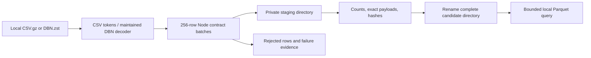

# Bounded historical conversion prototype

W6.06 local prototype feeding the W6.03 architecture decision. It reads completed local samples, invokes the existing W6.02 JavaScript contracts, writes a candidate Parquet file and measures bounded queries. It does not publish to S3 or connect to providers. Output quality remains `UNVERIFIED`.

## Run from repository root

```powershell
uv sync --project tools/historical-conversion --frozen
uv run --project tools/historical-conversion --frozen python tools/historical-conversion/convert.py apps/runtime/data/conversion-prototype/samples/btc-spot-trades.csv.gz apps/runtime/data/conversion-prototype/results --kind tardis-trades --max-rows 10000
uv run --project tools/historical-conversion --frozen python tools/historical-conversion/convert.py apps/runtime/data/conversion-prototype/samples/aapl-mbp10.dbn.zst apps/runtime/data/conversion-prototype/results --kind databento-mbp --max-rows 10000
uv run --project tools/historical-conversion --frozen python -m unittest discover -s tools/historical-conversion -p test_convert.py -v
uv run --project tools/historical-conversion --frozen python tools/historical-conversion/qualify.py
```

Requires Node on PATH and Python 3.12–3.13. The isolated `.venv` and downloaded/generated data are ignored by Git. `uv.lock` pins the tool dependencies independently of the terminal's Node environment.

`fetch-samples.cjs` is an optional **network read** step, separate from conversion. It uses the existing rclone S3 remote to read two named objects, refuses existing local samples, caps each at 64 MiB and their total at 96 MiB, and limits transfer speed to 4 MiB/s. It validates size/modification metadata before/after and hashes the downloaded bytes. It neither inventories the entire archive nor stops existing uploads. The recorded acquisition report is the provenance for the samples used here. S3 version IDs/ETags are not pinned, so this is not immutable remote-version certification.

## Data path



- `convert.py`: maintained `databento-dbn` decoding with `AS_IS` version policy, bounded CSV reading, identity mapping from DBN metadata, staging, exact Parquet comparison and query helper.
- `map-batch.cjs`: owned Node process per batch; calls the existing W6.02 mapper and validator, adds `PROTOTYPE_INGEST_TIME_UNAVAILABLE`. `ingestNs=0` is an explicit unknown marker, not an invented ingestion date.
- `test_convert.py`: local fault/precision/idempotency tests. Temp fixtures are independent of downloaded data.
- `qualify.py`: measures the owned Python/Node process tree every 20 ms and runs five bounded queries plus repeat-reuse checks.
- `inspect_samples.py`: bounded metadata/first-row inspection only; its default decoder upgrade policy differs from the converter's explicit AS_IS policy. Use conversion manifests for the preserved source version.

## Candidate format and limits

Parquet has typed `id`, `family`, `instrument_id`, unsigned 64-bit `event_ns`/`capture_position`, plus a lossless canonical JSON `payload`. This allows typed range filters while retaining the exact full record. It is a **prototype layout**, not the final optimized family-specific columnar schema. W6.03 must compare extracted trade/book columns, row groups and sorting with this baseline.

Default 10,000 source rows; hard maximum 100,000. Source file maximum 64 MiB. Mapping batches contain at most 256 rows; bridge request/output capped at 16 MiB; Node batch deadline 30 seconds. Staged JSON cap 512 MiB; DuckDB buffer limit 128 MiB and spill limit 128 MiB. These are component limits, not a universal OS RSS/scratch bound. Deadline checks occur between batches; qualification adds an owned-process deadline. The maintained decoder can expand compressed chunks, so full heavy-file memory qualification remains required.

`PREFIX_SAMPLE` means the source had more records than the configured limit. No complete-file CRC/continuity claim follows from stopping at a prefix. `COMPLETE_INPUT` means the local iterator reached EOF; content completeness relative to the market remains unverified in either case.

## Commit and failure behavior

Job identity includes raw SHA-256, kind, row cap and converter/contract/lockfile source hashes. A repeat verifies retained output hashes before reuse. Copied identical raw bytes produce equivalent logical records; semantic deduplication of differently packed overlapping archives is not implemented here.

Only a completed manifest-bearing directory is returned as committed. Interrupted/rejected work retains `.stage-*` plus failure/quarantine evidence and is not queried as a committed candidate. Reruns start a fresh stage, rather than resuming a decoder halfway through a compressed stream. Consumers must use the returned manifest and must not glob staging files. No production catalog exists or is updated by this prototype.

Directory rename is the local visibility boundary, not a tested power-loss durability guarantee. No whole-filesystem crash, disk-full or host-reboot claim is made. Failed stages remain for inspection and need bounded retention before sustained operation.

## Scope remaining

- Actual prototype inputs: BTC spot trades; AAPL top-ten depth; public DBN trade fixture in tests. Other markets/families require qualification.
- The AAPL file's metadata supplies date-scoped numeric ID mapping. Continuous futures aliases fail rather than resolve to a guessed contract.
- No order-book continuity reconstruction, source-authority publication, gap repair, full archive conversion, live ingestion changes or frontend design.
- Query timing includes a separate whole-call measurement that verifies all retained hashes; SQL-only timing excludes those checks. OS caches are not flushed. Neither is a cold-S3 or multi-user benchmark.
- The per-batch Node process and JSON bridge are correctness scaffolding; benchmark their overhead before choosing persistent workers or another integration. Current throughput is not a VPS sizing recommendation.

Official references: [Databento DBN library](https://github.com/databento/dbn), [DuckDB Parquet](https://duckdb.org/docs/stable/data/parquet/overview), [DuckDB memory limits](https://duckdb.org/docs/current/operations_manual/limits). Versions used are pinned in `uv.lock` and recorded in conversion manifests.
# W6.03 architecture experiments

`architecture_bench.py` decodes both existing sample files completely and compares
a narrow time/price/size projection in Parquet, materialized DuckDB and indexed
SQLite. It verifies identical ordered range results. It does not publish canonical
history or reconstruct L2. Inputs must already exist in the prototype sample folder.

`architecture_load.py <architecture-output-directory> [--stress]` runs eight local
query clients for 30 seconds while the existing Binance/dxFeed storage qualification
fixtures and a bounded canonical conversion execute in separate processes. It
retains uniquely named synthetic databases, evidence and outputs. It never opens
the running collectors' databases or provider connections. A failed child makes
the aggregate command fail; inspect `report.json` even on failure. Default Binance
burst is 82,000 records; `--stress` uses 210,000. Neither is measured provider load.

These are architecture experiments, not a VPS/replay SLA. See the Week-6 W6.03
architecture report for the retained stress failure and outstanding qualification.
